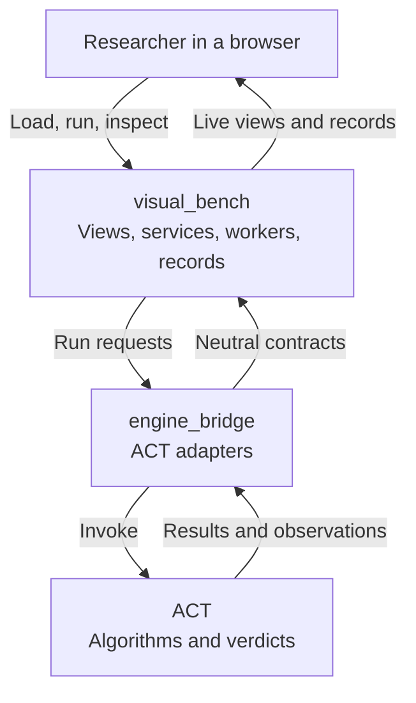

# ACT-GUI

<p align="center">
  
</p>

ACT-GUI is the visual workbench for [ACT](https://github.com/SVF-tools/ACT), a testing and verification framework for neural networks. ACT computes bounds, counterexamples and verdicts; ACT-GUI loads networks and specifications, runs ACT, shows each run as it happens, and keeps every result as a record you can inspect and export.

**Online (v0.1):** the website and user guide are at [act-online.au](https://act-online.au); the hosted workbench is at [app.act-online.au](https://app.act-online.au).

## Highlights

- **Models and specifications:** load VNN-LIB benchmarks or ONNX image classifiers, then inspect the network graph, the specification, and image inputs with their perturbation bounds.
- **Verification:** run ACT's interval, dual and HybridZ domains or branch-and-bound (BaB) with their settings; verdicts and counterexamples always come from ACT.
- **Propagation:** drill down from the network to a layer to a single neuron, with the run's per-neuron bounds, stability and relaxation, live or in replay.
- **BaB search tree:** watch the tree grow wave by wave, then replay it and inspect any node.
- **Fuzzing:** watch mutated inputs live; pause, resume, stop or retune a running fuzzer; save counterexamples.
- **Records:** every run keeps its settings, events and artifacts under integrity checks; export a run, a counterexample, or a reproduction snapshot with ACT's errors and warnings.
- **Engine:** switch ACT between branches of any fork, with API checks that turn off what a branch does not support, and add a Gurobi license.

On an ACT checkout without the newer GUI API, the workbench falls back to interval layer states, the final BaB summary, and fuzzing without live control. Not yet available: BaB node controls, per-neuron bounds of BaB nodes, geometry beyond interval boxes, and a real AI provider (the assistant uses a deterministic fake provider).

## Architecture



| Part | Responsibility | Read next |
| --- | --- | --- |
| visual_bench | React views, FastAPI services, isolated run workers, records and the assistant; never imports ACT | [Workbench map](visual_bench/README.md) |
| engine_bridge | The only code that imports ACT: version and API checks, model loading, invocation, neutral result contracts | [Bridge map](engine_bridge/README.md) |
| ACT | Algorithms, bounds and verdicts, in a separate checkout pinned by [fixtures/catalog.json](fixtures/catalog.json) | [ACT repository](https://github.com/SVF-tools/ACT) |

## Quick Start

Both setups read an ACT checkout from `ACT_ROOT`; the Docker build stages its pinned commit into the image.

```bash
# Docker (Compose v2.24+)
scripts/docker_build.sh                                          # stage the pinned ACT commit, build the image
docker compose up -d                                             # CPU: open http://127.0.0.1:8080
docker compose -f compose.yaml -f deploy/compose.gpu.yaml up -d  # or with an NVIDIA GPU

# Local development (ACT's act-py312 conda environment, Node 22+, uv)
uv venv --python "$(conda run -n act-py312 which python)" --system-site-packages .venv
VIRTUAL_ENV=.venv uv pip install -r requirements/dev.txt && npm install
./scripts/dev.sh                                                 # open http://127.0.0.1:5173
```

[Development and deployment](docs/development.md) covers ACT data, Gurobi, settings and checks.

## Documentation

| Read | To |
| --- | --- |
| [User guide](https://act-online.au/guide/) | Learn ACT and use the online workbench |
| [Developer guide](docs/README.md) | Find the module, files and tests for a change |
| [Development and deployment](docs/development.md) | Set up, run, configure and check the workbench |
| [Architecture](docs/design.md) and [plan](docs/plan.md) | Read cross-module decisions, task order and ACT prerequisites |
| [Contributor rules](AGENTS.md) | Contribute code or documentation |
