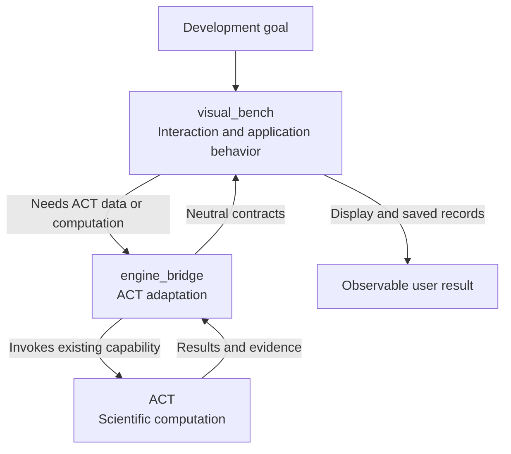

# ACT-GUI

<p align="center">
  
</p>

ACT-GUI is the visualization and interaction workbench for [ACT](https://github.com/SVF-tools/ACT). ACT computes verification results; this repository loads inputs, runs experiments, displays evidence, and saves records.

**Online (v0.1):** the website and user guide are at [act-online.au](https://act-online.au); the hosted workbench is at [app.act-online.au](https://app.act-online.au).

**Available:** real model loading, verification, the live BaB search tree with wave replay (on ACT with `act.pipeline.gui.bab_gui`; final summaries otherwise), live fuzzing, recorded interval-layer views, and record export. **Not available:** BaB node controls, per-neuron bounds of BaB nodes, geometry beyond interval boxes, and a real AI provider. The assistant currently uses a deterministic fake provider.

## Choose a Development Task

Start with the row matching your intended behavior. Follow its module guide for the concrete files, handoff contracts, and tests; you do not need to read every module.

| I want to change... | Start here | Cross the boundary only when... |
| --- | --- | --- |
| Layout, selection, mode switching, or the guided tour | [workspace](visual_bench/workspace/README.md#change-guide) | A selected object needs new server data, rather than just a new presentation. |
| Model loading, input images, or specifications | [visual_bench/model_spec](visual_bench/model_spec/README.md#change-guide) | ACT source loading or model descriptions change: [engine_bridge/model_spec](engine_bridge/model_spec/README.md#change-guide). |
| Run start/stop, time budgets, history, or lifecycle events | [verification](visual_bench/verification/README.md#change-guide) | ACT invocation changes: [execution](engine_bridge/execution/README.md#change-guide). |
| Captured ACT errors/warnings or the reproduction snapshot | [verification diagnostics](visual_bench/verification/README.md#diagnostics-and-reproduction-snapshot) | Storage guarantees change: [records](visual_bench/records/README.md#change-guide). |
| Fuzz settings, live mutations, or saved counterexamples | [fuzzing](visual_bench/fuzzing/README.md#change-guide) | New ACT data/options are needed, or the shared run lifecycle changes. |
| Layer bounds or propagation views | [analysis](visual_bench/analysis/README.md#change-guide) | Recorded data is insufficient: [inspection](engine_bridge/inspection/README.md#change-guide). |
| BaB search tree, coverage or final summaries | [bab](visual_bench/bab/README.md#change-guide) | New ACT record fields: [events](engine_bridge/events/README.md#change-guide). Node controls require new ACT support first. |
| Explanations and evidence navigation | [assistant](visual_bench/assistant/README.md#change-guide) | An evidence source needs a new application query; do not bypass its service. |
| Persistence, integrity, replay, or export | [records](visual_bench/records/README.md#change-guide) | A feature needs a new artifact or annotation; keep its meaning in the producing module. |
| Engine diagnostics or Gurobi licensing | [engine](visual_bench/engine/README.md#change-guide) | The actual engine/license probe changes: [engine_session](engine_bridge/engine_session/README.md#change-guide). |
| ACT compatibility or scientific result adaptation | [Engine Bridge](engine_bridge/README.md#change-guide) | ACT itself lacks the required algorithm or public capability. |
| The public website or user guide | [site](site/README.md#change-guide) | A guide page describes new behavior: change the owning module first, then the guide and its translations. |
| Architecture or implementation planning | [Documentation](docs/README.md#change-guide) | A decision spans modules; local feature evidence stays in its module README. |

## Flow Diagram

This is a responsibility map, not a list of files to edit. Read downward from the goal, then expand only the responsible block.




| Block | Expand next | Boundary to preserve |
| --- | --- | --- |
| visual_bench | [Module collaboration map](visual_bench/README.md#flow-diagram) | Owns browser state, service use cases, workers, and records; never imports ACT. |
| engine_bridge | [Adapter collaboration map](engine_bridge/README.md#flow-diagram) | Owns ACT calls and neutral result conversion; no HTTP, UI state, or run scheduling. |
| ACT | Separate engine checkout pinned by [catalog](fixtures/catalog.json) | Owns algorithms, bounds, and verdicts. |
| Observable user result | The selected module's Validation section | Verify the complete behavior, not merely that an endpoint returns 200. |

## Reading and Change Order

1. Choose a task above. The module's **Change Guide** distinguishes required edits, conditional edits, and code the request only passes through.
2. Follow that module's **Flow Diagram** and block-to-code table. Cross-module handoffs link to the neighboring guide; parent diagrams intentionally omit internal calls.
3. Check **Validation**, then open the reference/backlog only if you need contract rationale or future tasks. A planned API is not an existing entry point.

When a wire payload changes, edit the owning module's Pydantic schema, run `npm run gen:types`, and include the generated `visual_bench/generated/wire.ts`. Do not hand-edit generated types. A route, worker, or shared transport on the path is not automatically a modification target.

[Architecture and shared invariants](docs/design.md) · [Task index and future integration](docs/plan.md) · [Contributor rules](AGENTS.md)

## Development

Requirements: Linux with the ACT checkout and its conda environment (`act-py312`, see the ACT README), Node 22+, and [uv](https://docs.astral.sh/uv/).

```bash
# once
uv venv --python "$(conda run -n act-py312 which python)" --system-site-packages .venv   # ACT, torch from the conda env
VIRTUAL_ENV=.venv uv pip install -r requirements-dev.txt                                # FastAPI etc. into .venv only
npm install

# run (ACT_ROOT defaults to /data1/guanqin/ACT)
./scripts/dev.sh
# then open http://127.0.0.1:5173
```

`dev.sh` starts the FastAPI service on 127.0.0.1:18765 and the Vite dev server on 127.0.0.1:5173, which proxies `/api` to the service. Both bind to loopback only. If the workbench runs on a remote machine, forward the port: `ssh -L 5173:127.0.0.1:5173 <host>` and open the same URL locally. Runs execute on CPU by default (`ACT_GUI_DEVICE=cpu`); records are written to `var/records/` (`ACT_GUI_RECORDS` overrides).

In the browser, load or select a model, choose Fuzzing, Verification, or BaB, and start a run below the network. The right column contains Assistant, Records, Engine, and run history. Use **Guide** to revisit the introductory tour. Feature-specific behavior and limitations are documented in the module guides above.

### Run with Docker

Requirements: Docker with Compose v2.24+; for GPU, an NVIDIA driver and the NVIDIA Container Toolkit. Nothing else is installed on the host.

```bash
cp .env.example .env                      # optional settings (port, image tag, Gurobi, AI key)
scripts/docker_build.sh                   # stage the pinned ACT commit into build/act, then docker compose build
docker compose up -d                      # CPU; open http://127.0.0.1:8080
docker compose -f compose.yaml -f compose.gpu.yaml up -d      # NVIDIA GPU (ACT_GUI_DEVICE=cuda)
```

The image serves the built browser app, the API, and SSE from one origin on `127.0.0.1:${ACT_GUI_PORT:-8080}`; records and uploaded licenses persist in the `act-gui-data` volume. `scripts/docker_build.sh` reads the ACT commit from `fixtures/catalog.json` and fetches it from `$ACT_SOURCE` (a local checkout by default, or a git URL). The catalog models are generated, git-ignored ACT files, so the script also copies them from `$ACT_NETS_FROM` (default `$ACT_ROOT`) and fails unless each matches its pinned sha256. If port 8080 is taken, set `ACT_GUI_PORT`.

The **Load model** panel builds models from ACT's git-ignored `data/` (VNN-LIB benchmarks, MNIST/CIFAR-10 test sets) and `literature/` (ONNX classifiers) directories, which the image does not contain. Mount them read-only with `-f compose.actdata.yaml` (`ACT_DATA_FROM` defaults to `$ACT_ROOT`); without them the panel lists no sources and the catalog still works. Loaded models persist in the `act-gui-data` volume (`/data/models`); in development they go to `var/models/` (`ACT_GUI_MODELS` overrides).

Gurobi is optional; the image contains gurobipy (`GUROBIPY_VERSION`) but never a license. Either upload your `gurobi.lic` in the **Engine** tab, or mount it with `GUROBI_LICENSE_FILE=/path/to/gurobi.lic` in `.env` and `-f compose.gurobi.yaml`. The Engine tab shows Gurobi's own license check. WLS and token-server licenses work in containers; host-bound (named-user/academic) licenses usually do not. The current interval and BaB methods do not call Gurobi.

Other settings (all optional, read from `.env` by Compose or from the environment by `dev.sh`): `ACT_GUI_IMAGE` (image tag, default `act-gui:0.1.0`), `ACT_GUI_ENGINES` (imported ACT branch checkouts and the active engine selection, next to the records root by default), `ACT_GUI_SECRETS` (uploaded licenses, `/data/secrets` in Docker), `ACT_GUI_ACT_REMOTES` (preconfigured ACT repositories for branch switching, `name=url,...`), and `ACT_GUI_ALLOW_CUSTOM_REMOTES` (`0` stops users from entering other repository URLs; entering a URL runs that repository's code on the server, so a public deployment needs access control or `0`). Engine switching is described in [visual_bench/engine](visual_bench/engine/README.md).

Checks:

```bash
.venv/bin/python -m pytest      # bridge parity against real ACT + service tests (CPU: CUDA_VISIBLE_DEVICES=)
.venv/bin/python -m pytest visual_bench/fuzzing   # one module's tests (any module directory works)
npm test                        # browser tests: selection, mode registry, query keys, wire helpers (vitest)
npm run typecheck               # tsc
npm run check:types             # generated wire.ts matches visual_bench/schemas.py
.venv/bin/python scripts/gen_image_nets.py    # (re)generate the MNIST/CIFAR-10 catalog nets into ACT's examples/nets/
.venv/bin/python scripts/record_fixtures.py   # re-record fixtures/catalog.json from native ACT calls
```
