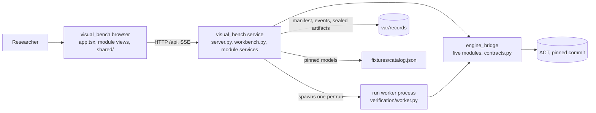

# ACT-GUI

A visualization and interaction interface for the [ACT](https://github.com/SVF-tools/ACT) engine. Researchers can inspect networks and specifications, observe verification and branch-and-bound (BaB), analyze layer-wise overapproximation, and conduct experiments through direct interaction or AI assistance.

This repository contains the GUI product. ACT remains a separate computation engine. React/TypeScript and FastAPI/Pydantic are implementation technologies within the workbench.

**Status:** first runnable version (2026-11-03). The workbench loads real ACT networks, runs real ACT verification (`verify_once` in the interval, dual, or HybridZ domain, and BaB) and ACT's fuzzer (ACTFuzzer) in a worker process, records runs, and lets you browse layer-wise interval bounds in the browser. Node-level BaB history, controls, geometry beyond interval boxes, and a real AI provider are not implemented; see [plan status](docs/plan.md#first-version-status).

```text
ACT-GUI/
  visual_bench/       # Workbench: server.py + workbench.py + app.tsx roots, nine module slices, shared/, generated/wire.ts
    <module>/         #   schemas.py -> service.py -> routes.py (service) | api.ts -> hooks.ts -> views (browser) | tests
  engine_bridge/      # ACT integration: contracts.py and five modules (only place that imports ACT)
  fixtures/catalog.json  # Real ACT models pinned by ACT commit + sha256, with native results
  scripts/            # dev.sh, gen_image_nets.py, record_fixtures.py, gen_types.mjs
  docs/               # README.md, design.md, plan.md
```

- [Visual Bench](visual_bench/README.md): views, research context, application operations, records, and AI collaboration.
- [Engine Bridge](engine_bridge/README.md): ACT integration and compatibility; no verification algorithm implementations.
- [Documentation scope](docs/README.md): ownership and maintenance of design information.
- [Architecture](docs/design.md) · [Development plan](docs/plan.md) · [Contributor rules](AGENTS.md).

Top-level boundaries follow product responsibilities. Each module owns its data path end to end (wire schema, service, routes, browser client and TanStack Query hooks, views, tests), so contributors can work on different modules in parallel; see [docs/design.md section 3](docs/design.md#3-runtime-and-implementation-boundaries). Every module README lists its current files, routes, and test command, plus feature plans, dependency-linked tasks, and acceptance evidence.

## Flow Diagram

The runtime path of one request, from the browser to ACT. Arrows point from caller to callee. Each box is expanded in its scope's own Flow Diagram: [visual_bench](visual_bench/README.md#flow-diagram) and [engine_bridge](engine_bridge/README.md#flow-diagram).



## Development

Requirements: Linux with the ACT checkout and its conda environment (`act-py312`, see the ACT README), Node 22+, and [uv](https://docs.astral.sh/uv/).

```bash
# once
uv venv --python "$(conda run -n act-py312 which python)" --system-site-packages .venv   # ACT, torch from the conda env
VIRTUAL_ENV=.venv uv pip install -r requirements-dev.txt                                # FastAPI etc. into .venv only
npm install

# run (ACT_ROOT defaults to /data1/guanqin/ACT)
./scripts/dev.sh
# then open http://127.0.0.1:5173
```

`dev.sh` starts the FastAPI service on 127.0.0.1:18765 and the Vite dev server on 127.0.0.1:5173, which proxies `/api` to the service. Both bind to loopback only. If the workbench runs on a remote machine, forward the port: `ssh -L 5173:127.0.0.1:5173 <host>` and open the same URL locally. Runs execute on CPU by default (`ACT_GUI_DEVICE=cpu`); records are written to `var/records/` (`ACT_GUI_RECORDS` overrides).

In the browser: pick a model, press **Run ACT**, select the run, then click a layer in the network (drawn left to right) or use the Propagation stepper. The center column switches between the Verification, BaB, and Fuzzing modes, showing one at a time; the right panel holds the Assistant, Records, and Engine tabs, all acting on the same selection. The **Verification runs** panel sits to the right of the network and follows the center mode: Verification runs `interval`, BaB runs `bab`, Fuzzing runs `fuzz`, and choosing a method in its dropdown switches the mode. Past runs of the selected model for that method are listed in **Run history**, the lower half of the right column. To demonstrate fuzzing, switch to **Fuzzing**, set the budget, iteration limit, and seed, and press **Run ACT**: the view follows the run live (coverage and counterexamples over iterations), then shows the seed inputs with ACT's outputs on them, a gallery of mutated counterexample inputs (seed vs mutated vs perturbation, expected vs predicted class for labelled properties), a seed-vs-mutated input and output comparison for the selected one, and the mutation strategies. `unsafe_linear` yields counterexamples immediately; `bab_deep_mlp` and `range_check` yield none, which is consistent with BaB certifying them but is not a proof.

### Run with Docker

Requirements: Docker with Compose v2.24+; for GPU, an NVIDIA driver and the NVIDIA Container Toolkit. Nothing else is installed on the host.

```bash
cp .env.example .env                      # optional settings (port, image tag, Gurobi, AI key)
scripts/docker_build.sh                   # stage the pinned ACT commit into build/act, then docker compose build
docker compose up -d                      # CPU; open http://127.0.0.1:8080
docker compose -f compose.yaml -f compose.gpu.yaml up -d      # NVIDIA GPU (ACT_GUI_DEVICE=cuda)
```

The image serves the built browser app, the API, and SSE from one origin on `127.0.0.1:${ACT_GUI_PORT:-8080}`; records and uploaded licenses persist in the `act-gui-data` volume. `scripts/docker_build.sh` reads the ACT commit from `fixtures/catalog.json` and fetches it from `$ACT_SOURCE` (a local checkout by default, or a git URL). The catalog models are generated, git-ignored ACT files, so the script also copies them from `$ACT_NETS_FROM` (default `$ACT_ROOT`) and fails unless each matches its pinned sha256. If port 8080 is taken, set `ACT_GUI_PORT`.

The **Load model** panel builds models from ACT's git-ignored `data/` (VNN-LIB benchmarks, MNIST/CIFAR-10 test sets) and `literature/` (ONNX classifiers) directories, which the image does not contain. Mount them read-only with `-f compose.actdata.yaml` (`ACT_DATA_FROM` defaults to `$ACT_ROOT`); without them the panel lists no sources and the catalog still works. Loaded models persist in the `act-gui-data` volume (`/data/models`); in development they go to `var/models/` (`ACT_GUI_MODELS` overrides).

Gurobi is optional; the image contains gurobipy (`GUROBIPY_VERSION`) but never a license. Either upload your `gurobi.lic` in the **Engine** tab, or mount it with `GUROBI_LICENSE_FILE=/path/to/gurobi.lic` in `.env` and `-f compose.gurobi.yaml`. The Engine tab shows Gurobi's own license check. WLS and token-server licenses work in containers; host-bound (named-user/academic) licenses usually do not. The current interval and BaB methods do not call Gurobi.

Checks:

```bash
.venv/bin/python -m pytest      # bridge parity against real ACT + service tests (CPU: CUDA_VISIBLE_DEVICES=)
.venv/bin/python -m pytest visual_bench/fuzzing   # one module's tests (any module directory works)
npm test                        # browser tests: selection, mode registry, query keys, wire helpers (vitest)
npm run typecheck               # tsc
npm run check:types             # generated wire.ts matches visual_bench/schemas.py
.venv/bin/python scripts/gen_image_nets.py    # (re)generate the MNIST/CIFAR-10 catalog nets into ACT's examples/nets/
.venv/bin/python scripts/record_fixtures.py   # re-record fixtures/catalog.json from native ACT calls
```
