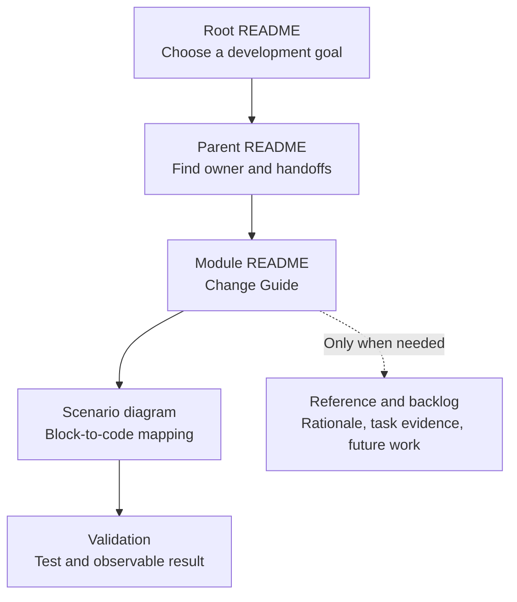

# Documentation: Developer Navigation

[Project task chooser](../README.md#choose-a-development-task) → **documentation ownership**.

Documentation should let a developer find the smallest correct change without reading the entire repository. The root chooses a goal, parent scopes explain collaboration, and module guides connect the goal to files, contracts and tests. Keep technical documentation in English.

## Change Guide

| Information to change | Authoritative location | Also update only when needed |
| --- | --- | --- |
| Task entry or startup instructions | [Root README](../README.md) | Parent/module links if entry points moved. |
| Module responsibility or neighbor handoff | [visual_bench](../visual_bench/README.md) or [engine_bridge](../engine_bridge/README.md) | The producer and consumer module guides. |
| Feature path, files, routes, tests or acceptance evidence | Owning module README | Parent summary if its responsibility or boundary contract changed. |
| Cross-module invariant or architecture decision | [design.md](design.md) | Affected module guides and integration prerequisites. |
| Task dependency or cross-repository prerequisite | [plan.md](plan.md) for the index; module README for detailed task | Keep stable task IDs and link the acceptance evidence. |
| Repository-wide contributor behavior | [AGENTS.md](../AGENTS.md) | Scope-specific rules only if genuinely distinct. |

## Flow Diagram

Arrows here mean **read next**, not runtime calls. A developer should follow one branch until the intended change and its validation are clear.

| Block | What the reader must learn | What to leave for the next level |
| --- | --- | --- |
| Root | Which feature owns the intended change; how to run the project | Detailed API fields and file inventories |
| Parent | Which modules collaborate and what crosses their boundaries | Internal helper calls and every import edge |
| Module | Required edits, conditional edits, reused path, exact code/contract links, validation | Lengthy rationale and unimplemented design |
| Reference/backlog | Constraints, stable task IDs, dependencies, acceptance evidence, future extraction criteria | Nothing here should masquerade as a current capability |

## Module README Structure

Use a short current responsibility/status paragraph followed by:

1. **Change Guide:** concrete developer goals mapped to required edits, conditional edits and existing pass-through code. Do not turn the runtime path into a mandatory edit checklist.
2. **Flow Diagram:** one compact top-down Mermaid diagram per distinct use case. Follow requests through execution and show how the result reaches the user; separate live and recorded paths when their semantics differ.
3. **Block mapping:** beside the diagram, link each block to its code entry, contract/artifact and neighbor guide. A file name in a box alone is not a development instruction.
4. **Validation:** focused existing commands and an observable end-to-end result, including errors and unavailable data. Commands are not evidence until actually run.
5. **Reference/backlog:** current file/route inventory, rationale, detailed task IDs/dependencies/evidence, and clearly labeled future plans. Use GitHub details disclosures for long material, not for the primary development path.

Browser-only modules do not need invented service layers. Storage and assistant modules use their actual store.py and explain.py entries. Preserve task IDs and evidence when reorganizing sections; repair inbound anchors when headings move.

### Diagram Correspondence

- Parent blocks represent responsibilities; child diagrams expand the selected responsibility. They need not repeat every internal edge in the parent.
- Use the same module names at each level. Qualify visual_bench/model_spec versus engine_bridge/model_spec whenever both scopes could be meant.
- Label arrow meaning: request/call, result, event, artifact, or navigation. A return arrow is not an import dependency. Explain the legend locally rather than relying on color alone.
- Every cross-module handoff links to the receiving module's guide and names its public contract. Do not maintain a duplicate field catalog: link executable schemas or bridge dataclasses.
- Keep current and proposed flows separate. Short labels and small top-down charts must remain readable in GitHub's README column; split an overloaded graph by scenario before shrinking text.

## Validation

For a documentation change:

- Follow at least one concrete task from the root to its module and test entry. Confirm both the request and result paths, not only a list of filenames.
- Compare code links and public operations with the implementation. Check required versus conditional edits against actual forwarding behavior.
- Validate local file links and heading anchors, Mermaid syntax/rendering, and disclosure markup. Inspect rendered diagrams, not just fenced text.
- Check that no stable task ID, dependency or acceptance evidence was accidentally removed and that historical test results remain dated evidence, not current claims.

Examples for this repository: expose a fuzz hyperparameter; add a live fuzz metric; adjust an existing layer view; change run stop behavior. Each should lead to a different edit scope. A task that changes only presentation should not send the developer through the whole engine stack.

## Reference

Ownership and maintenance boundaries

B coordinates cross-module consistency. A, C and D maintain the scientific semantics, interaction and validation content affected by their work. READMEs explain responsibility and development; AGENTS.md defines contributor behavior.

Inputs are confirmed requirements, decisions, constraints and actual evidence. Outputs are navigable scope, implementation guidance and acceptance criteria. Mark unresolved items explicitly and revise the original decision when facts change; do not append contradictory histories to current instructions.

Feature plans and task evidence stay with the owning module. Cross-module decisions stay in design.md; the task index and integration order stay in plan.md. Do not add a parallel document tree or empty implementation directories merely to fit a template. Extract detail into another file only when its size or independent maintenance warrants it.

