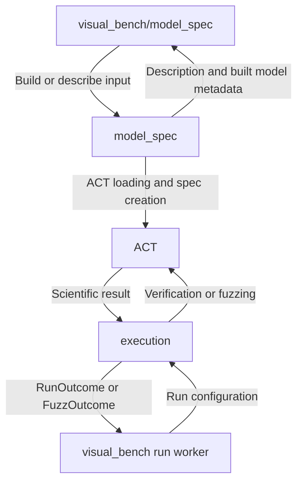
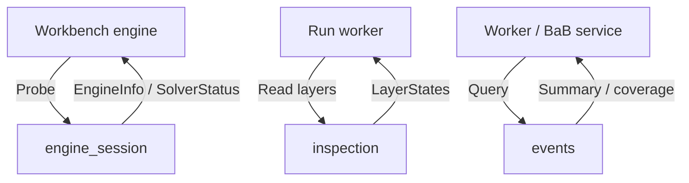

# Engine Bridge: Developer Map

[Project task chooser](../README.md#choose-a-development-task) → **ACT adaptation** → a module's Change Guide.

Only this scope directly imports ACT. It adapts the pinned engine into neutral results; it does not implement algorithms, own HTTP routes, or schedule workbench workers. [visual_bench](../visual_bench/README.md#flow-diagram) owns the other side of the boundary.

## Change Guide

| Goal / module | Start here | Current output / upper-layer consumer |
| --- | --- | --- |
| **engine_session**: ACT discovery, branch staging, API parity checks per capability, version diagnostics, solver probe | [Probe and import guide](engine_session/README.md#change-guide) | EngineInfo / SolverStatus → visual_bench/engine; act_imports stays inside bridge callers. |
| **model_spec**: source discovery, ACT net building, graph/spec description | [Loading and description guide](model_spec/README.md#change-guide) | ModelDescription, BuiltNet, source/sample descriptions → visual_bench/model_spec. |
| **execution**: verification/BaB invocation, fuzz options/observations, method eligibility | [Invocation guide](execution/README.md#change-guide) | RunOutcome / FuzzOutcome → run worker; supported methods → ModelService. |
| **inspection**: layer-bound collection | [Interval analysis guide](inspection/README.md#change-guide) | LayerStates → worker output → sealed layers.json → visual_bench/analysis. |
| **events**: BaB observation coverage and summary filtering | [Summary guide](events/README.md#change-guide) | Coverage and final metadata dictionaries → visual_bench/bab and verification worker. No ACT import or live event transport here. |

## Flow Diagram

The map expands the root **engine_bridge** block by responsibility. It intentionally omits shared imports and helper calls; module diagrams show their actual execution paths.

### Model preparation and computation




### Supplementary evidence and diagnostics




| Block | Code entry and boundary contract | Expand / consumer handoff |
| --- | --- | --- |
| model_spec | [describe.py](model_spec/describe.py): describe_model; [sources.py](model_spec/sources.py): source builders. Native load_net is an internal bridge helper. | [Local flow](model_spec/README.md#flow-diagram) → [workbench model_spec](../visual_bench/model_spec/README.md#flow-diagram) |
| execution | [verify.py](execution/verify.py): run_verification; [fuzz.py](execution/fuzz.py): run_fuzzing; [methods.py](execution/methods.py): verify_methods | [Local flow](execution/README.md#flow-diagram) → [verification](../visual_bench/verification/README.md#flow-diagram) / [fuzzing](../visual_bench/fuzzing/README.md#flow-diagram) |
| inspection | [layers.py](inspection/layers.py): interval_layer_states; a fresh interval analysis, not a saved BaB/node state | [Local flow](inspection/README.md#flow-diagram) → [analysis](../visual_bench/analysis/README.md#flow-diagram) |
| engine_session | [session.py](engine_session/session.py): probe, probe_isolated, probe_gurobi, act_root, act_code_root, act_imports; [checkouts.py](engine_session/checkouts.py): branch staging; [parity.py](engine_session/parity.py): API checks | [Local flow](engine_session/README.md#flow-diagram) → [engine](../visual_bench/engine/README.md#flow-diagram) |
| events | [coverage.py](events/coverage.py): observation_coverage, bab_summary | [Local flow](events/README.md#flow-diagram) → [bab](../visual_bench/bab/README.md#flow-diagram) |

## Decide the Edit Scope

- **An existing result needs a different display:** change the workbench view, not this bridge.
- **An ACT field or option must cross the boundary:** change the owning adapter and, if needed, [contracts.py](contracts.py); then follow the consumer link above for worker/service/wire/view mappings. A new dataclass field does not automatically appear in the browser.
- **ACT changes its API:** fix the owning adapter and parity test; check the capability declarations in engine_session. Change workbench behavior only if the public contract or availability changes.
- **ACT lacks the requested capability:** record the prerequisite in [cross-repository work](../docs/plan.md#cross-repository-work). Do not manufacture node history, controls, or a scientific verdict in the GUI.

## Validation

Use each module's **Validation** section for focused commands and fixture requirements. For a shared contract or ACT-baseline change, run:


```bash
.venv/bin/python -m pytest engine_bridge
```

Then run the affected workbench consumer tests. Native ACT parity proves result adaptation; HTTP tests prove wire mapping; a browser flow proves the end-to-end feature. Neither a synthetic fixture nor a diagram proves native engine support. These are validation instructions, not new test results.

## Reference

<details>
<summary>Shared files, contract rules, ownership, and future capabilities</summary>

| Shared file | Role |
| --- | --- |
| [contracts.py](contracts.py) | Implemented frozen dataclasses, literals and BridgeError; no workbench types, ACT objects or tensors in the public data contract. |
| [contracts.md](contracts.md) | Semantic design vocabulary, including future handles/events/commands; not an inventory of implemented types. |
| [testing.py](testing.py) | Pinned catalog, model_path, native_net, require_sources test helpers. |

Bridge numbers remain Python numbers, including non-finite values; workbench wire encoding handles JSON representations. Retain ACT provenance, shape, direction and availability. Missing data is not zero; errors are not scientific verdicts. Do not expose mutable ACT objects to workbench callers.

The bridge has no service routes. Module packages export their public operations through __init__.py; each module README lists current files and its tests. Model loading and ACT imports are reused internally across execution/inspection; this reuse alone is not a reason to edit model_spec or engine_session for every execution feature.

Current coverage is narrower than the long-term contract: engine_session has probes/import setup, not session/run handles; inspection provides interval after-states, not arbitrary geometry or historical node snapshots; events exposes final BaB summaries, not committed node/wave hooks. Controls and committed event interfaces remain dependent on ACT work in the [plan](../docs/plan.md).

B owns engine_session, model_spec, execution and contract integration. A owns inspection/events and reviews scientific semantics. Detailed task IDs, prerequisites and evidence live in module READMEs. Extract a separate package only when a real second consumer or independent lifecycle justifies it, not merely because the bridge has five modules.

</details>
