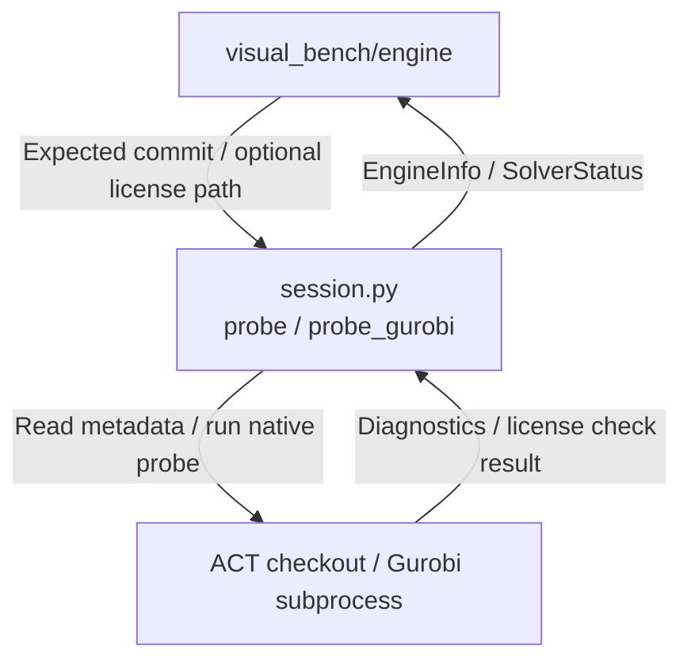

# Engine Session

The current bridge can locate the configured ACT checkout, import it, probe its commit and runtime, report the pinned baseline capabilities, and run Gurobi's own license check in a fresh process. It does not create session handles or manage workers, queues, HTTP connections, or user sessions. The workbench owns worker lifecycle. Follow the [repository rules](../../AGENTS.md) and [engine_bridge scope](../README.md).

For project navigation, see [engine_bridge flow](../README.md#flow-diagram) and [choose a development task](../../README.md#choose-a-development-task).

## Change Guide

| Goal | Required edits | Conditional / reused path |
| --- | --- | --- |
| Change checkout discovery or diagnostics | [session.py](session.py), [test_engine_session.py](test_engine_session.py) | Existing EngineInfo consumers need no change if fields/semantics remain compatible. |
| Advertise a capability | Prove the native ACT path, then update _BASELINE_CAPABILITIES and the owning adapter/test | Update workbench gating only if availability/contract changes, not just because a capability label is added. |
| Change Gurobi probing | probe_gurobi in [session.py](session.py), probe tests | License storage/upload policy belongs to [visual_bench/engine](../../visual_bench/engine/README.md#change-guide). |
| Add process-local handles | ES-02 backlog and ACT lifecycle prerequisite | No current handle API exists; keep worker supervision in verification. |

## Flow Diagram

Arrows name requests, returned data, or persistence handoffs. Only implemented paths are shown.



| Block | Code / contract | Handoff |
| --- | --- | --- |
| Probe | [session.py](session.py): probe, probe_gurobi; [contracts.py](../contracts.py): EngineInfo, SolverStatus | [Workbench engine](../../visual_bench/engine/README.md#flow-diagram) maps status and gating. |
| Import setup | [session.py](session.py): act_root, act_imports | [model_spec](../model_spec/README.md#flow-diagram), [execution](../execution/README.md#flow-diagram), [inspection](../inspection/README.md#flow-diagram) reuse it internally; events does not import ACT. |

## Validation

Run the focused real-ACT tests:

```bash
.venv/bin/python -m pytest engine_bridge/engine_session
```

The tests use the pinned catalog and real ACT checkout. `test_probe_missing_act_is_a_deterministic_error` uses a temporary path only for the missing-environment branch. Gurobi tests are skipped when `gurobipy` is not installed. No test result is implied by this guide.

Acceptance evidence for the stable current slice is ES-01 and ES-04 below. ES-02 and ES-03 remain planned.

## Reference and Backlog

<details>
<summary>Current files and operation details</summary>

## Current Files and Usage

| File | Current responsibility |
| --- | --- |
| [session.py](session.py) | `act_root`, `act_imports`, `probe`, `probe_gurobi`, and the baseline capability table |
| [__init__.py](__init__.py) | Re-exports `act_imports`, `act_root`, `probe`, and `probe_gurobi` |
| [test_engine_session.py](test_engine_session.py) | Real pinned-commit probe, missing ACT, version mismatch, and Gurobi license rejection |

Import callers are model_spec, execution and inspection through `act_imports`, plus `visual_bench/engine` through `probe` and `probe_gurobi`. The bridge types are `EngineInfo`, `Capability`, `Diagnostic`, `SolverStatus`, and `BridgeError` in [`../contracts.py`](../contracts.py).

## Operation Notes

### Change the ACT probe or capability list

Edit [session.py](session.py):

* `act_root()` resolves `ACT_ROOT`, defaulting to `/data1/guanqin/ACT`.
* `act_imports()` verifies the checkout and imports ACT, raising `BridgeError` with `act_missing` or `act_import_failed`.
* `_BASELINE_CAPABILITIES` is the source for advertised support. Keep each source tied to a real ACT call or an explicit missing hook.
* `probe(expected_commit, root)` returns `EngineInfo` with commit, Python, torch, CUDA, capabilities, and diagnostics. A commit mismatch is a warning, not a failed probe. A missing or unimportable checkout is an error.
* `probe_gurobi(license_file)` starts a separate Python process and returns `SolverStatus`. It reports Gurobi's result, never a credential value, and does not claim that current methods use Gurobi.

Update [test_engine_session.py](test_engine_session.py) with a real baseline expectation when ACT changes. Then inspect `visual_bench/engine/service.py`, which maps `EngineInfo` to the Engine tab and calls `require_engine()` before bridge work.

### Add an ACT-dependent bridge capability

First establish the native ACT call and its semantics. Then update `_BASELINE_CAPABILITIES`, the owning bridge module, its parity test, and the workbench service mapping. If the capability needs a new ACT hook, retain the task's ACT dependency in [docs/plan.md](../../docs/plan.md). Do not advertise a capability because a UI control exists.

### Add resource handles

This is planned work, not a current API. It requires ES-01, then ES-02 and ACT-02. Add process ownership, close behavior, and post-close diagnostics only when ACT exposes a safe lifecycle. Do not move worker startup or restart policy into this module.


</details>

<details>
<summary>Task evidence, design constraints and future capabilities</summary>

<a id="1-subproblems-and-objective"></a><a id="2-scope-and-non-goals"></a><a id="3-inputs-outputs-and-state"></a><a id="4-design-patterns-and-rationale"></a><a id="5-dependencies-and-implementation-placement"></a><a id="6-implementation-plan"></a><a id="7-acceptance-and-tests"></a><a id="8-future-extraction-criteria"></a><a id="9-functional-implementation-specification"></a>

## Task Evidence

| ID | Deliverable | Depends on | Completion evidence |
| --- | --- | --- | --- |
| ES-01 | Implement version/capability probe | BASE-01 | Against the pinned baseline, every advertised capability has a known support source or verified sample; missing ACT and version mismatch produce deterministic diagnostics. |
| ES-02 | Implement explicit resource handles | ES-01 | Open/use/close has a defined lifecycle; crossing a process boundary does not transfer native solver/GPU objects. |
| ES-04 | Probe optional solver licenses (Gurobi) | ES-01 | `probe_gurobi(license_file)` starts a Gurobi environment in a fresh process and returns Gurobi's own verdict as licensed, restricted, invalid, or not_installed, without credential values; a host-bound license for another host reports invalid with Gurobi's HostID message (`test_engine_session.py`). |
| ES-03 | Validate cleanup and compatibility regression | ES-02 | Repeated close and post-close access produce deterministic diagnostics with no leaked resources; ES-01 incompatibility diagnostics hold across every declared engine combination. |

## Boundaries and Cross-Module Changes

Changes to this module normally pass through existing callers without edits when the public functions and frozen contract fields remain compatible. A changed capability affects `visual_bench/engine` and any service that gates on it. A changed `EngineInfo` or `SolverStatus` requires updates to the workbench schemas and their tests, but engine_bridge must not import those schemas. ACT version changes require the adapter, parity tests, and capability source to move together.


The original design target was a process-local session facade with explicit `openSession` and `closeSession` operations. That API is not implemented. Add it only with ES-02 and ACT-02 evidence. Split internal files only when lifecycle logic has independent evolution or size. Do not create a provider registry or another process manager for this task.

</details>
