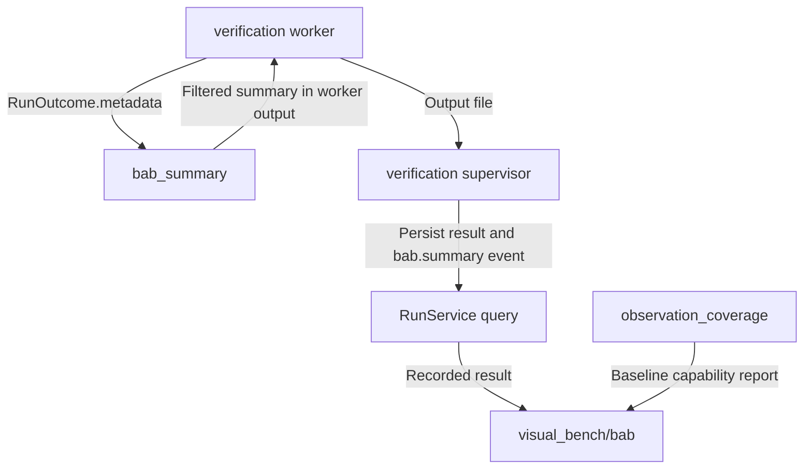

# Committed Events Adapter

The current module does not observe ACT, import ACT, own SSE, or emit committed node and wave events. It filters final BaB metadata into a stable summary and reports the pinned baseline's observation coverage. Node-level events, rollback-safe commit batches, and backpressure remain blocked on ACT-03. The workbench owns event persistence, replay, and browser SSE.

For project navigation, see [engine_bridge flow](../README.md#flow-diagram) and [choose a development task](../../README.md#choose-a-development-task).

## Change Guide

| Goal | Required edits | Conditional / reused path |
| --- | --- | --- |
| Include another scalar final-summary key | BAB_SUMMARY_KEYS in [coverage.py](coverage.py), affected verification assertions | Worker's summary dictionary and generic view may already carry/render it. No new SSE protocol is required. |
| Change declared coverage | observation_coverage in [coverage.py](coverage.py), capability evidence/tests | [BabService](../../visual_bench/bab/service.py) maps run-specific availability; change it only when semantics differ. |
| Change event delivery/replay | [verification](../../visual_bench/verification/README.md#change-guide), [records](../../visual_bench/records/README.md#change-guide) | This module has no SSE transport. |
| Add committed node/wave observations | EVT-02/03 backlog after ACT-03 | Requires native commit/rollback evidence and contracts, not inference from summary counters. |

## Flow Diagram

Arrows name requests, returned data, or persistence handoffs. Only implemented paths are shown.



| Block | Code / contract | Handoff |
| --- | --- | --- |
| Filter | [coverage.py](coverage.py): BAB_SUMMARY_KEYS, bab_summary; plain dict[str, object] | [worker.py](../../visual_bench/verification/worker.py) receives the return value; no direct adapter-to-browser stream. |
| Persistence/query | [verification/service.py](../../visual_bench/verification/service.py): _commit_result, get | [verification](../../visual_bench/verification/README.md#flow-diagram) owns the lifecycle event and RunOut projection. |
| Coverage | [coverage.py](coverage.py): observation_coverage; dict[str, str] | [BabService](../../visual_bench/bab/service.py) combines baseline coverage with run status/summary. |

## Validation

There is no focused events test command today. Validate the current path with the existing verification tests:

```bash
.venv/bin/python -m pytest visual_bench/verification/test_verification.py
```

That test exercises the real worker, final BaB summary, ordered workbench lifecycle events, and persisted records. It does not prove ACT node observation because the baseline has no observer. No test result is implied by this guide.

## Reference and Backlog

<details>
<summary>Current files and operation details</summary>

## Current Files and Usage

| File | Current responsibility |
| --- | --- |
| [coverage.py](coverage.py) | `observation_coverage`, `bab_summary`, and `BAB_SUMMARY_KEYS` |
| [__init__.py](__init__.py) | Re-exports the three public names |
| Tests | No dedicated events test currently exists. The summary path is covered by `visual_bench/verification/test_verification.py` |

The current input is `RunOutcome.metadata`, already returned by `engine_bridge.execution`. The current outputs are `dict[str, str]` coverage data and a filtered `dict[str, object]` summary. No ACT object or workbench type crosses this module.

## Operation Notes

### Change final BaB summary

Edit [coverage.py](coverage.py):

* `BAB_SUMMARY_KEYS` is the allowlist of metadata copied from ACT's final `VerifyResult`.
* `bab_summary(metadata)` returns only keys present in that metadata.
* `observation_coverage()` reports node and wave events as unsupported, final summary as available, and explains the missing ACT observer hook.

Update the visual_bench verification and BaB tests when summary keys or availability meanings change. The worker calls `bab_summary` after execution, and `visual_bench/bab/service.py` serves the resulting summary and coverage.

### Add committed ACT events

This is planned work, not a current API. It requires ACT-03 and EVT-01. First document the native commit and rollback boundary, then add neutral event contracts and parity tests. Publish only committed state. Do not infer nodes from final summary keys, timestamps, coverage counts, or lane indices.

### Change browser delivery

Do not add SSE, replay, record storage, or browser event hooks here. Those belong to visual_bench verification and records. The bridge should return neutral committed batches and coverage only after ACT exposes them.


</details>

<details>
<summary>Task evidence, design constraints and future capabilities</summary>

<a id="1-subproblems-and-objective"></a><a id="2-scope-and-non-goals"></a><a id="3-inputs-outputs-and-state"></a><a id="4-design-patterns-and-rationale"></a><a id="5-dependencies-and-implementation-placement"></a><a id="6-implementation-plan"></a><a id="7-acceptance-and-tests"></a><a id="8-future-extraction-criteria"></a><a id="9-functional-implementation-specification"></a>

## Task Evidence

| ID | Deliverable | Depends on | Completion evidence |
| --- | --- | --- | --- |
| EVT-01 | Audit and expose actual ACT observation coverage | EXE-02 | Record concrete hooks/commit points and limitations; summary-only data is labeled summary-only. |
| EVT-02 | Implement committed node/event batches | EVT-01, ACT-03 | With ACT-03 in the pinned baseline, rollback/retry leaves no ghost nodes; batch identity, seq, revision, and snapshot boundary agree. |
| EVT-03 | Validate backpressure and observation overhead | EVT-02, PERF-01 | A burst either preserves complete committed data or reports an explicit gap/degradation; deterministic scientific outcomes match observer-off execution. |

## Boundaries and Cross-Module Changes

Changing summary keys normally requires only `coverage.py` and the visual_bench BaB or verification mapping. Adding actual events crosses ACT, execution run context, shared bridge contracts, visual_bench records, verification SSE, and browser schemas. It must also update the parent [flow diagram](../README.md#flow-diagram). Do not claim committed events, node history, rollback handling, or controls until ACT-03 evidence exists.


The earlier design proposed an observer iterator, commit positions, bounded buffers, and stop-observation operations. None exists today. When EVT-02 starts, choose one sequence owner, require an atomic ACT commit boundary, and report gaps instead of silently dropping data. The bridge must not create an SSE layer or reconstruct scientific history from summaries.

</details>
