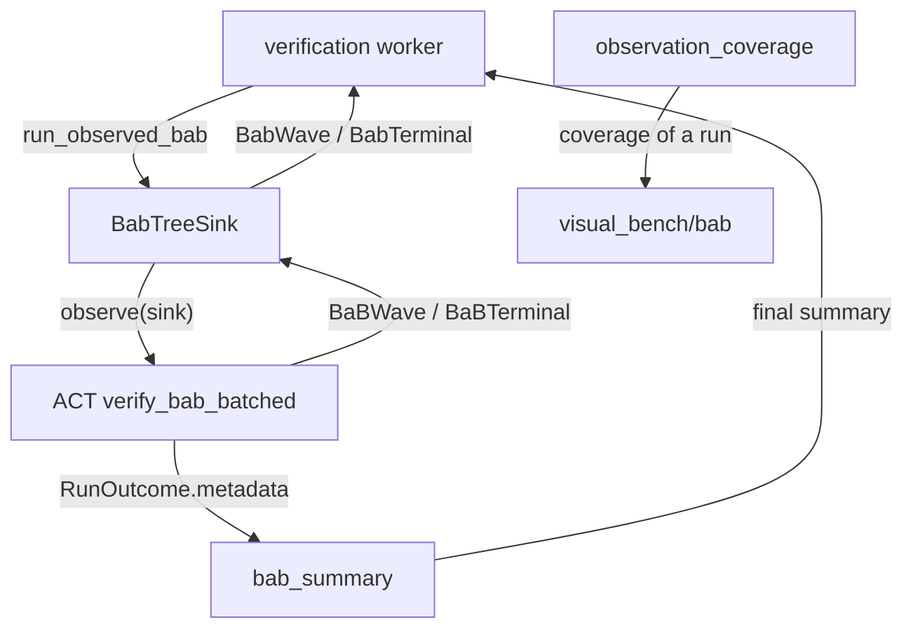

# Committed Events Adapter

The module copies ACT's committed BaB search records out of ACT and filters ACT's final BaB metadata into a stable summary. On ACT checkouts with `act.pipeline.gui.bab_gui` (capability `events.bab_nodes`), `run_observed_bab` runs BaB exactly as `run_verification(method="bab")` does, with the run's BaB settings, under a `BabTreeSink` on ACT's shared observation channel, and hands every committed wave and the terminal record to a callback as neutral contracts. The workbench owns the log, notifications, replay and browser SSE. Older ACT, including the pinned baseline, only exposes the final summary.

For project navigation, see [engine_bridge flow](../README.md#flow-diagram) and [choose a development task](../../docs/README.md#choose-a-development-task).

## Change Guide

| Goal | Required edits | Conditional / reused path |
| --- | --- | --- |
| Copy another field of ACT's BaB records | `BabTreeSink` in [bab.py](bab.py), the `Bab*` contracts in [contracts.py](../contracts.py), [test_bab.py](test_bab.py) | The workbench log writes whatever the contracts hold; its [projection](../../visual_bench/bab/README.md#change-guide) and wire schema decide what is shown. |
| Follow an ACT change of the record API | [bab.py](bab.py) and the `events.bab_nodes` requirements in [parity.py](../engine_session/parity.py) | A failing requirement makes the capability unsupported; BaB still runs summary-only. |
| Include another scalar final-summary key | `BAB_SUMMARY_KEYS` in [coverage.py](coverage.py), affected verification assertions | The worker's summary dictionary and the generic view already carry it. |
| Change event delivery or replay | [verification](../../visual_bench/verification/README.md#change-guide), [records](../../visual_bench/records/README.md#change-guide) | This module has no transport, storage or throttling. |

## Flow Diagram

Arrows name requests, returned data, or persistence handoffs. Only implemented paths are shown.



| Block | Code / contract | Handoff |
| --- | --- | --- |
| Sink | [bab.py](bab.py): `BabTreeSink`, `run_observed_bab`; contracts `BabWave`, `BabNodeResult`, `BabChild`, `BabBranch`, `BabLayerBounds`, `BabTerminal` | [worker.py](../../visual_bench/verification/worker.py) writes them through [records/bab.py](../../visual_bench/records/bab.py). Other records on the channel are skipped; malformed BaB records are counted; a callback failure is kept for the worker and never raised into ACT. |
| Filter | [coverage.py](coverage.py): `BAB_SUMMARY_KEYS`, `bab_summary` | The worker puts the summary in its output; the supervisor commits `bab.summary`. |
| Coverage | [coverage.py](coverage.py): `observation_coverage(waves)` | [BabService](../../visual_bench/bab/service.py) passes whether the run recorded waves. |

## Validation

```bash
.venv/bin/python -m pytest engine_bridge/events
ACT_CODE_ROOT=<ACT main >= 22693fb> .venv/bin/python -m pytest engine_bridge/events/test_bab.py
```

Synthetic tests cover the copy (split phases per property row, input intervals, ReLU stability from the layer feeding the ReLU, ACT's own per-layer summary, non-finite values), skipped foreign records and isolated callback failures. Native tests need an ACT checkout with `act.pipeline.gui.bab_gui`: observed and unobserved BaB agree on verdict and node count, the record sequence is complete, and every child links to a node solved in its wave. No test result is implied by this guide.

## Reference and Backlog

<details>
<summary>Current files and operation details</summary>

## Current Files and Usage

| File | Current responsibility |
| --- | --- |
| [bab.py](bab.py) | `BabTreeSink`, `run_observed_bab`, `BabRecord` |
| [coverage.py](coverage.py) | `observation_coverage`, `bab_summary`, `BAB_SUMMARY_KEYS` |
| [__init__.py](__init__.py) | Re-exports the public names |
| [test_bab.py](test_bab.py) | Synthetic copy tests and native parity tests (skipped without `events.bab_nodes`) |

ACT sends every solved node's full per-neuron bounds per layer together with its own per-layer summary. The sink keeps the summary (`lb_min`, `ub_max`, neuron count), drops the per-neuron lists and adds, for every RELU layer, how many inputs are stably active, stably inactive or unstable at that node, computed from the bounds of the layer feeding it. Split phases arrive once per property row; the sink groups them by (layer, neuron, sign). On ACT 22693fb importing `act.pipeline.gui.bab_gui` before `act.back_end.bab` is a circular import (fixed on ACT branch `fix/bab-gui-import-cycle`); the sink never imports it and the parity check imports `act.back_end.bab.bab` first.

</details>

<details>
<summary>Task evidence and design constraints</summary>

## Task Evidence

| ID | Deliverable | Depends on | Completion evidence |
| --- | --- | --- | --- |
| EVT-01 | Audit and expose actual ACT observation coverage | EXE-02 | Coverage is reported per run: waves on ACT with `events.bab_nodes`, summary-only otherwise. |
| EVT-02 | Copy committed BaB waves | EVT-01, ACT-03 | First version 2026-11-12 against SVF-tools/ACT main 22693fb: `test_bab.py` (synthetic and native). ACT emits no revision; the wave sequence is the commit order, and ACT discards a wave it rolls back before emitting it. |
| EVT-03 | Validate backpressure and observation overhead | EVT-02, PERF-01 | Partial. 2026-11-12, `bab_deep_mlp` with a 19-node dual-tier search on one CPU thread, 12 rounds in rotating order: unobserved 56.2 ms, observed with a no-op sink 66.0 ms, ACT's `on_progress` callback 64.6 ms (medians). The cost is ACT's progress emitter (about 0.5 ms per solved node, mostly per-neuron bound lists), not the channel's other producers; ACT creates no emitter when nothing observes. The full sink and log add about 2 ms. No backpressure: the sink copies synchronously in ACT's thread. |

## Boundaries

Do not reconstruct search history from summaries, timestamps or lane indices, and do not add transport, storage or throttling here. Do not claim node controls until ACT exposes them (ACT-05).

</details>
