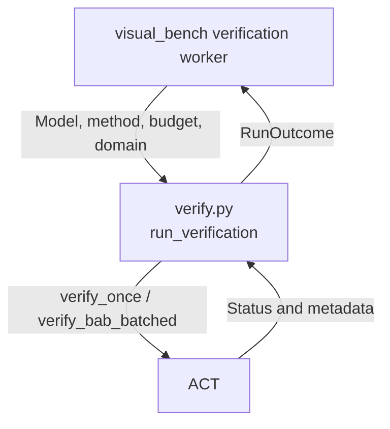
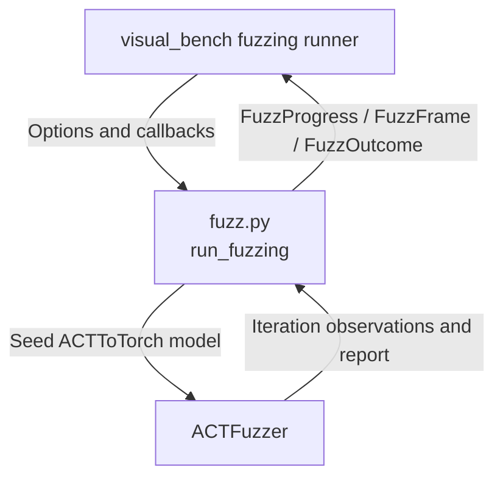

# Execution Adapter

The current bridge invokes ACT's `verify_once` for interval, dual, and HybridZ domains, ACT's batched BaB entry point, and ACTFuzzer. It maps ACT statuses without deciding scientific verdicts, exposes method eligibility and fuzzing provenance, and returns neutral frozen outcomes. Runs are blocking inside the caller's worker process. The workbench owns process lifecycle, run records, idempotency, HTTP, and SSE.

For project navigation, see [engine_bridge flow](../README.md#flow-diagram) and [choose a development task](../../README.md#choose-a-development-task).

## Change Guide

| Goal | Required edits | Conditional / reused path |
| --- | --- | --- |
| Change verification invocation/domain setup | [verify.py](verify.py), direct ACT parity tests | Compatible RunOutcome passes through the existing worker/service; no UI or lifecycle rewrite. |
| Expose an ACT fuzz hyperparameter | [fuzz.py](fuzz.py) TUNABLE plus tests, then [workbench fuzzing](../../visual_bench/fuzzing/README.md#change-guide) | split_options and runner forwarding are generic for ordinary hyperparameters; change them only for independent run arguments. |
| Add progress/frame/outcome data | [fuzz.py](fuzz.py), [contracts.py](../contracts.py), relevant tests and consuming workbench mappings | Worker dataclass serialization/storage may already carry the field; inspect rather than rewrite it. |
| Change supported methods | [methods.py](methods.py), tests | Workbench asks verify_methods; browser policy should not duplicate ACT limits. |
| Add pause/step/split controls | EXE-02/03 and ACT-02/05 backlog | Not an extension of an existing control API; first establish safe ACT semantics. |

## Flow Diagram

Arrows name requests, returned data, or persistence handoffs. Only implemented paths are shown.

### Verification / BaB



### Fuzzing



| Block | Code / contract | Handoff |
| --- | --- | --- |
| Verification | [verify.py](verify.py): select_domain, run_verification, _outcome; RunOutcome in [contracts.py](../contracts.py) | [verification worker](../../visual_bench/verification/README.md#flow-diagram); supervisor persists the final result. |
| Fuzzing | [fuzz.py](fuzz.py): split_options, run_fuzzing, fuzzing_defaults, PROVENANCE | [fuzzing runner/live service](../../visual_bench/fuzzing/README.md#flow-diagram); bridge emits callbacks, workbench serializes/delivers them. |
| Method eligibility | [methods.py](methods.py): verify_methods, UNIVERSAL_METHODS | [visual_bench/model_spec](../../visual_bench/model_spec/README.md#flow-diagram) publishes allowed methods. |
| Shared internals | [model_spec loader](../model_spec/README.md#flow-diagram), [engine_session imports](../engine_session/README.md#flow-diagram) | Reused setup, not an automatic edit target for every new option. |

## Validation

Run the focused real-ACT tests:

```bash
.venv/bin/python -m pytest engine_bridge/execution
```

These tests compare adapter statuses with recorded native ACT results and direct `verify_once` calls. Fuzz tests use real ACTFuzzer and check ACT counterexamples, input-box membership, stop behavior, and a BaB-certified net that fuzzing leaves `unknown`. The test suite does not establish browser or real-provider behavior. No test result is implied by this guide.

## Reference and Backlog

<details>
<summary>Current files and operation details</summary>

## Current Files and Usage

| File | Current responsibility |
| --- | --- |
| [verify.py](verify.py) | `run_verification`, domain selection, ACT result mapping |
| [fuzz.py](fuzz.py) | `run_fuzzing`, defaults, option split, ACT fuzzing provenance and observations |
| [methods.py](methods.py) | `verify_methods` and `UNIVERSAL_METHODS` |
| [__init__.py](__init__.py) | Public execution functions and constants |
| [test_execution.py](test_execution.py) | Native verdict/domain parity, fuzz counterexamples and stop behavior, and structured errors |

Callers are [`visual_bench/verification/worker.py`](../../visual_bench/verification/worker.py), [`visual_bench/fuzzing/runner.py`](../../visual_bench/fuzzing/runner.py), and [`visual_bench/model_spec/service.py`](../../visual_bench/model_spec/service.py). The neutral contracts are `RunOutcome`, `FuzzOutcome`, `FuzzProgress`, `FuzzFrame`, `FuzzCounterexample`, `FuzzSeed`, `FuzzStrategyStats`, `Method`, `Domain`, `Verdict`, and `BridgeError` in [`../contracts.py`](../contracts.py).

## Operation Notes

### Change verification invocation

Edit [verify.py](verify.py):

* `run_verification(model_path, method, time_budget_s, domain)` validates method, domain, and budget.
* `select_domain()` resets ACT's process-global solver and transfer-function modes before each call.
* `interval` calls `verify_once`; `bab` calls `verify_bab_batched` with ACT's configured `TorchLPSolver`.
* `_outcome()` maps ACT `VerifyStatus` one to one into `RunOutcome`, keeps raw `act_status`, summarizes scalar metadata, and copies a counterexample only when ACT supplies one.

Update [test_execution.py](test_execution.py) with a direct native ACT comparison. Do not turn timeout, unresolved search, or an empty frontier into `certified`.

### Change fuzzing

Edit [fuzz.py](fuzz.py):

* `run_fuzzing()` rebuilds the net with ACT `ACTToTorch`, seeds ACTFuzzer from input rows, validates budgets and tunable fields, and returns `FuzzOutcome`.
* `split_options()` separates run arguments from `FuzzingConfig` hyperparameters.
* `fuzzing_defaults()` reads the pinned ACT configuration.
* `PROVENANCE` documents the ACT call, config source, and display frames.
* Display-only input vectors (frame input and seed input, seed rows, a counterexample's seed input) are None above `contracts.DISPLAY_VALUES` values; a counterexample keeps its full `input` for save and export, and recorded frames drop a large counterexample already listed in `counterexamples`.
* Progress and frames are observations between ACT iterations. Counterexamples are only ACT PropertyChecker results. Fuzzing returns `falsified` or `unknown`, never `certified`.

The current implementation relies on ACTFuzzer's private `_print_progress` and `mutation_engine.mutate` seams. Recheck both against the pinned ACT commit when changing ACT.

### Change method availability

Edit [methods.py](methods.py) when ACT accepts or rejects a method based on input rows. Keep `verify_methods` free of browser policy. `UNIVERSAL_METHODS` currently contains only `fuzz`.


</details>

<details>
<summary>Task evidence, design constraints and future capabilities</summary>

<a id="1-subproblems-and-objective"></a><a id="2-scope-and-non-goals"></a><a id="3-inputs-outputs-and-state"></a><a id="4-design-patterns-and-rationale"></a><a id="5-dependencies-and-implementation-placement"></a><a id="6-implementation-plan"></a><a id="7-acceptance-and-tests"></a><a id="8-future-extraction-criteria"></a><a id="9-functional-implementation-specification"></a>

## Task Evidence

| ID | Deliverable | Depends on | Completion evidence |
| --- | --- | --- | --- |
| EXE-01 | Adapt a real verification entry point | MSB-03, ES-02 | A deterministic no-time-cutoff sample produces the same scientific result as native ACT under recorded tolerances. |
| EXE-02 | Define observable execution and run handles | EXE-01, ACT-02 | Handle lifecycle, inspection access, completion, and interruption semantics are agreed with A and exercised on ACT. |
| EXE-03 | Implement capability-gated safe controls | EXE-02, EVT-02, ACT-05 | Only ACT-implemented pause/step/split/cancel operations are enabled; stale targets and failed preconditions have actual rejection receipts. |
| EXE-04 | Adapt ACT's inference-based fuzzer | EXE-01 | `run_fuzzing` rebuilds the net with ACT's `ACTToTorch`, seeds ACTFuzzer with the net's INPUT rows, and reports ACT's `FuzzingReport`; counterexamples are only those ACT's PropertyChecker accepted. Verdict is `falsified` iff ACT reported a counterexample, otherwise `unknown` (fuzzing never certifies). Progress (iteration, coverage, counterexample count, corpus) is read between iterations. `test_execution.py`: a counterexample on `unsafe_linear` lies inside the input box; 200 iterations on `bab_deep_mlp` (BaB-certified) report none. |
| EXE-05 | Report which run methods ACT accepts for a net | EXE-01, EXE-04 | `methods.verify_methods(input_rows)` returns `interval`/`bab` for single-lane nets and only `interval` for batched nets (`verify_once` returns one verdict per INPUT row, reported as `RunOutcome.rows` with their conjunction as the run verdict; `verify_bab_batched` takes a single instance) and `UNIVERSAL_METHODS` holds `fuzz` (ACTFuzzer runs on every JSON net ACTToTorch rebuilds); `fuzz.split_options` and `fuzz.PROVENANCE` keep fuzz option and provenance knowledge in the bridge. Evidence: `visual_bench/fuzzing/test_fuzzing.py::test_torch_batch_is_one_net_fuzzed_row_by_row` (a 3-image net lists `interval` and `fuzz` and rejects `bab`), `engine_bridge/execution/test_execution.py::test_batched_net_reports_native_verdict_per_row_and_their_conjunction`, `visual_bench/verification/test_verification.py::test_torch_batch_verification_records_a_verdict_per_image`. |
| EXE-06 | Pass verify_once domain options to ACT | EXE-01, ACT-07 | `run_verification(..., dual=DualOptions, hybridz_tolerance=...)`: default `DualOptions` add no keyword, so a plain `verify_once` runs on every checkout; other values become `dual_iters`, `dual_config` (ACT `DualConfig`) and `dual_refresh_forward`, gated by capability `verify.dual.options` (`parity.py`). The HybridZ tolerance replaces the fixed 1e-7. |

## Boundaries and Cross-Module Changes

Changes to outcome fields or method names require checking the worker, verification/fuzzing mappings, wire schemas, generated types and affected tests. Edit only explicit mappings or contracts that actually change; generic dataclass serialization may already carry a new field. Changes limited to ACT invocation that preserve the frozen contracts pass through the existing worker. New controls cross into engine_session capability reporting, events commit semantics, records, and shared manual/AI commands. Do not add control methods or committed event hooks to current diagrams before ACT implements them.


The earlier design proposed `RunHandle` and `submitControl`. Neither is a current API. Add them only with EXE-02 and EXE-03 evidence from ACT-02 and ACT-05. Keep application idempotency in visual_bench. Split adapter files only when a new ACT capability has independent tests and lifecycle.

</details>
