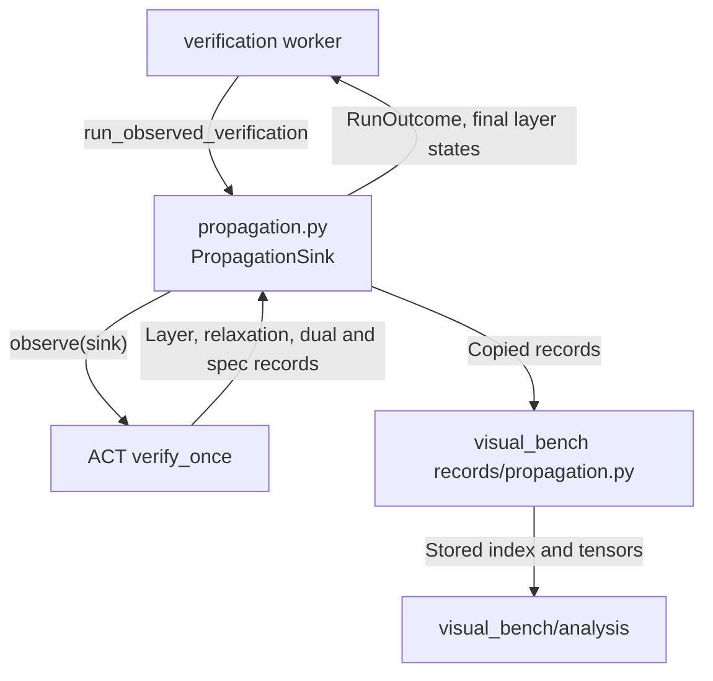
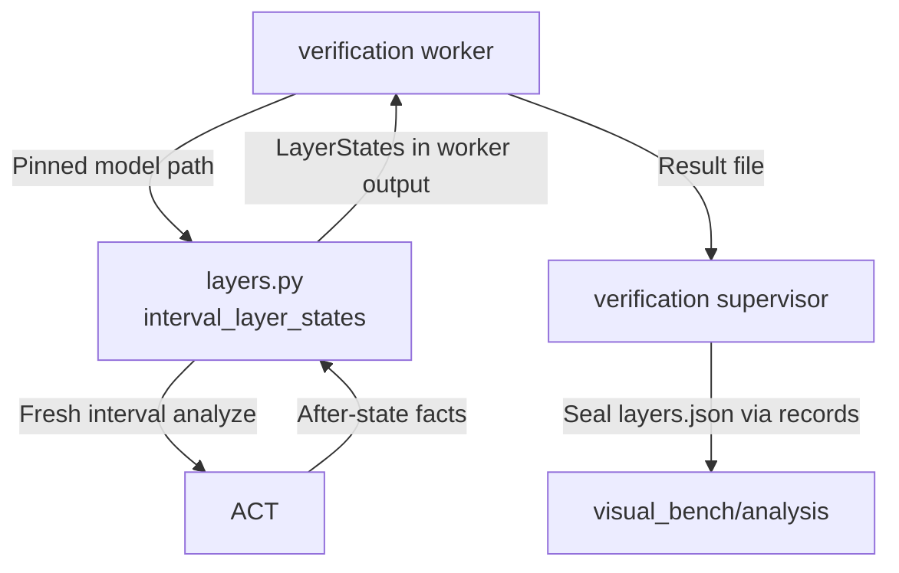

# Inspection Adapter

The bridge records propagation during `verify_once` when the active ACT exposes `observe.propagation`. Records retain the run's domain, pass, scope, stage, version, and full per-neuron data. Final forward records supply the existing layer-state view; dual activation records are labeled `pre` (forward pre-activation bounds). On older ACT checkouts the INSP-01 fresh interval analysis remains available as an explicitly labeled fallback. Geometry, live BaB node reads, and solver stepping are not implemented.

For project navigation, see [engine_bridge flow](../README.md#flow-diagram) and [choose a development task](../../docs/README.md#choose-a-development-task).

## Change Guide

| Goal | Required edits | Conditional / reused path |
| --- | --- | --- |
| Copy another field of ACT's propagation records | `PropagationSink` and the neutral record types in [propagation.py](propagation.py), [test_propagation.py](test_propagation.py) | The records writer stores every record the sink passes; [analysis](../../visual_bench/analysis/README.md#change-guide) decides what is served and shown. |
| Follow an ACT change of the observer API | [propagation.py](propagation.py) and the `observe.propagation` requirements in [parity.py](../engine_session/parity.py) | A failing requirement makes the capability unsupported; runs then fall back to interval layer states. |
| Change interval-state collection or limits | [layers.py](layers.py), native [test_inspection.py](test_inspection.py) | Keep LayerStates compatible unless new data is required. |
| Add a bound/provenance field | [layers.py](layers.py), [contracts.py](../contracts.py), parity tests, [analysis mapping](../../visual_bench/analysis/README.md#change-guide) | Worker serializes dataclasses generically; change worker/records only if artifact or failure semantics change. |
| Change stepper or box rendering | [visual_bench/analysis](../../visual_bench/analysis/README.md#change-guide) | No new inspection call for a display-only change. |
| Add geometry/history | INSP-02/03 backlog and ACT capability evidence | Fresh recomputation cannot impersonate historical node data. |

## Flow Diagram

Arrows name requests, returned data, or persistence handoffs. Only implemented paths are shown.

### Propagation records (ACT with `observe.propagation`)



| Block | Code / contract | Handoff |
| --- | --- | --- |
| Sink | [propagation.py](propagation.py): `run_observed_verification`, `PropagationSink`, `PropagationKey`, `TensorData`, `PropagationRecord`; `observe.propagation` requirements in [parity.py](../engine_session/parity.py) | Runs the existing verifier under ACT's `observe` and copies each record's key and tensors before ACT can release them; a storage failure is reported after verification, never raised into ACT. |
| Writer | The worker's callback: `PropagationWriter` in [records/propagation.py](../../visual_bench/records/propagation.py) | [verification](../../visual_bench/verification/README.md#flow-diagram) streams index entries; [analysis](../../visual_bench/analysis/README.md#flow-diagram) serves the stored records. |

### Interval layer states (fallback)



| Block | Code / contract | Handoff |
| --- | --- | --- |
| Inspection | [layers.py](layers.py): interval_layer_states; LayerState/LayerStates in [contracts.py](../contracts.py) | One input lane, stage=after, predecessor IDs for before-states, explicit interval provenance. |
| Worker output | [worker.py](../../visual_bench/verification/worker.py) serializes LayerStates or captures layer_states_error | [verification](../../visual_bench/verification/README.md#flow-diagram) writes and seals the artifact; the adapter does not own storage. |
| User-facing query | [AnalysisService](../../visual_bench/analysis/service.py) reads sealed layers.json | [analysis](../../visual_bench/analysis/README.md#flow-diagram) maps data/absence to the view. |

## Validation

Run the focused real-ACT tests:

```bash
.venv/bin/python -m pytest engine_bridge/inspection
```

The tests compare returned bounds with direct native `verify_once(..., collect_facts=True)` facts. They also verify that a preceding HybridZ run does not change the interval inspection. No test result is implied by this guide.

Propagation evidence, 2026-11-05: with `ACT_CODE_ROOT=/data1/guanqin/ACT-wt/act-gui-match`
and an isolated `ACT_GUI_ENGINES` selection of the same checkout, the combined bridge/analysis/worker
propagation suite passed 15 tests. After the final ASSERT-output-axis correction, the bridge and real
worker propagation tests passed 9 tests again. Native interval, HybridZ and dual use `bab_deep_mlp`;
convolution batch/output-axis mapping is a synthetic contract test. The old pinned
`mnist_conv_small` snapshot cannot load on that ACT branch (`Unsupported ACT metadata tag
'LabeledInputTensor'`), so it is not claimed as native convolution evidence.

## Reference and Backlog

<details>
<summary>Current files and operation details</summary>

## Current Files and Usage

| File | Current responsibility |
| --- | --- |
| [layers.py](layers.py) | `interval_layer_states` and the 65536-value per-layer guard |
| [propagation.py](propagation.py) | `PropagationSink`, neutral `PropagationKey`/`TensorData`/`PropagationRecord`, and `run_observed_verification`; copies CPU float32 little-endian bytes before ACT can mutate/release tensors |
| [__init__.py](__init__.py) | Re-exports `interval_layer_states`, `PropagationSink`, `run_observed_verification` |
| [test_inspection.py](test_inspection.py) | Native `verify_once` fact parity, including after a HybridZ call |
| [test_propagation.py](test_propagation.py), [testing.py](testing.py) | Synthetic record-copy/failure tests (real observer registry when importable, otherwise a schema-only stub); native observer tests gated on `observe.propagation` |

The run worker calls this adapter after execution and serializes its output; the verification supervisor writes and seals layers.json, which visual_bench analysis reads. The neutral contracts are `LayerState`, `LayerStates`, `Availability`, and `BridgeError` in [`../contracts.py`](../contracts.py). See [visual_bench analysis](../../visual_bench/analysis/README.md).

## Operation Notes

### Change interval layer states

Edit [layers.py](layers.py):

* `interval_layer_states(model_path)` loads the net through `engine_bridge.model_spec.load_net`.
* It explicitly resets ACT to interval transfer functions and no solver mode, so a prior HybridZ call in the same process cannot leak into inspection.
* It calls ACT's public `analyze`, accepts one input lane, rejects larger layers above `MAX_VALUES_PER_LAYER`, and maps available facts to `LayerState`.
* Missing ACT facts are omitted. The caller must preserve that as missing data, not zero-fill it.
* `LayerStates.provenance` currently records `act.back_end.analyze.analyze` and interval transfer mode.

Update [test_inspection.py](test_inspection.py) with direct native ACT facts. The existing test intentionally runs HybridZ first, then checks interval parity.

### Add geometry or historical inspection

These are not current APIs. Geometry needs ACT-04 and a contract for coordinates, representation, guarantee, and provenance. Historical availability needs records integration, but this module must not import records. A new computation must receive a new inspection identity and provenance. Never label fresh interval analysis as retained historical data.


</details>

<details>
<summary>Task evidence, design constraints and future capabilities</summary>

<a id="1-subproblems-and-objective"></a><a id="2-scope-and-non-goals"></a><a id="3-inputs-outputs-and-state"></a><a id="4-design-patterns-and-rationale"></a><a id="5-dependencies-and-implementation-placement"></a><a id="6-implementation-plan"></a><a id="7-acceptance-and-tests"></a><a id="8-future-extraction-criteria"></a><a id="9-data-required-by-propagation-views"></a><a id="10-functional-implementation-specification"></a>

## Task Evidence

| ID | Deliverable | Depends on | Completion evidence |
| --- | --- | --- | --- |
| INSP-01 | Expose fixed-run layer states | EXE-01, MSB-03, ACT-01 | A small real network yields correctly mapped before/after data for input through output; absent stages are explicit. |
| INSP-02 | Expose geometry and projection metadata | INSP-01, ACT-04 | Coordinates, representation, guarantee, method, dtype/tolerance, and source are present; interval-only data is not upgraded into fabricated geometry. |
| INSP-03 | Define historical availability and new inspection semantics | INSP-01, REC-02 | Integration with retained records distinguishes old evidence, missing history, and recomputation; new inspection data never overwrites original historical provenance. |
| INSP-04 | Record propagation during the run | INSP-01, ACT-06 | Implemented in `propagation.py`: the sink copies full tensors and scope/parent/domain/pass/layer/stage/version/origin, counts unknown or malformed records, and retains the latest forward bounds. `run_observed_verification` invokes the existing verifier under `observe`; storage callbacks never raise into ACT, but a storage failure is reported after verification. Capability requirements are in `parity.py`; older ACT uses INSP-01. `test_propagation.py` checks copy isolation and native interval/HybridZ final facts after float32 conversion. Native tests skip unless the active ACT has the capability. |
| INSP-05 | Per-neuron over-approximation of the run's domain | INSP-04, ACT-06 (AGM-06, AGM-08) | Implemented record adaptation for `LayerBounds`, `Relaxation`, `DualBackward`, and `SpecBound`: ACT status, slopes/intercepts, alpha per spec row with `alpha_optimized`, nu when present, margins/slack, and original tensor/output shapes. Missing records are explicit, never computed by another domain. The analysis layer endpoint serves all recorded tensor fields; native observer tests cover all three domains. No additional intermediate dual refinement or BaB records are invented. |

## Boundaries and Cross-Module Changes

Changes to LayerState or availability require checking worker serialization and updating the affected analysis mapping/schema, generated wire types and tests. Generic worker serialization is not automatically an edit target. A change to layer selection or rendering belongs in visual_bench analysis. A new ACT read or projection capability requires engine_session capability evidence and an inspection parity test. Existing interval state changes that preserve the contract pass through the worker without a new route.


The earlier design proposed context-rich node and layer query operations, on-demand projection, and historical queries. Those are design targets, not current functions. Add them only when ACT supplies safe read boundaries and explicit provenance. Keep large payloads on demand and preserve DAG predecessor relationships rather than flattening the graph.

</details>
