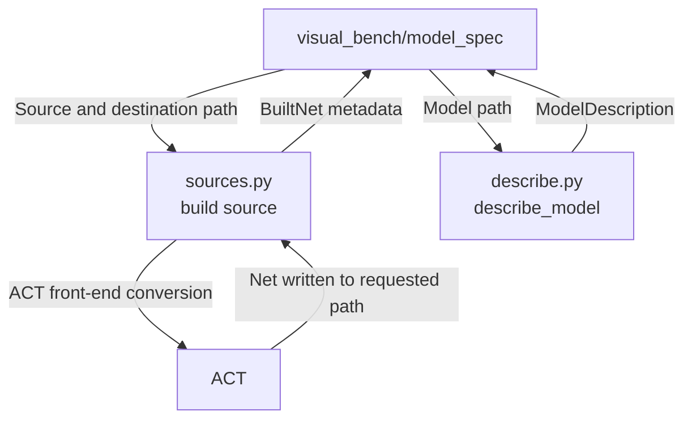

# Model and Specification Adapter

The current bridge loads JSON ACT nets, maps their DAG and box specification into immutable `ModelDescription` data, computes source hashes, and builds nets from VNN-LIB instances or supported image-classifier sources through ACT's own front ends. It does not own browser model views, graph layout, arbitrary path access, or a second specification parser. Keep this module distinct from [`visual_bench/model_spec`](../../visual_bench/model_spec/README.md), which owns catalog presentation, source selection, persistence, and wire mapping.

For project navigation, see [engine_bridge flow](../README.md#flow-diagram) and [choose a development task](../../README.md#choose-a-development-task).

## Change Guide

| Goal | Required edits | Conditional / reused path |
| --- | --- | --- |
| Change DAG/spec description | [describe.py](describe.py), native parity tests; [contracts.py](../contracts.py) for a new field | [Workbench model_spec](../../visual_bench/model_spec/README.md#change-guide) mapping/schema/view only for new public data or meaning. |
| Add or fix source building | [sources.py](sources.py), [test_model_spec.py](test_model_spec.py) | Existing discovery/list shapes may suffice; edit workbench load input/UI only when the user request changes. |
| Change batch support | Builder row semantics and relevant tests | [execution/methods.py](../execution/methods.py) changes only when ACT method eligibility changes; a different row count already follows the current rule. |
| Change graph layout or persisted model IDs | [visual_bench/model_spec](../../visual_bench/model_spec/README.md#change-guide) | Keep renderer and storage policy outside this bridge. |

## Flow Diagram

Arrows name requests, returned data, or persistence handoffs. Only implemented paths are shown.



| Block | Code / contract | Handoff |
| --- | --- | --- |
| Source discovery/build | [sources.py](sources.py): source lists, dataset_sample, build_vnnlib_net, build_classifier_net; BuiltNet records build metadata | [Workbench model_spec](../../visual_bench/model_spec/README.md#flow-diagram) hashes/stores the output file and selects methods. |
| Description | [describe.py](describe.py): describe_model, file_sha256; ModelDescription in [contracts.py](../contracts.py) | Workbench maps the neutral description into ModelDescriptionOut. |
| Internal loader | [describe.py](describe.py): load_net uses [engine_session](../engine_session/README.md#flow-diagram) | [execution](../execution/README.md#flow-diagram) and [inspection](../inspection/README.md#flow-diagram) get a process-local ACT net; it is not a public wire object. |

## Validation

Run the focused real-ACT tests:

```bash
.venv/bin/python -m pytest engine_bridge/model_spec
```

The parity tests use native ACT networks and the pinned catalog. Source-builder tests require ACT data, ONNX files, and torchvision datasets, and are skipped or rejected by their own `require_sources` and structured error paths when those inputs are unavailable. No test result is implied by this guide.

## Reference and Backlog

<details>
<summary>Current files and operation details</summary>

## Current Files and Usage

| File | Current responsibility |
| --- | --- |
| [describe.py](describe.py) | `load_net`, `describe_model`, `file_sha256` |
| [sources.py](sources.py) | VNN-LIB and classifier discovery, dataset samples, `build_vnnlib_net`, `build_classifier_net`, `BATCH_LIMIT` |
| [__init__.py](__init__.py) | Re-exports `describe_model` and `file_sha256`; `sources` remains a submodule |
| [test_model_spec.py](test_model_spec.py) | Native DAG/spec parity, image shapes and centers, builder parity, and rejected inputs |

The public bridge types are `ModelDescription`, `LayerDescription`, `InputSpec`, `OutputSpec`, `BuiltNet`, `DatasetSample`, `VnnlibInstance`, `ClassifierSource`, and `BridgeError` in [`../contracts.py`](../contracts.py). [describe.py](describe.py) and [sources.py](sources.py) use `engine_session.act_imports`.

## Operation Notes

### Change model or specification mapping

Edit [describe.py](describe.py):

* `load_net(path)` is the only ACT JSON loader and raises structured `BridgeError` values for missing or unreadable files.
* `describe_model(path)` maps ACT layers, predecessor/successor IDs, shapes, parameter summaries, `INPUT_SPEC` boxes, and one `ASSERT` into `ModelDescription`.
* Output layout comes from ACT's `params["output_shape"]` when present (including its native batch axis), or the older `get_output_shape()` API. Propagation inspection removes the batch axis for neuron coordinates while tensor references retain it. The synthetic convolution mapping regression lives in `../inspection/test_propagation.py`.
* `_MAX_SPEC_VALUES` and `_MAX_SPEC_ROWS` are deliberate payload limits. `_MAX_SPEC_VALUES` covers the largest VNN-COMP input in ACT's data (smart_turn_multimodal_2026: 80x800 audio plus 3x32x112x112 video, which ACT packs into one flat input row). A larger or non-box input specification must raise `unsupported_spec`, not be truncated. The bridge keeps full bounds for the service; the workbench wire omits lb/ub/center above `contracts.DISPLAY_VALUES` (3x224x224) values per row, so the browser shows the shape and a "too large to display" note.
* `file_sha256(path)` supplies snapshot identity for the workbench.

Keep ACT objects and tensors inside the bridge. Update [test_model_spec.py](test_model_spec.py) against native ACT calls and check repeated descriptions for stable equality and primitive leaves.

### Add a model source or builder

Edit [sources.py](sources.py) and its parity tests:

* `vnnlib_instances()` lists existing `instances.csv` entries under ACT data.
* `classifier_sources()` lists available pinned ONNX and dataset sources.
* `dataset_sample()` returns a neutral `DatasetSample`.
* `build_vnnlib_net()` uses ACT `create_specs_from_paths`.
* `build_classifier_net()` uses ACT ONNX conversion and `TorchToACT`, writes an ACT net, and returns `BuiltNet`.

Preserve source parameters, content-addressed output, and the distinction between one input row and a batch. `visual_bench/model_spec/service.py` owns the model ID and storage mapping.

### Change method eligibility

If a builder changes input-row semantics, inspect `engine_bridge/execution/methods.py` and its tests. A new row count alone already follows the existing eligibility rule. The workbench asks `verify_methods` and adds universal `fuzz` through the execution bridge.


</details>

<details>
<summary>Task evidence, design constraints and future capabilities</summary>

<a id="1-subproblems-and-objective"></a><a id="2-scope-and-non-goals"></a><a id="3-inputs-outputs-and-state"></a><a id="4-design-patterns-and-rationale"></a><a id="5-dependencies-and-implementation-placement"></a><a id="6-implementation-plan"></a><a id="7-acceptance-and-tests"></a><a id="8-future-extraction-criteria"></a><a id="9-functional-implementation-specification"></a>

## Task Evidence

| ID | Deliverable | Depends on | Completion evidence |
| --- | --- | --- | --- |
| MSB-01 | Define neutral descriptions against a real sample | ES-01, BASE-03 | Field map covers DAG, layer/tensor identity, shapes, provenance, and required spec semantics; A reviews it. |
| MSB-02 | Implement model loading and mapping | MSB-01, ES-02 | Repeated reads of one snapshot preserve IDs and match native ACT connectivity/shape; no mutable tensor escapes. |
| MSB-03 | Implement spec loading and validation | MSB-02 | Real input-domain/output-constraint mapping matches ACT; invalid variables and unsupported representations have explicit errors. |
| MSB-04 | Build nets from model sources | MSB-03 | `sources.py`: VNN-LIB instances listed from `ACT_ROOT/data/vnnlib/*/instances.csv` and built with ACT's `create_specs_from_paths` (first query); ONNX image classifiers (BaVerLy MNIST/CIFAR-10, EMSOFT MNIST 4x256) built as an L-inf box of radius eps around a chosen MNIST/CIFAR-10 test image (or a batch of up to 64 distinct test images, one ACT input/spec row each, which ACTFuzzer fuzzes as one batch and `verify_once` checks row by row; BaB takes single-image nets only) with a TOP1_ROBUST assertion, via `convert_onnx_to_pytorch`, `VerifiableModel`, `TorchToACT`. Parity tests: the VNN-LIB box/property equals ACT's spec creation, the classifier box equals clip(image ± eps) with the dataset label, and the builder reproduces a pinned catalog net byte for byte. |
| MSB-05 | Batch VNN-LIB properties of one network | MSB-04 | `sources.build_vnnlib_net` takes one instance or up to 64 distinct properties sharing one benchmark and ONNX file (else `invalid_instance`); each is parsed by `create_specs_from_paths` (first query), and ACT's own `synthesize_models_and_seeds_from_specs(cd_group="shape")` merges them into one net with a row per property (`input_rows` = batch, params `batch`/`vnnlibs`). Properties ACT does not merge (different input/output kind or constraint shape, e.g. ACAS Xu prop_1 with 1 row vs prop_2 with 4) raise `incompatible_batch` naming the groups. UNSAFE_LINEAR properties that differ only in their rows or thresholds (dist_shift, collins_rul_cnn) need an ACT whose `OutputSpec.encode_linear` takes per-lane `c`/`d` (ACT branch `feat/per-lane-unsafe-thresholds`); on an older ACT, `TorchToACT` rejects them and the bridge reports `incompatible_batch`. A single instance builds the same net as before. Builds run on the service's worker threads, and the net records each tensor's device, so equal sources map to one content-addressed model only on an ACT whose device manager applies its default device on every thread (branch `fix/thread-default-device`). `test_model_spec.py::test_vnnlib_batch_merges_properties_of_one_network_through_act_synthesis`. |

## Boundaries and Cross-Module Changes

Description-only changes pass through the existing `visual_bench/model_spec` mapping when dataclass fields and meanings stay compatible. New fields require that service's Pydantic schema, generated wire types, and tests. Changes to source parameters or input row count also affect method eligibility and the workbench load flow. Do not edit generated browser types by hand. ACT loader or spec semantics changes require native parity tests and a capability or error update in the owning bridge module.


The earlier design proposed explicit model and spec handles and separate mapping files. Those are not current APIs. Add them only when a caller needs lifecycle or independently complex mapping. A source content change must create a new snapshot identity. Renderer fields, arbitrary AI paths, raw tensors, and a multi-engine plugin layer remain outside this module.

</details>
