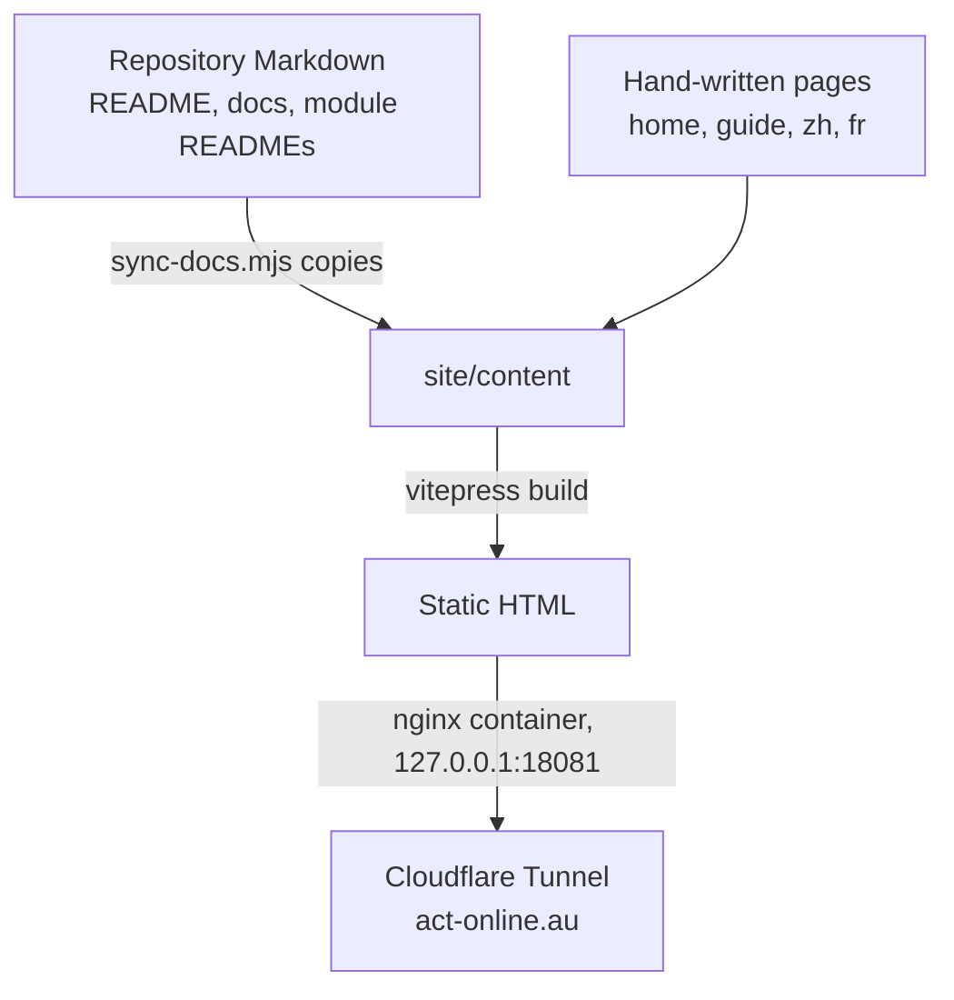

# Website

[Project task chooser](../docs/README.md#choose-a-development-task) → **website**.

This directory builds the public ACT website with [VitePress](https://vitepress.dev): the home page and the user guide introduce ACT itself (installation, architecture, verification, fuzzing, validation and configuration, based on ACT's own README and CLIs), and the developer docs are this repository's ACT-GUI documentation. It is static, has its own `package.json`, and shares no code or dependencies with the workbench. The hosted site is served at `act-online.au`, and the workbench is served at `app.act-online.au`.

## Change Guide

| Goal | Edit |
| --- | --- |
| Change the home page or a user guide page | `content/index.md`, `content/guide/*.md`, and the same page under `content/zh/` and `content/fr/`; check ACT commands against the ACT CLI (`--help`) on upstream `main` |
| Change navigation, sidebar, languages or the workbench link | [.vitepress/config.mts](.vitepress/config.mts) |
| Change a developer page | The original file in the repository (for example `docs/design.md`). The site copies it at build time. |
| Publish another repository Markdown file | `SOURCES` in [sync-docs.mjs](sync-docs.mjs) and the developer sidebar in the config |
| Change how the site is served | [Dockerfile](Dockerfile), [nginx.conf](nginx.conf), [compose.site.yaml](../compose.site.yaml) |

English is the default language. Chinese (`/zh/`) and French (`/fr/`) translate the home page and the user guide; developer docs are English only and live next to the code they describe (each module's README), so every locale's sidebar links to the same English pages, and [nginx.conf](nginx.conf) redirects `/zh/` and `/fr/` developer paths (reached through the language switcher) to them. When an English guide page changes, update both translations in the same change.

## Flow Diagram



Relative links from developer pages to source files (such as `service.py`) are rewritten to the file on GitHub; links between Markdown pages stay inside the site.

## Validation

```bash
cd site
npm install
npm run build        # fails on dead links between pages
npm run dev          # http://localhost:5173, live preview (re-run after editing a developer doc)
```

Serve the built site the way production does:

```bash
docker compose -f compose.site.yaml up -d --build    # http://127.0.0.1:18081
```
