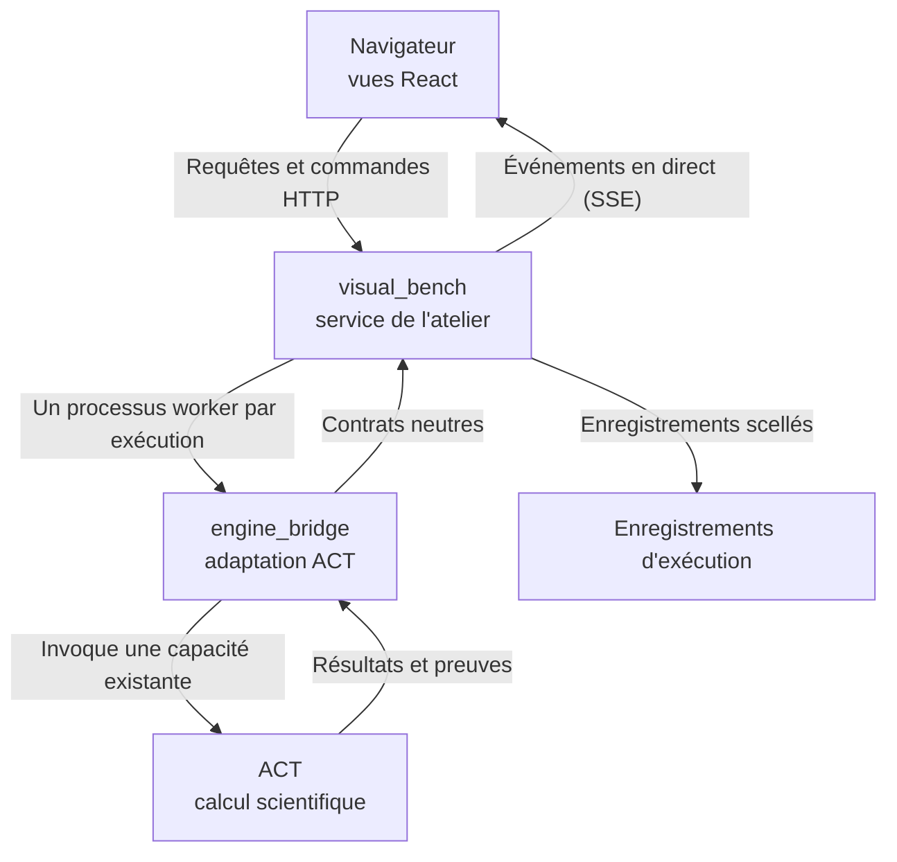

# Fonctionnement

ACT-GUI est un produit unique organisé en deux zones selon leurs responsabilités. Un moteur ACT distinct se trouve en dessous.

| Couche | Responsabilité | Ne fait jamais |
| --- | --- | --- |
| **visual_bench** | Vues du navigateur, services applicatifs, workers d'exécution, enregistrements et assistant | Importer ACT |
| **engine_bridge** | Vérification de la version et des capacités d'ACT, appels à ACT, conversion des résultats en données neutres | Servir HTTP, conserver l'état de l'interface, planifier les exécutions |
| **ACT** | Algorithmes, bornes et verdicts | Connaître l'interface graphique |

---

## Cycle de vie d'une exécution

1. **Requête.** Le navigateur envoie une requête avec le modèle, la méthode et ses options. Une requête répétée avec le même identifiant client renvoie l'exécution existante au lieu d'en démarrer une autre.
2. **Worker.** Le service démarre un processus worker séparé. Celui-ci appelle ACT par l'intermédiaire d'engine_bridge, afin qu'un crash ou un délai d'expiration ne fasse pas tomber le service.
3. **Événements en direct.** La progression, comme les images de fuzzing et les changements de cycle de vie, est inscrite dans un journal d'événements ordonné et envoyée au navigateur par Server-Sent Events. Un navigateur qui se reconnecte rejoue les événements manqués.
4. **Enregistrement scellé.** À la fin de l'exécution, le résultat et les preuves sont écrits comme artefacts, chacun scellé par un hash sha256 à côté d'un manifeste immuable. Les lectures ultérieures vérifient les hash.

---

## Contrôle des capacités

ACT varie selon les branches et les forks. L'atelier ne suppose pas qu'un checkout ACT possède l'API requise par une fonction : engine_bridge vérifie les symboles ACT appelés par chaque adaptateur. Une fonction absente du moteur actif est désactivée et sa raison est affichée, plutôt que d'échouer au milieu d'une exécution.

---

## Modules

L'atelier est organisé en quatorze modules, chacun avec son propre guide.

| Zone | Modules |
| --- | --- |
| visual_bench | [workspace](/visual_bench/workspace/README), [model_spec](/visual_bench/model_spec/README), [verification](/visual_bench/verification/README), [fuzzing](/visual_bench/fuzzing/README), [engine](/visual_bench/engine/README), [analysis](/visual_bench/analysis/README), [bab](/visual_bench/bab/README), [assistant](/visual_bench/assistant/README), [records](/visual_bench/records/README) |
| engine_bridge | [engine_session](/engine_bridge/engine_session/README), [model_spec](/engine_bridge/model_spec/README), [execution](/engine_bridge/execution/README), [inspection](/engine_bridge/inspection/README), [events](/engine_bridge/events/README) |

Pour les décisions de conception et les invariants, consultez l'[architecture](/docs/design).

Suite : [Modes de travail](./modes).
