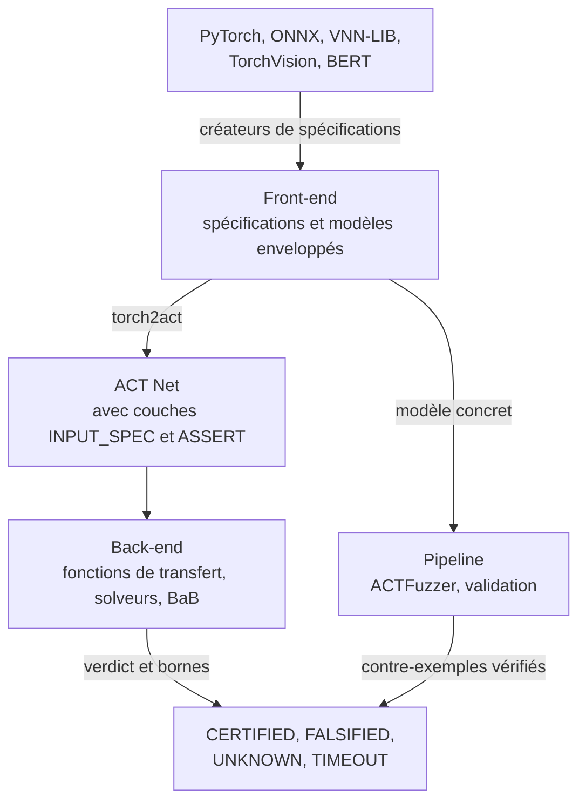

# Fonctionnement

ACT comporte trois niveaux. Le front-end transforme modèles, données et propriétés en tâches de vérification. Le back-end les vérifie. Le pipeline relie les deux et les teste.

| Niveau | Responsabilités | Ligne de commande |
| --- | --- | --- |
| **Front-end** (`act/front_end`) | Créateurs de spécifications pour VNN-LIB, TorchVision et BERT ; spécifications d'entrée et de sortie ; enveloppes de modèles vérifiables ; synthèse de modèles | `python -m act.front_end` |
| **Back-end** (`act/back_end`) | L'ACT Net ; fonctions de transfert par intervalles, HybridZ et duales ; solveurs ; vérification en une passe et séparation-évaluation | `python -m act.back_end` |
| **Pipeline** (`act/pipeline`) | Conversion PyTorch ↔ ACT, ACTFuzzer, validation des vérificateurs, gestion des benchmarks | `python -m act.pipeline` |

---

## Du modèle à l'ACT Net {#from-a-model-to-an-act-net}

1. **Spécification.** Un créateur de spécifications lit un benchmark ou un jeu de données et produit une spécification d'entrée (une boîte, une boule L∞ ou un polytope linéaire) et une propriété de sortie (robustesse top-1, robustesse avec marge, contraintes linéaires, intervalle de sortie ou région linéaire dangereuse).
2. **Modèle enveloppé.** La spécification entoure le réseau sous forme de couches PyTorch : une couche d'entrée, une couche de spécification d'entrée et une couche de spécification de sortie.
3. **Conversion.** `torch2act` convertit le modèle enveloppé en ACT Net. La spécification devient les couches `INPUT_SPEC` et `ASSERT` du Net : la vérification n'a donc besoin d'aucun fichier de spécification séparé. `act2torch` effectue la conversion inverse, et les tests du pipeline vérifient que les deux sens concordent.

Plusieurs propriétés peuvent partager un même réseau. La synthèse de modèles les fusionne en un seul Net en lots, avec une ligne par propriété, qu'ACT vérifie ensemble.

---

## Vérifier un ACT Net {#verifying-an-act-net}

**Bornes.** Une fonction de transfert propage des bornes à travers chaque couche du Net :

| Domaine | Précision et coût |
| --- | --- |
| `interval` | Le plus rapide ; une borne inférieure et une borne supérieure par neurone. |
| `hybridz` | Zonotopes ; des bornes plus serrées pour un coût plus élevé. |
| `dual` | Bornes duales issues d'une relaxation linéaire, avec en option des relaxations ReLU optimisées (alpha). |

**Décision.** Un solveur confronte la propriété de sortie aux bornes. Si elles prouvent la propriété pour toute entrée, le résultat est `CERTIFIED`. Si la propriété reste ouverte, ACT évalue des entrées candidates sur le modèle concret ; une candidate qui viole la propriété donne `FALSIFIED` avec ce contre-exemple.

**Raffinement.** Si aucun des deux n'aboutit, la séparation-évaluation découpe le problème en sous-problèmes, en fixant la phase d'une ReLU instable ou en scindant une dimension d'entrée, puis borne chaque sous-problème à nouveau jusqu'à ce que chaque branche soit décidée ou que le budget soit épuisé.

---

## Chercher des contre-exemples {#searching-for-counterexamples}

ACTFuzzer exécute le modèle concret, pas une abstraction. Il fait muter des entrées graines à l'intérieur de la spécification d'entrée par des pas guidés par le gradient (de type FGSM/PGD) et des perturbations aléatoires, conserve les entrées qui atteignent une nouvelle couverture de neurones et confronte chaque candidate à la propriété de sortie. Une candidate qui la viole est signalée comme contre-exemple ; le fuzzing ne certifie jamais une propriété.

---

## Contrôler le vérificateur {#checking-the-verifier}

Les résultats de vérification ne sont utiles que si le vérificateur est correct. La validation du pipeline comporte deux niveaux :

1. **Correction.** Un vérificateur ne doit jamais répondre `CERTIFIED` lorsqu'un contre-exemple concret existe.
2. **Précision numérique.** Les bornes abstraites de chaque couche doivent contenir les activations concrètes des entrées échantillonnées.

Suite : [Vérification et tests](./modes).
