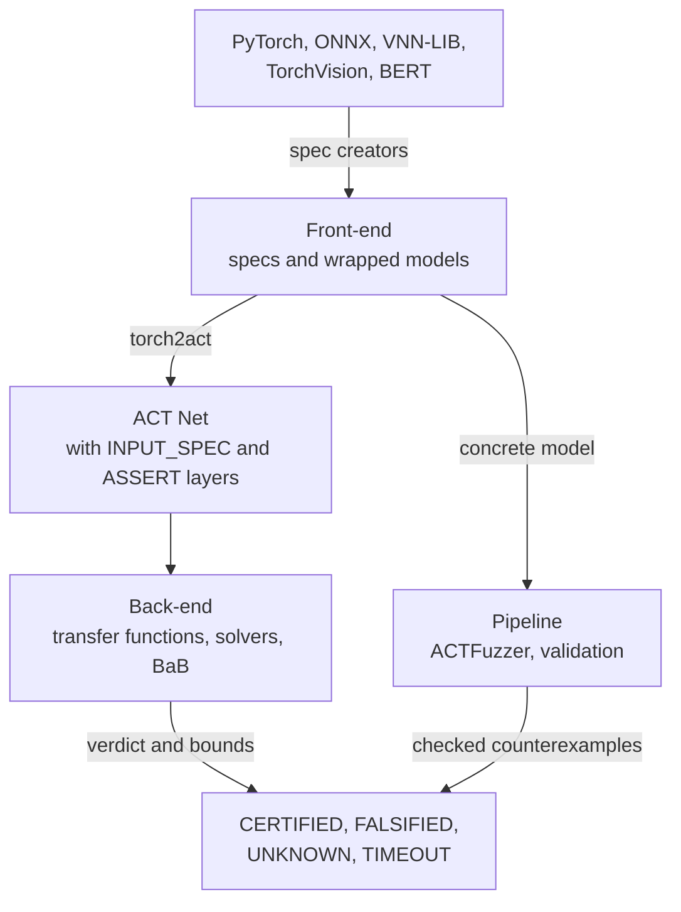

# How it works

ACT has three tiers. The front-end turns models, data and properties into verification tasks. The back-end verifies them. The pipeline connects the two and tests them.

| Tier | Owns | Command line |
| --- | --- | --- |
| **Front-end** (`act/front_end`) | Spec creators for VNN-LIB, TorchVision and BERT; input and output specifications; verifiable model wrappers; model synthesis | `python -m act.front_end` |
| **Back-end** (`act/back_end`) | The ACT Net; interval, HybridZ and dual transfer functions; solvers; single-pass verification and branch-and-bound | `python -m act.back_end` |
| **Pipeline** (`act/pipeline`) | PyTorch ↔ ACT conversion, ACTFuzzer, verifier validation, benchmark management | `python -m act.pipeline` |

---

## From a model to an ACT Net

1. **Specification.** A spec creator reads a benchmark or dataset and produces an input specification (a box, an L∞ ball or a linear polytope) and an output property (top-1 robustness, margin robustness, linear constraints, an output range or an unsafe linear region).
2. **Wrapped model.** The specification is wrapped around the network as PyTorch layers: an input layer, an input-spec layer and an output-spec layer.
3. **Conversion.** `torch2act` converts the wrapped model into an ACT Net. The specification becomes the Net's `INPUT_SPEC` and `ASSERT` layers, so verification needs no separate specification file. `act2torch` converts back, and the pipeline tests check that both directions agree.

Several properties can share one network. Model synthesis merges them into one batched Net with a row per property, and ACT verifies the rows together.

---

## Verifying an ACT Net

**Bounds.** A transfer function propagates bounds through every layer of the Net:

| Domain | Precision and cost |
| --- | --- |
| `interval` | Fastest; one lower and upper bound per neuron. |
| `hybridz` | Zonotopes; tighter bounds at higher cost. |
| `dual` | Linear-relaxation dual bounds, optionally with optimized ReLU relaxations (alpha). |

**Decision.** A solver checks the output property against the bounds. If they prove it for every input, the result is `CERTIFIED`. If the property is still open, ACT evaluates candidate inputs on the concrete model; one that violates the property gives `FALSIFIED` with that counterexample.

**Refinement.** When neither happens, branch-and-bound splits the problem into subproblems, by fixing the phase of an unstable ReLU or by splitting an input dimension, and bounds each subproblem again until every branch is decided or the budget runs out.

---

## Searching for counterexamples

ACTFuzzer runs the concrete model, not an abstraction. It mutates seed inputs inside the input specification with gradient-guided steps (FGSM/PGD style) and random perturbations, keeps inputs that reach new neuron coverage, and checks every candidate against the output property. A candidate that violates it is reported as a counterexample; fuzzing never certifies a property.

---

## Checking the verifier

Verification results are only useful if the verifier is sound. The pipeline's validation checks two levels:

1. **Soundness.** A verifier must never report `CERTIFIED` when a concrete counterexample exists.
2. **Numerical precision.** The abstract bounds of every layer must contain the concrete activations of sampled inputs.

Next: [Verification and testing](./modes).
