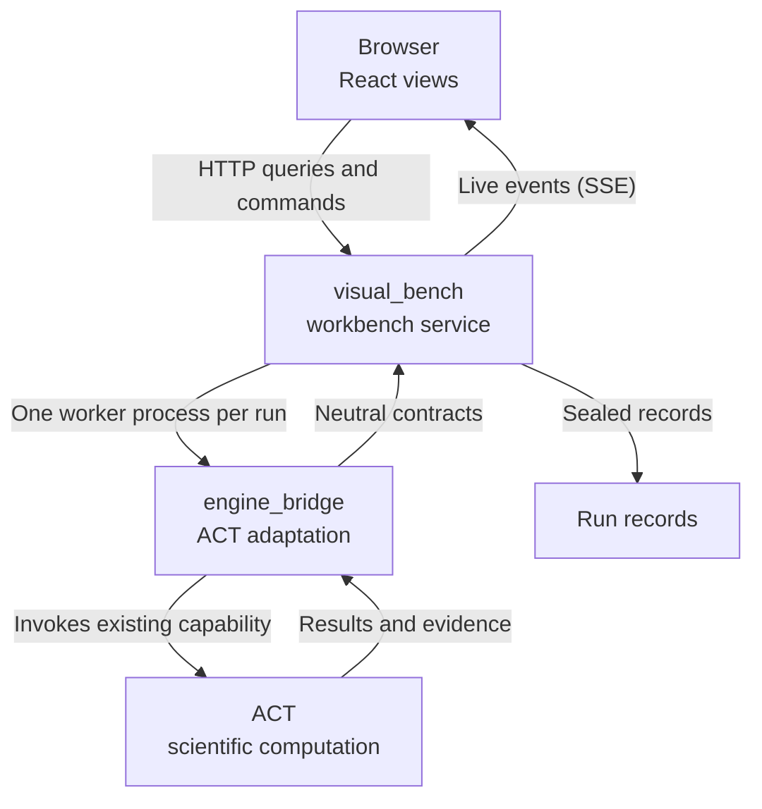

# How it works

ACT-GUI is one product split into two areas by responsibility. A separate ACT engine sits beneath them.

| Layer | Owns | Never does |
| --- | --- | --- |
| **visual_bench** | Browser views, application services, run workers, records, the assistant | Import ACT |
| **engine_bridge** | ACT version and capability checks, ACT calls, converting results to neutral data | Serve HTTP, hold UI state, schedule runs |
| **ACT** | Algorithms, bounds, verdicts | Know about the GUI |

---

## The life of a run

1. **Request.** The browser sends a run request with the model, the method and its options. A repeated request with the same client request ID returns the existing run instead of starting another.
2. **Worker.** The service starts a separate worker process for the run. The worker calls ACT through engine_bridge, so a crash or timeout cannot take down the service.
3. **Live events.** Progress, such as fuzzing frames and lifecycle changes, is committed to an ordered event log and streamed to the browser over Server-Sent Events. A reconnecting browser replays the events it missed.
4. **Sealed record.** When the run ends, its result and evidence are written as artifacts, each sealed with a sha256 hash, next to an immutable manifest. Later reads check the hashes.

---

## Capability gating

ACT changes between branches and forks. The workbench does not assume that an ACT checkout has the API a feature needs: engine_bridge checks for the ACT symbols each adapter calls. A feature the active engine lacks is disabled, and the reason is shown, instead of failing halfway through a run.

---

## Modules

The workbench is organized into fourteen modules, each with its own guide.

| Area | Modules |
| --- | --- |
| visual_bench | [workspace](/visual_bench/workspace/README), [model_spec](/visual_bench/model_spec/README), [verification](/visual_bench/verification/README), [fuzzing](/visual_bench/fuzzing/README), [engine](/visual_bench/engine/README), [analysis](/visual_bench/analysis/README), [bab](/visual_bench/bab/README), [assistant](/visual_bench/assistant/README), [records](/visual_bench/records/README) |
| engine_bridge | [engine_session](/engine_bridge/engine_session/README), [model_spec](/engine_bridge/model_spec/README), [execution](/engine_bridge/execution/README), [inspection](/engine_bridge/inspection/README), [events](/engine_bridge/events/README) |

For design decisions and invariants, see [Architecture](/docs/design).

Next: [Working modes](./modes).
