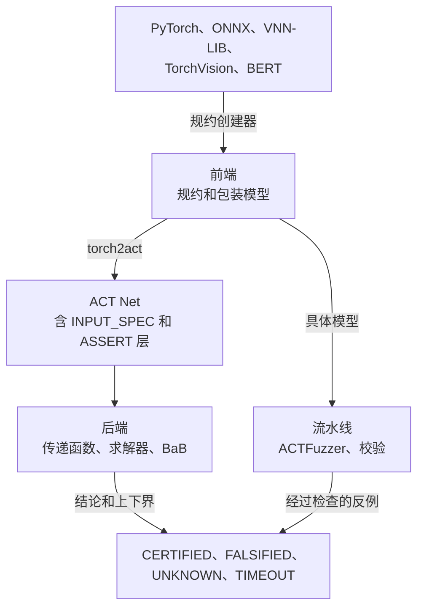

# 工作原理

ACT 分为三层。前端把模型、数据和性质变成验证任务，后端负责验证，流水线把两者连接起来并对它们做测试。

| 层 | 负责 | 命令行 |
| --- | --- | --- |
| **前端**（`act/front_end`） | VNN-LIB、TorchVision 和 BERT 的规约创建器；输入和输出规约；可验证模型包装；模型合成 | `python -m act.front_end` |
| **后端**（`act/back_end`） | ACT Net；区间、HybridZ 和对偶传递函数；求解器；单次验证和分支定界 | `python -m act.back_end` |
| **流水线**（`act/pipeline`） | PyTorch ↔ ACT 转换、ACTFuzzer、验证器校验、基准管理 | `python -m act.pipeline` |

---

## 从模型到 ACT Net {#from-a-model-to-an-act-net}

1. **规约。** 规约创建器读取基准或数据集，生成输入规约（盒、L∞ 球或线性多面体）和输出性质（top-1 鲁棒性、间隔鲁棒性、线性约束、输出范围或不安全线性区域）。
2. **包装模型。** 规约以 PyTorch 层的形式包在网络外面：一个输入层、一个输入规约层和一个输出规约层。
3. **转换。** `torch2act` 把包装后的模型转换成 ACT Net。规约变成 Net 的 `INPUT_SPEC` 层和 `ASSERT` 层，因此验证时不需要单独的规约文件。`act2torch` 负责反向转换，流水线测试会检查两个方向的结果一致。

多个性质可以共用一个网络。模型合成会把它们合并成一个批量 Net，每个性质占一行，ACT 一起验证这些行。

---

## 验证 ACT Net {#verifying-an-act-net}

**上下界。** 传递函数把上下界传播到 Net 的每一层：

| 抽象域 | 精度与代价 |
| --- | --- |
| `interval` | 最快；每个神经元一个下界和一个上界。 |
| `hybridz` | 带形（zonotope）；上下界更紧，代价更高。 |
| `dual` | 线性松弛对偶界，可选优化的 ReLU 松弛（alpha）。 |

**判定。** 求解器根据上下界检查输出性质。如果上下界证明性质对所有输入都成立，结果是 `CERTIFIED`。如果性质仍未判定，ACT 会在具体模型上评估候选输入；违反性质的候选会给出 `FALSIFIED` 和对应的反例。

**细化。** 两者都没有发生时，分支定界会把问题拆分成子问题，方法是固定一个不稳定 ReLU 的状态，或拆分一个输入维度，然后对每个子问题重新定界，直到每个分支都得到判定或预算用完。

---

## 搜索反例 {#searching-for-counterexamples}

ACTFuzzer 运行的是具体模型，而不是抽象。它在输入规约内对种子输入做变异，使用梯度引导的步长（FGSM/PGD 风格）和随机扰动，保留能达到新神经元覆盖的输入，并用输出性质检查每个候选。违反性质的候选会作为反例报告；模糊测试从不证明性质成立。

---

## 检查验证器 {#checking-the-verifier}

只有验证器可靠，验证结果才有用。流水线的校验分两个层次：

1. **可靠性。** 存在具体反例时，验证器绝不能报告 `CERTIFIED`。
2. **数值精度。** 对于采样的输入，每一层的抽象上下界都必须包含具体激活值。

下一步：[验证与测试](./modes)。
