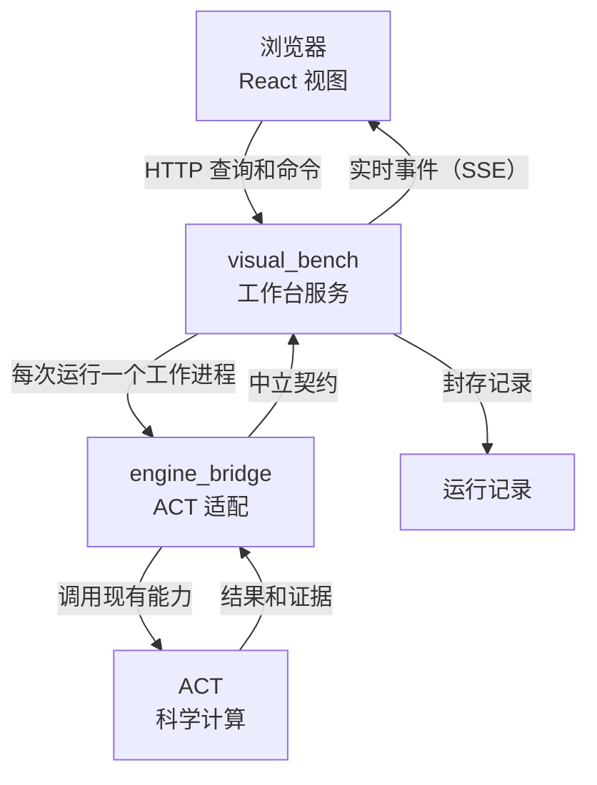

# 工作原理

ACT-GUI 是一个按职责划分为两个区域的产品，底层连接独立的 ACT 引擎。

| 层 | 负责内容 | 不负责内容 |
| --- | --- | --- |
| **visual_bench** | 浏览器视图、应用服务、运行工作进程、记录和助手 | 导入 ACT |
| **engine_bridge** | ACT 版本和能力检查、ACT 调用、将结果转换为中立数据 | 提供 HTTP、保存 UI 状态、调度运行 |
| **ACT** | 算法、上下界和结论 | 了解 GUI |

---

## 一次运行的生命周期

1. **请求。** 浏览器发送包含模型、方法及其选项的运行请求。使用相同客户端请求 ID 的重复请求会返回已有运行，而不是再次启动。
2. **工作进程。** 服务为该运行启动独立工作进程。工作进程通过 engine_bridge 调用 ACT，因此崩溃或超时不会拖垮服务。
3. **实时事件。** 模糊测试帧和生命周期变化等进度会写入有序事件日志，并通过 Server-Sent Events 传给浏览器。重新连接的浏览器会重放错过的事件。
4. **封存记录。** 运行结束后，结果和证据写入工件，每个工件都用 sha256 哈希封存，并与不可变清单放在一起。之后读取时会检查哈希。

---

## 能力门控

不同分支和派生仓库中的 ACT 可能不同。工作台不会假定 ACT 代码库拥有某项功能所需的 API，engine_bridge 会检查每个适配器调用的 ACT 符号。如果当前引擎缺少某项功能，该功能会被禁用并显示原因，而不是在运行中途失败。

---

## 模块

工作台由十四个模块组成，每个模块都有自己的指南。

| 区域 | 模块 |
| --- | --- |
| visual_bench | [workspace](/visual_bench/workspace/README)、[model_spec](/visual_bench/model_spec/README)、[verification](/visual_bench/verification/README)、[fuzzing](/visual_bench/fuzzing/README)、[engine](/visual_bench/engine/README)、[analysis](/visual_bench/analysis/README)、[bab](/visual_bench/bab/README)、[assistant](/visual_bench/assistant/README)、[records](/visual_bench/records/README) |
| engine_bridge | [engine_session](/engine_bridge/engine_session/README)、[model_spec](/engine_bridge/model_spec/README)、[execution](/engine_bridge/execution/README)、[inspection](/engine_bridge/inspection/README)、[events](/engine_bridge/events/README) |

设计决策和不变量请参阅[架构](/docs/design)。

下一步：[工作模式](./modes)。
