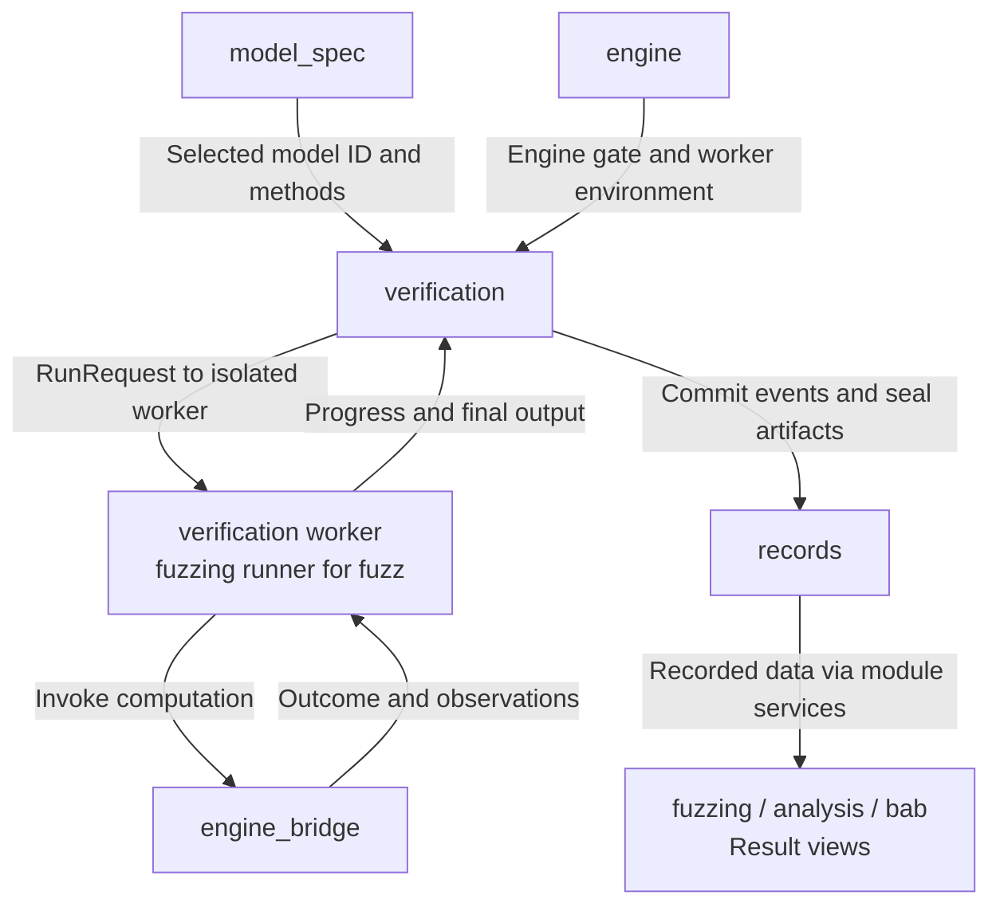
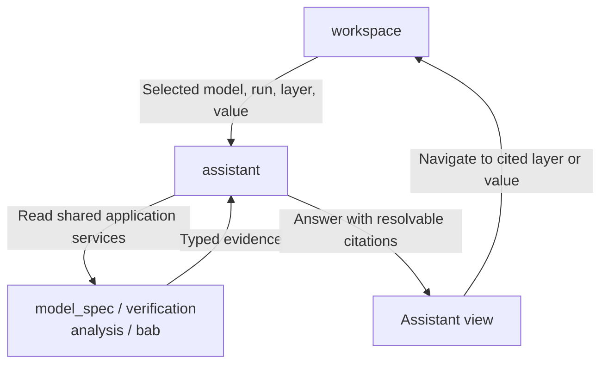

# Visual Bench: Developer Map

[Project task chooser](../README.md#choose-a-development-task) → **workbench collaboration** → a module's Change Guide.

This scope owns interaction, application services, run workers, and records. ACT-specific loading, computation, and result adaptation belong to [engine_bridge](../engine_bridge/README.md). The browser and service are parts of the same product, not separate feature owners.

## Change Guide

Choose the owner of the behavior, then follow the linked module guide for files and tests. The nine module names below are the stable names used by the diagrams.

| Goal / module | Current responsibility and entry guide | Neighbor handoff |
| --- | --- | --- |
| **workspace** | [Selection, modes, layout, theme, tour](workspace/README.md#change-guide) | Passes selection to views; no HTTP service of its own. |
| **model_spec** | [Load models and inspect graph/spec/input images](model_spec/README.md#change-guide) | Provides model ID, verified path, supported methods to verification; source adaptation goes through bridge model_spec. |
| **verification** | [Start/stop runs, supervise workers, expose lifecycle/SSE](verification/README.md#change-guide) | Accepts RunRequest; returns run_id/RunOut; persists results through records. |
| **fuzzing** | [Options, live images, saved counterexamples and export](fuzzing/README.md#change-guide) | Uses verification lifecycle; provides runner.py and FuzzLive; serves FuzzingOut. |
| **engine** | [ACT status and Gurobi license management](engine/README.md#change-guide) | Model loading/runs use its engine gate; workers inherit license environment. |
| **analysis** | [Recorded layer bounds and interval-box views](analysis/README.md#change-guide) | Reads run status and sealed layers.json; new scientific data requires bridge inspection. |
| **bab** | [Observation coverage and final BaB summary](bab/README.md#change-guide) | Reads RunOut and bridge events coverage; no node tree/control path exists yet. |
| **assistant** | [Frozen context, typed evidence, fake-provider answers](assistant/README.md#change-guide) | Reads the same model/run/analysis/BaB services as HTTP; navigates through workspace. |
| **records** | [Artifacts, event log, integrity, annotations, zip export](records/README.md#change-guide) | Feature modules supply content; RecordStore persists it without deciding scientific meaning. |

## Flow Diagram

These are feature-level handoffs, not an import inventory or a mandatory edit list. Each named module expands into files and contracts in its own guide. Labeled arrows distinguish a request from produced data.

### Start a run and consume its results




| Handoff | Implementation / contract | Where to continue |
| --- | --- | --- |
| Model choice → run | [ModelService](model_spec/service.py), [RunRequest](verification/schemas.py); verification validates the pinned model path and allowed method | [Model loading](model_spec/README.md#flow-diagram), [run lifecycle](verification/README.md#flow-diagram) |
| Run → computation | [worker.py](verification/worker.py) dispatches verification or [fuzzing/runner.py](fuzzing/runner.py); only the bridge invokes ACT | [Execution bridge](../engine_bridge/execution/README.md#flow-diagram) |
| Worker → recorded result | [RunService](verification/service.py) receives progress, writes result/layers/fuzzing artifacts, seals them, then commits completion | [Records](records/README.md#flow-diagram) |
| Result → page | Feature services project records; hooks fetch them. [verification/hooks.ts](verification/hooks.ts) follows SSE and invalidates run-scoped query keys | [Fuzz live/recorded paths](fuzzing/README.md#flow-diagram), [analysis](analysis/README.md#flow-diagram), [BaB](bab/README.md#flow-diagram) |

Live fuzz frames are an exception to the stored-data route: the supervisor forwards them to FuzzLive in memory; the fuzzing query combines that state with committed progress. The completed fuzzing artifact is the durable result. Follow the fuzzing guide before adding a live metric.

### Inspect evidence and navigate




The assistant uses [explain.py](assistant/explain.py), not a second API or direct ACT access. Pure selection and navigation remain in [workspace](workspace/README.md#flow-diagram).

## Decide the Edit Scope

| Intended change | Usually edit | Inspect, but do not change automatically |
| --- | --- | --- |
| Restyle or rearrange existing data | Owning view and relevant CSS; workspace only for shared layout/selection | Server, routes, bridge, records |
| Add a wire field | Owning schemas/service, relevant view, generated wire.ts; API/hook only if access changes | Shared HTTP transport and run supervisor |
| Add an ACT input/output | Owning bridge adapter/contracts, feature mapping/schema/view | Generic scheduling, storage, SSE transport when existing contracts suffice |
| Change lifecycle or persistence guarantees | verification or records plus the affected callers' tests | Every feature view; bridge algorithms remain ACT-owned |
| Add a new module dependency | Service constructor and [workbench.py](workbench.py); browser composition if needed | Unrelated module internals |

The wire contract is owned by module Pydantic schemas. Run `npm run gen:types` after a schema change; generated browser types are an output, not another handwritten source.

## Validation

Start with the selected module's **Validation** section: it names the focused tests and observable user result. Cross-module changes must verify the complete use case, including failure/missing-data states and the return path to the page.

Broader checks from the repository root:


```bash
.venv/bin/python -m pytest visual_bench
npm test
npm run typecheck
npm run check:types
```

These are commands to run, not a claim that a new test run occurred. ACT-backed cases need the pinned checkout and environment; fake-provider tests do not validate a real AI provider.

## Reference

<details>
<summary>Composition roots, shared layers, and dependency rules</summary>

### Root Files

| File | Responsibility |
| --- | --- |
| [server.py](server.py) | FastAPI app, error rendering, /api/health, router inclusion, production assets. |
| [workbench.py](workbench.py) | Constructs module services and injects collaborators; HTTP and assistant share instances. |
| [schemas.py](schemas.py) | Re-exports module schemas and lists WIRE_MODELS for generation. |
| [wire.py](wire.py), [errors.py](errors.py), [config.py](config.py) | Wire primitives, application errors, paths/settings. |
| [app.tsx](app.tsx), [main.tsx](main.tsx) | Browser composition, shared selection, QueryClientProvider. |
| [generated/wire.ts](generated/wire.ts) | Generated browser wire types. |
| [conftest.py](conftest.py), [testing.py](testing.py) | Shared service test fixtures and helpers. |

### Shared Browser Layer

[shared/http.ts](shared/http.ts) owns HTTP and SSE transport. [shared/queryClient.ts](shared/queryClient.ts) owns the QueryClient and key factory: run projections sit under the run key so committed events invalidate related data. [shared/wire.ts](shared/wire.ts) contains formatting helpers; shared/ui contains reusable UI primitives. Shared code imports no feature module.

### Module Slice and Boundaries

A data-serving module normally has schemas.py, service.py, routes.py, api.ts, hooks.ts, views, and nearby tests. Exceptions reflect actual responsibilities: workspace is browser-only; assistant uses explain.py; records uses store.py. The module's file inventory is authoritative.

Views obtain server data through hooks, not direct fetch calls. Services receive collaborators through constructors, not another module's routes. Composition roots may assemble views from several modules. AI explanations never override ACT verdicts. Workers belong to verification; ACT integration belongs to engine_bridge.

### Ownership and Future Work

C owns interaction/product consistency; B owns application services and AI orchestration; D, when available, owns analysis/visualization and test integration. A reviews scientific semantics. Module task tables retain detailed acceptance evidence and future interfaces; [plan.md](../docs/plan.md) owns cross-module integration order. Node-level BaB, advanced geometry, real providers and authorized AI plans remain future work, not current service capabilities.

Extract deeper modules only when ownership or implementation complexity requires it. Keep cross-module decisions in [design.md](../docs/design.md), and feature-specific details in the owning README.

</details>
