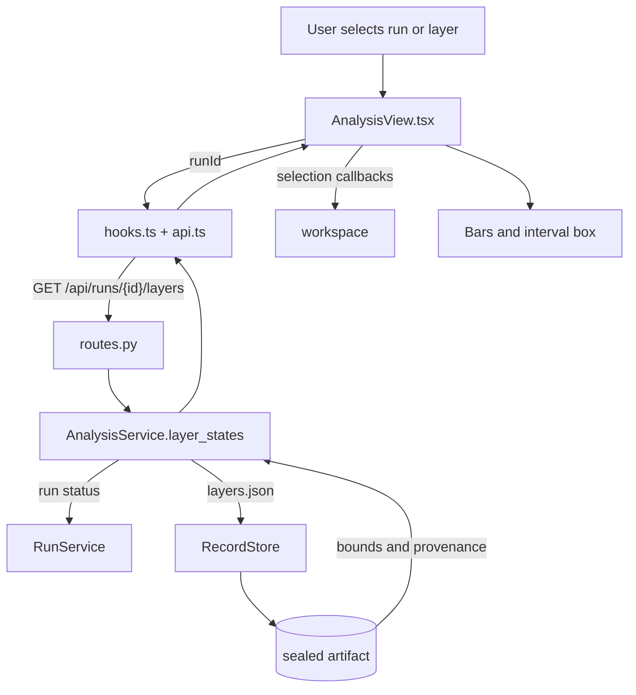

# Analysis and Propagation

Current responsibility: show recorded layer-wise interval states for a completed run and let the user move through layers, compare before and after bars, select values, and inspect a two-coordinate interval box. The first slice is implemented. `AnalysisService` reads a sealed `layers.json` artifact. ANA-03, recorded playback and evidence navigation, is not started. This module does not step ACT, compute new projections in the browser, or control BaB. See the [parent scope](../README.md), [repository rules](../../AGENTS.md), and the [development task guide](../../README.md#choose-a-development-task).

## Change Guide

| Goal | Edit here | Conditional / reused path |
| --- | --- | --- |
| Change bars, stepper, or existing interval-box presentation | [AnalysisView.tsx](AnalysisView.tsx) | Reuse [hooks.ts](hooks.ts) and workspace callbacks; no new ACT call or storage change. |
| Expose another field already in layers.json | [service.py](service.py), [schemas.py](schemas.py), consuming view; generate wire types | [routes.py](routes.py), [api.ts](api.ts), [hooks.ts](hooks.ts) only if endpoint/arguments/cache behavior change. |
| Collect data missing from the artifact | Start in [bridge inspection](../../engine_bridge/inspection/README.md#change-guide), then update worker/output mapping and this service/view | [verification](../verification/README.md#change-guide) owns sealing, [records](../records/README.md#change-guide) owns integrity. Do not change either merely to draw an existing field. |
| Change pending/missing-data behavior | [service.py](service.py), view, focused route tests | Corrupt records are errors, not fabricated empty bounds. Keep failed/missing data distinct from active runs. |

After schema changes, run `npm run gen:types`. Advanced geometry and recorded playback remain ANA-02/03 work; the current interval box is not a new scientific projection.

## Flow Diagram



| Block | Implementation and contract |
| --- | --- |
| Query | `useLayers` in [hooks.ts](hooks.ts), using `keys.layers`. The query is bound to the selected run. |
| HTTP | `layers` in [routes.py](routes.py), `GET /api/runs/{run_id}/layers`. |
| Service | `AnalysisService.layer_states` in [service.py](service.py). It refuses to invent data before completion or when the sealed artifact is absent or invalid. |
| Artifact | `RecordStore.artifact(run_id, "layers.json")`. Hash validation is required before the payload reaches the view. |
| View | `AnalysisView` and `LayerBounds` in [AnalysisView.tsx](AnalysisView.tsx). Before means the predecessor's after state. The projection is the ACT interval box, not tighter geometry. |
| Neighbor handoff | `workspace` owns layer and neuron selection. `verification` owns run lifecycle. `records` owns sealed reads. `assistant` may request the same service for evidence. See the [parent flow diagram](../README.md#flow-diagram). |

## Validation

The service also exposes propagation observations during a run and after sealing:

| Route | Wire model | Meaning |
| --- | --- | --- |
| `GET /api/runs/{run_id}/propagation` | `PropagationIndexOut` | `run_id`, `domain`, `availability` (`available`, `pending`, `unavailable`, `not_recorded`), `complete`, `phases`, `records`, `layers`, `ignored_records`, `value_limit`. |
| `GET /api/runs/{run_id}/propagation/layers/{layer_id}?scope=root&pass_=&stage=&version=&fields=&neuron=` | `PropagationLayerOut` | `run_id`, `layer_id`, `domain`, `availability`, `output_shape`, `records`, `value_limit`, `neuron`; optional filters select an exact pass/stage/version. Without version, selects the latest record independently per kind/pass/stage. `fields` (comma-separated tensor names) keeps only those tensors; `neuron` slices every tensor indexed by this layer's neurons to that neuron (the neuron axis stays with size 1; tensors such as spec margins are returned whole). The neuron map requests `fields=lb,ub,status` and the detail panel `neuron=i`, so conv layers stay within `value_limit`. |

An index entry (`PropagationRecordOut`) has `record_id` (shared monotonic order across phases and
records), `kind`, `key`, `t_ms`, `layer_kind`, `shape`, `output_shape`, `tensors`, `counts`, and `metadata`.
The key preserves `scope`, `parent`, `domain`, `pass_`, `layer_id`, `stage`, `version`, and `origin`;
phase entries have a null key. Each tensor reference has `sha256`, `dtype: float32`, and its complete
`shape`, including batch lane and alpha spec-row dimensions. `output_shape` describes layer output
axes for neuron-to-channel/row/column mapping. Counts contain `n_active`, `n_inactive`, `n_unstable`
for relaxation records. Metadata contains `form`, `alpha_optimized`, `iterations`, `stop_reason`,
`changed`, or phase `phase`/`status` as appropriate. No source name is invented if ACT omits it.

Layer summaries (`PropagationLayerSummaryOut`) contain `key`, `layer_kind`, `output_shape`,
`latest_record_id`, `record_count`, and the latest relaxation `counts` for each scope/domain/pass/layer/stage.
Layer-detail records add `values`, a dictionary of full flattened arrays: `lb`, `ub`, `status`,
`lower_slope`, `lower_intercept`, `upper_slope`, `upper_intercept`, `alpha`, optional `nu`,
`margins`, `slack`, and tensor-valued extras named `extra.<name>`. Reshape each array using its own
tensor reference. ACT status is 1 active, 0 inactive, -1 unstable; alpha retains every spec row.
Missing tensors are absent keys. Non-finite values use `"Infinity"`, `"-Infinity"`, `"NaN"`.
Responses exceeding 65536 total selected scalar values return HTTP 413 `too_large`; nothing is
silently truncated. Missing selections return `not_recorded`. Corrupt indices/blobs return HTTP 409
`record_corrupt`. Completed reads require sealed artifacts; active/failed partial reads remain explicit.

`verify.propagation` SSE events carry an index entry without values. Events are notifications, not
the full replay history: read `records` plus `phases` and order by `record_id` for complete replay.
The producer publishes its atomic index before sending an event. `LayerStatesOut.method` records the
actual domain when observation is available, and `LayerStateOut.stage` permits `pre` for dual bounds.
The legacy `/layers` route remains available.

Focused tests:

```bash
.venv/bin/python -m pytest visual_bench/analysis/test_propagation.py
ACT_CODE_ROOT=/data1/guanqin/ACT-wt/act-gui-match .venv/bin/python -m pytest engine_bridge/inspection/test_propagation.py visual_bench/verification/test_propagation.py
```

For native service tests, also select that checkout through an isolated `ACT_GUI_ENGINES/active.json`;
EngineService restores its persisted source and otherwise clears `ACT_CODE_ROOT`. See the exact
validation invocation and results in [verification](../verification/README.md#validation).

Run the relevant service and bridge tests:

```bash
.venv/bin/python -m pytest visual_bench/verification/test_verification.py
.venv/bin/python -m pytest engine_bridge/inspection/test_inspection.py
npm test
```

Observable behavior: no run shows a no-run state, an active run shows pending data, a missing artifact shows not recorded, a corrupt/unsealed completed record raises an integrity error, and a completed sealed run shows the stepper, before and after bars, selected values, and the labeled interval box. These are validation instructions, not a new test result.

## Reference and Backlog

<details>
<summary>Current files and routes</summary>

## Current Files and Routes

| File | Responsibility |
| --- | --- |
| [schemas.py](schemas.py) | Legacy `LayerStatesOut`/`LayerStateOut`, propagation index/detail models, tensor references, keys, and layer summaries. |
| [service.py](service.py) | `AnalysisService.layer_states`, `propagation`, `propagation_layer`; legacy sealed bounds, atomic live propagation, sealed completed propagation, exact version filters and explicit size/integrity errors. |
| [routes.py](routes.py) | `GET /api/runs/{run_id}/layers`, `/propagation`, `/propagation/layers/{layer_id}`. |
| [test_propagation.py](test_propagation.py) | Synthetic producer/store/API tests, separate from native worker integration in `../verification/test_propagation.py`. |
| [api.ts](api.ts) | Generated-type clients for legacy layers, propagation index and scope/pass/stage/version-specific tensors. |
| [hooks.ts](hooks.ts) | `useLayers`, `usePropagation`, `usePropagationRecords`; run-prefixed TanStack keys invalidated by committed SSE events. |
| [AnalysisView.tsx](AnalysisView.tsx) | Verification integration; propagation when recorded, explicitly labeled legacy fallback otherwise. |
| [PropagationView.tsx](PropagationView.tsx) | Block DAG, live/replay cursor, per-layer unstable-share history, input-bound images and right-inspector composition. |
| [PropagationContext.tsx](PropagationContext.tsx) | Run-local replay cursor, pass, lane and responsive inspection level (no second server-data cache). |
| [NeuronMap.tsx](NeuronMap.tsx) | Dense canvas / convolution channel maps, bounded binning, zoom and keyboard/index selection. |
| [NeuronDetail.tsx](NeuronDetail.tsx) | Recorded pre/post bounds, domain relaxation and per-specification-row dual alpha. |
| [propagation.ts](propagation.ts), [propagation.test.ts](propagation.test.ts) | Pure block grouping, status mapping, full-coverage binning, historical identity selection and lane/spec tensor indexing tests. |
| [propagation.css](propagation.css), [DESIGN.md](DESIGN.md) | Existing-token styling, responsive layout contract and evidence ledger. |
| [../verification/test_verification.py](../verification/test_verification.py) | Route and run lifecycle coverage, including BaB and domain runs. |
| [../../engine_bridge/inspection/test_inspection.py](../../engine_bridge/inspection/test_inspection.py) | Bridge parity for recorded inspection data. |


</details>

<details>
<summary>Task acceptance, rationale, and planned capabilities</summary>

## Tasks and Acceptance

| ID | Deliverable | Depends on | Completion evidence |
| --- | --- | --- | --- |
| ANA-01 | Deliver manual real-data propagation | INSP-01, VER-02, WS-02 | For a small real model, navigate input to output; every stage agrees with ACT before/after values and tensor IDs; missing stages are explicit. |
| ANA-02 | Add geometry, coordinate selection, and comparison | ANA-01, INSP-02 | Two selected coordinates render their declared representation; samples are distinct; incompatible axes disable misleading comparisons. |
| ANA-03 | Add recorded playback and evidence navigation | ANA-02, INSP-03, REC-03 | Playback does not invoke solver stepping; a missing historical stage pauses/skips explicitly; AI evidence selects the exact recorded stage. |
| ANA-04 | Show propagation dynamics live and in replay | ANA-01, VER-13 | During a run the network DAG highlights the layer being evaluated, marks revisits, and colors layers by bound width; a per-layer width/unstable-neuron chart grows with each step; image inputs show lb/ub images per step. After the run the same view replays `propagation.json` with play/pause/scrub at real or normalized timing. Values shown equal the recorded steps. |
| ANA-05 | Drill down network -> layer -> neuron with the run's over-approximation | ANA-04, INSP-05 | Level 1 (block network): layers grouped into blocks (ACT layer source names when present, else affine+activation patterns), each layer with a thin stacked bar of active/inactive/unstable share; click a layer. Level 2 (neuron map): a canvas grid (dense) or channel x H x W small multiples (conv), stable active, stable inactive and unstable in clearly different colors; dual runs switch between forward bounds and backward data (alpha on unstable neurons) with the pass always labeled; above ~4k cells it bins and zooms instead of drawing every cell. Level 3 (neuron detail in the right inspector): pre/post bounds, the ReLU curve with this run's relaxation, and for dual the alpha per spec row. Space: DAG column about 25-30% width, neuron map in the main area, detail in the inspector; under 900 px a breadcrumb (Network > Layer > Neuron) shows one level at a time. Cross-domain comparison is out of scope. Checked by screenshots at desktop and 390 px widths. |

Current status: ANA-01 has legacy recorded layer states. ANA-02 remains limited to the interval-box projection. ANA-04/05 now have browser live/replay and neuron inspection, with limitations and browser evidence below. ANA-03's broader evidence-navigation contract is still planned.


Build stage view models from ACT data and keep scientific transformations out of renderers. Query keys should include run, node, revision, layer, projection, and method as those dimensions become available. A future geometry adapter must label coordinates, representation, and guarantee. Samples are not sound outer approximations. The final verdict always comes from ACT.

Planned operations include `listStages`, `loadStage`, `buildStageView`, `compareStages`, and `advancePlayback`. They are design targets, not current APIs. The current implementation has `AnalysisService.layer_states` and `AnalysisView`.

Owner: D. With three contributors, C implements views, B integrates data, and A reviews numerical semantics. On completion, record real samples, exact commands and results, and unverified items.

</details>

## Browser propagation implementation and evidence (2026-11-05)

Verification uses the existing mode and right inspector's **Neuron** tab. The DAG
groups affine/activation chains because the current model contract has no ACT
source names. Stability bars use recorded counts; the map uses recorded status or
recorded pre-bounds, never post-ReLU zeros. Unknown status is explicit.

Live queries share the existing SSE run-prefix invalidation. Replay selects exact
record IDs and fetches their scope/pass/stage/version; play/pause never invokes ACT.
Forward bounds remain readable even when a backward tensor request exceeds the
65,536-value service limit. The backward error is shown, not silently sampled.
Convolution channels use output geometry; at most sixteen channels appear per
page, with at most 4,096 drawn cells before bin/zoom. Every neuron remains directly
selectable by index. Batch lanes and dual specification rows retain ACT ordering.

Real browser checks used ACT `3a93f4a89690`, CPU, Chrome on Linux:

- `bab_deep_mlp`: interval `run-7e13bf51d228`, dual `run-fa4683cbd25a`.
- Catalog MNIST convolution files failed with `Unsupported ACT metadata tag
  'LabeledInputTensor'`; rebuilding through the current ACT produced
  `torch-6714fbc47cdc` (MNIST conv-small, image 0, epsilon 0.05).
- Rebuilt convolution: interval `run-75f005224c07`, dual `run-16c2452462d3`.
  Layer 5, neuron 30, specification row 2 rendered alpha `0.09533`, matching the
  recorded float32 value `0.09532640874385834`.
- Real dual layer 3 backward selection contains 86,528 scalars; the UI shows the
  server's 65,536 limit error. Its forward map remains available.
- Replay advanced from step 1 to step 2 and paused through the rendered controls.
- A fresh convolution dual run started through **Run ACT** displayed live phase
  records, then highlighted layer 7 during its forward pass (version 1).
- Captures are in `.omo/evidence/propagation/`: desktop 1440, mobile 390 CSS px,
  light/dark, network/layer/neuron levels, convolution maps, input bounds, alpha,
  and the explicit size-limit error. No mocked API or fixture harness was used.

Checks run: `npm run typecheck` (exit 0), `npm test` (6 files, 23 tests passed),
`npm run build` (exit 0). Draft guard passed the four new visual files.
The detect SDK's desktop snapshot reported existing shell contrast/density and
decoration findings; no finding mapped to the selected propagation/detail region.
This is not a claim of whole-app WCAG conformance. Full visual acceptance is owned
by the integrating parent session. Batch-lane and >4k binning logic have unit
coverage; those large/batched states are not claimed as browser-verified here.
