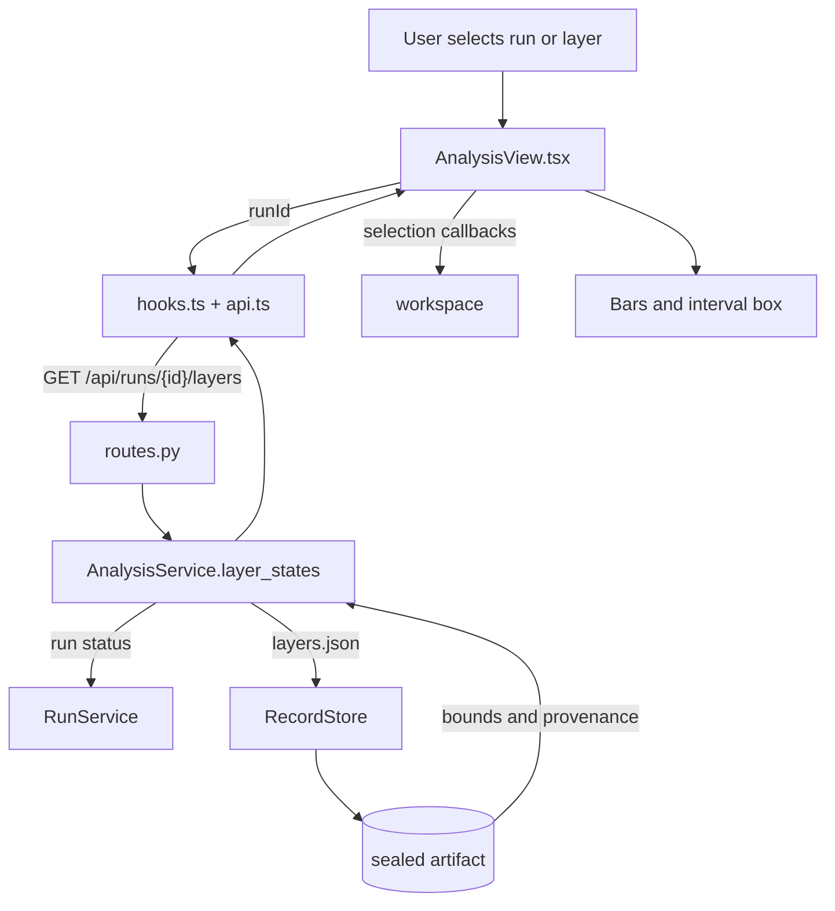

# Analysis and Propagation

Current responsibility: show recorded layer-wise interval states for a completed run and let the user move through layers, compare before and after bars, select values, and inspect a two-coordinate interval box. The first slice is implemented. `AnalysisService` reads a sealed `layers.json` artifact. ANA-03, recorded playback and evidence navigation, is not started. This module does not step ACT, compute new projections in the browser, or control BaB. See the [parent scope](../README.md), [repository rules](../../AGENTS.md), and the [development task guide](../../README.md#choose-a-development-task).

## Change Guide

| Goal | Edit here | Conditional / reused path |
| --- | --- | --- |
| Change bars, stepper, or existing interval-box presentation | [AnalysisView.tsx](AnalysisView.tsx) | Reuse [hooks.ts](hooks.ts) and workspace callbacks; no new ACT call or storage change. |
| Expose another field already in layers.json | [service.py](service.py), [schemas.py](schemas.py), consuming view; generate wire types | [routes.py](routes.py), [api.ts](api.ts), [hooks.ts](hooks.ts) only if endpoint/arguments/cache behavior change. |
| Collect data missing from the artifact | Start in [bridge inspection](../../engine_bridge/inspection/README.md#change-guide), then update worker/output mapping and this service/view | [verification](../verification/README.md#change-guide) owns sealing, [records](../records/README.md#change-guide) owns integrity. Do not change either merely to draw an existing field. |
| Change pending/missing-data behavior | [service.py](service.py), view, focused route tests | Corrupt records are errors, not fabricated empty bounds. Keep failed/missing data distinct from active runs. |

After schema changes, run `npm run gen:types`. Advanced geometry and recorded playback remain ANA-02/03 work; the current interval box is not a new scientific projection.

## Flow Diagram



| Block | Implementation and contract |
| --- | --- |
| Query | `useLayers` in [hooks.ts](hooks.ts), using `keys.layers`. The query is bound to the selected run. |
| HTTP | `layers` in [routes.py](routes.py), `GET /api/runs/{run_id}/layers`. |
| Service | `AnalysisService.layer_states` in [service.py](service.py). It refuses to invent data before completion or when the sealed artifact is absent or invalid. |
| Artifact | `RecordStore.artifact(run_id, "layers.json")`. Hash validation is required before the payload reaches the view. |
| View | `AnalysisView` and `LayerBounds` in [AnalysisView.tsx](AnalysisView.tsx). Before means the predecessor's after state. The projection is the ACT interval box, not tighter geometry. |
| Neighbor handoff | `workspace` owns layer and neuron selection. `verification` owns run lifecycle. `records` owns sealed reads. `assistant` may request the same service for evidence. See the [parent flow diagram](../README.md#flow-diagram). |

## Validation

Run the relevant service and bridge tests:

```bash
.venv/bin/python -m pytest visual_bench/verification/test_verification.py
.venv/bin/python -m pytest engine_bridge/inspection/test_inspection.py
npm test
```

Observable behavior: no run shows a no-run state, an active run shows pending data, a missing artifact shows not recorded, a corrupt/unsealed completed record raises an integrity error, and a completed sealed run shows the stepper, before and after bars, selected values, and the labeled interval box. These are validation instructions, not a new test result.

## Reference and Backlog

<details>
<summary>Current files and routes</summary>

## Current Files and Routes

| File | Responsibility |
| --- | --- |
| [schemas.py](schemas.py) | `LayerStatesOut` and `LayerStateOut` wire payloads. |
| [service.py](service.py) | `AnalysisService.layer_states(run_id)`. Reads sealed `layers.json` only after the run is complete, and returns `pending`, `not_recorded`, or available data with provenance. |
| [routes.py](routes.py) | `GET /api/runs/{run_id}/layers`. |
| [api.ts](api.ts) | Calls the layer-state endpoint. |
| [hooks.ts](hooks.ts) | `useLayers`, keyed by `keys.layers(runId)`. |
| [AnalysisView.tsx](AnalysisView.tsx) | Layer stepper, before and after bars, value selection, and interval-box projection in Verification mode. |
| [../verification/test_verification.py](../verification/test_verification.py) | Route and run lifecycle coverage, including BaB and domain runs. |
| [../../engine_bridge/inspection/test_inspection.py](../../engine_bridge/inspection/test_inspection.py) | Bridge parity for recorded inspection data. |


</details>

<details>
<summary>Task acceptance, rationale, and planned capabilities</summary>

## Tasks and Acceptance

| ID | Deliverable | Depends on | Completion evidence |
| --- | --- | --- | --- |
| ANA-01 | Deliver manual real-data propagation | INSP-01, VER-02, WS-02 | For a small real model, navigate input to output; every stage agrees with ACT before/after values and tensor IDs; missing stages are explicit. |
| ANA-02 | Add geometry, coordinate selection, and comparison | ANA-01, INSP-02 | Two selected coordinates render their declared representation; samples are distinct; incompatible axes disable misleading comparisons. |
| ANA-03 | Add recorded playback and evidence navigation | ANA-02, INSP-03, REC-03 | Playback does not invoke solver stepping; a missing historical stage pauses/skips explicitly; AI evidence selects the exact recorded stage. |

Current status: ANA-01 is implemented for recorded interval states. ANA-02 is limited to the interval-box projection. ANA-03 is planned.


Build stage view models from ACT data and keep scientific transformations out of renderers. Query keys should include run, node, revision, layer, projection, and method as those dimensions become available. A future geometry adapter must label coordinates, representation, and guarantee. Samples are not sound outer approximations. The final verdict always comes from ACT.

Planned operations include `listStages`, `loadStage`, `buildStageView`, `compareStages`, and `advancePlayback`. They are design targets, not current APIs. The current implementation has `AnalysisService.layer_states` and `AnalysisView`.

Owner: D. With three contributors, C implements views, B integrates data, and A reviews numerical semantics. On completion, record real samples, exact commands and results, and unverified items.

</details>
