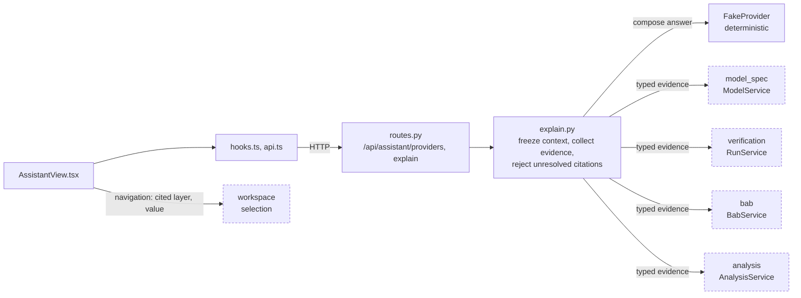

# AI Assistant

**Status:** first version: `explain.py`, `AssistantView.tsx` (AI-01 with a deterministic fake provider); no real provider (AI-02), AI-03/04 not started. **Owner:** B owns orchestration; C owns interaction; A reviews scientific explanations.
Follow the [repository rules](../../AGENTS.md) and [parent scope](../README.md).

## Current Files and Usage

| File | Layer | Responsibility |
| --- | --- | --- |
| `schemas.py` | Wire | `SelectionContext`, `ExplainRequest`, `ExplainResponse`, `EvidenceRef`, `AnswerSection`, `ProviderList`. |
| `explain.py` | Service | Freeze context, collect typed evidence through the same module services the routes use (`wb.models`, `wb.runs`, `wb.bab`, `wb.analysis`), compose with a provider, reject unresolved citations. Deterministic `FakeProvider` only. |
| `routes.py` | HTTP | `GET /api/assistant/providers`, `POST /api/assistant/explain`. |
| `api.ts`, `hooks.ts` | Browser data | Providers query, explain mutation. |
| `AssistantView.tsx` | View | Question, sections with evidence, navigation to the cited layer/value. |
| `test_assistant.py` | Tests | Resolvable citations, frozen context, ACT verdict passthrough, context mismatch. |

Run this module's tests: `.venv/bin/python -m pytest visual_bench/assistant`.

## Flow Diagram

Arrows point from caller to callee and are labeled with what flows. Dashed nodes belong to other modules and use the same names as the [parent diagram](../README.md#flow-diagram); every edge to a dashed node also appears there. The assistant reaches other modules only through the same services the routes use.

## 1. Subproblems and Objective

Use workbench context and ACT evidence to explain problems, propose plans, and call shared application use cases.

| Subproblem | Responsibility |
| --- | --- |
| Context | Freeze run/node/layer/revision and coverage when a request starts; select only task-relevant data. |
| Explanation | Separate observations, interpretations, and hypotheses. Evidence references must resolve to the correct version. |
| Plans and tools | Typed steps, preconditions/budgets, visible parameters; distinguish navigation from engine mutations. |
| Provider integration | Run providers in the service with bounded retries/time/use, and handle unconfigured or unavailable providers. |

## 2. Scope and Non-goals

Own the behavior above and its failure/availability states. Deliver it incrementally using the sequence below; the full scope is not a first-slice requirement.

Does not override ACT verdicts, import ACT directly, write engine state into records directly, or provide arbitrary code execution by default.

## 3. Inputs, Outputs, and State

- **Inputs:** Frozen SelectionContext, question, authorized tool scope, real query results, and provider configuration.
- **Outputs:** Answers/evidence, plans, navigation, shared query/command requests, and AI action records.
- State, absence, and scientific semantics follow the [architecture](../../docs/design.md). Type names here describe intended contracts, not existing APIs.

## 4. Design Patterns and Rationale

**Provider and tool adapters.** Inject small provider/tool interfaces. Start with one provider and one orchestration flow.

**Bounded plan state machine.** Fix plan version, execution scope, and stopping conditions. Model retries cannot reapply completed actions.

**Evidence references.** Cite actual artifacts/fields rather than relying on a textual claim of provenance.

Use small interfaces, pure functions, or ordinary classes. A pattern name alone does not justify adding a framework.

## 5. Dependencies and Implementation Placement

Use verification use cases, workspace navigation, and records action logging. Those modules must not depend on provider implementations.

Provider and orchestration logic runs in Python; interaction runs in TypeScript. Expose typed tools without introducing a multi-agent framework.

Add code and focused tests in this module as implementation proceeds. Keep language/runtime boundaries explicit. No installation or test commands exist yet.

## 6. Implementation Plan

All tasks are **Planned**. IDs identify reviewable implementation slices; dependencies are completion prerequisites, not code-import instructions. Fixture-based work may proceed earlier against an agreed contract, but it does not satisfy real-integration acceptance.

| ID | Deliverable | Depends on | Completion evidence |
| --- | --- | --- | --- |
| AI-01 | Define context/evidence/tools with fake provider | VER-01, WS-02 | Tools validate arguments and preserve frozen context; malicious instructions in tool data cannot change scope. |
| AI-02 | Integrate one provider for layer/stage evidence explanation | AI-01, ANA-01 | A selected real layer/stage of a completed run produces an answer whose evidence links resolve to the exact ACT stage data; missing evidence and provider failure remain explicit; manual GUI remains usable. |
| AI-03 | Extend evidence explanation to committed BaB nodes | AI-02, BAB-01 | A real unresolved node produces an evidence-linked answer bound to its run/node/revision; summary-only coverage is stated rather than filled in. |
| AI-04 | Implement versioned plan execution and evaluation | AI-03, VER-04 | Authorized steps share command IDs across retries; stale plans stop dependents; reviewed research cases record correctness, evidence support, latency, and use. |

Owner: **B**. A reviews scientific semantics; use the team-role mapping in the [development plan](../../docs/plan.md). There are no implied calendar estimates.

Missing ACT interfaces require linked ACT issues/changes owned by A. Record the required capability and engine PR before marking the corresponding GUI integration task complete.

## 7. Acceptance and Tests

- An answer retains its original context after the user selects another node.
- Missing evidence or unsupported actions do not produce fabricated data/execution; instructions inside tool results do not override permissions.
- Stopping AI generation does not implicitly cancel ACT; repeated tool calls cannot duplicate mutations.

On completion, provide real samples, commands actually run, results, and unverified items, then update this document's status. See the [development plan](../../docs/plan.md).

## 8. Future Extraction Criteria

Split internal files/directories when independent evolution, reuse, or size warrants it. This README owns this module's subproblem and design details; the parent retains summary and navigation.

## 9. Functional Implementation Specification

**Design proposal:** the interfaces and file names below are implementation targets, not existing code or ACT APIs. Add them only with the task that uses them. The task table above owns delivery status.

### Feature Behavior

| Feature | Trigger | Observable result |
| --- | --- | --- |
| Explain a selection | Ask why a selected node is unresolved or where a layer is loose. | Freeze context, call typed reads, and distinguish ACT observations from interpretation/hypothesis with clickable evidence. |
| Propose a plan | Ask for a next inspection or branch action. | Show structured steps, targets, parameters, preconditions, capability requirements, and budget before execution. |
| Execute/stop a plan | Execute a concrete authorized plan or stop generation. | Use verification commands; track actual outcomes; stopping AI orchestration does not implicitly cancel an ACT run. |

### Processing Flow

1. Capture a ContextSnapshot and allowed tool scope; keep it fixed for the request.
2. Construct a bounded provider request from selected summaries and evidence references.
3. Validate tool names/arguments, invoke shared use cases, and attach provenance to results.
4. Render answer/plan and record provider/template/tool versions plus action references.
5. For authorized execution, validate the exact plan revision and current engine preconditions for every dependent step.

### Proposed Public Operations

| Operation | Contract and responsibility |
| --- | --- |
| `explain(contextSnapshot, question) → AnswerStream` | Emits text, evidence references, and terminal status without changing ACT state by default. |
| `proposePlan(contextSnapshot, goal) → Plan` | A plan is versioned and declarative; this operation does not execute it. |
| `executePlan(planId, planRevision, executionScope) → ActionStream` | Execution authority is service-validated, not inferred from model text. |
| `cancelSession(sessionId) → SessionStatus` | Stops orchestration; cancelling existing engine work requires a separate explicit command. |

### Planned Files (design targets)

Implemented equivalents: `providers.py` → `explain.py` (`FakeProvider`, `providers()`); `tools.py` → direct calls on the Workbench services.

Paths are relative to this module; none of these implementation files exists yet. Keep the public API small and add implementation/testing files with the feature, without further directory scaffolding.

| File | Responsibility |
| --- | --- |
| `AssistantView.tsx` | Question, evidence, plan preview, and actual receipts. |
| `orchestration.py` | Bounded explain/propose/execute state transitions. |
| `providers.py` | One provider adapter and a deterministic fake. |
| `tools.py` | Typed mappings to application use cases; no arbitrary shell tool. |
| `test_assistant.py` | Context, evidence, tool permissions, retries, and cancellation. |

### State, Failure, and Recovery Rules

Keep AI session sequence separate from ACT event sequence. Retry transport/provider operations only within budget; never reapply completed commands. Resolve evidence reference identity/version server-side. A valid reference is necessary but does not prove that an explanation is correct; evaluate interpretation separately.

### Task Completion Record

For each completed task, attach its implementation PR, fixture/input provenance, exact commands and results, any ACT/provider dependency, and remaining capability limitations. Update status here only after the stated evidence exists. Tests mentioned in this document remain planned until then.
