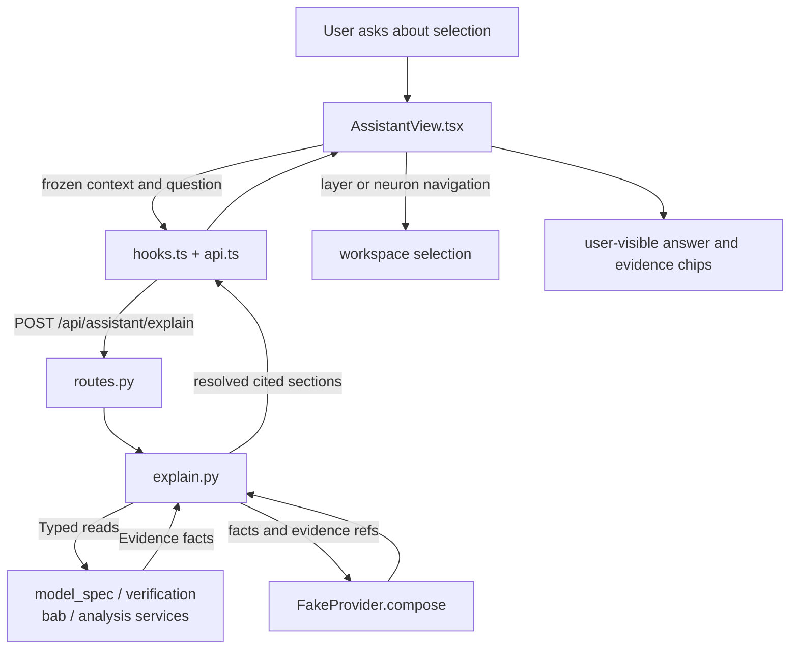

# AI Assistant

Current responsibility: freeze the browser selection, collect typed evidence through existing workbench services, compose a cited answer, and navigate back to cited layers or values. The first version uses a deterministic `FakeProvider`. No real provider or tool execution is wired. The assistant does not import ACT, override ACT verdicts, or execute arbitrary tools. See the [parent scope](../README.md), [repository rules](../../AGENTS.md), and the [development task guide](../../README.md#choose-a-development-task).

## Change Guide

| Goal | Edit here | Conditional / reused path |
| --- | --- | --- |
| Change evidence display or navigation | [AssistantView.tsx](AssistantView.tsx) | [workspace](../workspace/README.md#change-guide) / app composition only if navigation props change. |
| Add facts from an existing service | collect_evidence in [explain.py](explain.py), [test_assistant.py](test_assistant.py) | Edit the supplying module only when its public query lacks the data. Preserve frozen context and citation resolution. |
| Change fake-provider wording | FakeProvider in [explain.py](explain.py) | No prose-pinning tests. Add/update behavior checks only for changed structured fields or evidence semantics. |
| Change request/response contract | [schemas.py](schemas.py), [explain.py](explain.py), consuming view; generate wire types | Routes/client/hooks only when endpoints, arguments or mutation handling change. |
| Integrate a real provider | AI-02: add a bounded provider adapter and configuration, then evaluate it separately | Existing fake-provider tests remain deterministic; they do not validate a real provider. No execution tools are currently wired. |

New wire fields require `npm run gen:types`. AI-03 is node evidence, AI-04 is authorized plan execution; both remain separate from today's read-only explanation flow.

## Flow Diagram



| Block | Implementation and contract |
| --- | --- |
| Context | `SelectionContext` and the `context` object in [AssistantView.tsx](AssistantView.tsx). It is copied at request time and returned with the answer. |
| Evidence collection | `collect_evidence` in [explain.py](explain.py). Reads existing module services, checks model and run identity, and records ACT verdict, coverage, and layer facts. |
| Provider | `FakeProvider.compose` in [explain.py](explain.py). Deterministic templates over facts. It is not a language model. |
| Citation check | `explain` in [explain.py](explain.py). Every cited ID must exist in the collected evidence map or the request fails. |
| HTTP | `assistant_providers` and `assistant_explain` in [routes.py](routes.py). |
| View | `AssistantView` renders observation, interpretation, hypothesis, or missing sections and navigates only to evidence with a layer ID. |
| Neighbor handoff | `workspace` receives navigation. `analysis`, `bab`, `verification`, and `model_spec` remain owners of their services. See the [parent flow diagram](../README.md#flow-diagram). |

## Validation

Run this module's existing test command:

```bash
.venv/bin/python -m pytest visual_bench/assistant
```

Observable behavior: the provider list marks the fake provider available and real providers not configured, an answer returns its frozen context and resolved evidence, clicking a layer evidence chip navigates to that layer, and a context mismatch fails explicitly. These are validation instructions, not a new test result.

## Reference and Backlog

<details>
<summary>Current files and routes</summary>

## Current Files and Routes

| File | Responsibility |
| --- | --- |
| [schemas.py](schemas.py) | `SelectionContext`, `ExplainRequest`, `ExplainResponse`, `EvidenceRef`, `AnswerSection`, and `ProviderList`. |
| [explain.py](explain.py) | Freezes context, collects evidence through `wb.models`, `wb.runs`, `wb.bab`, and `wb.analysis`, composes with a provider, and rejects unresolved citations. |
| [routes.py](routes.py) | `GET /api/assistant/providers` and `POST /api/assistant/explain`. |
| [api.ts](api.ts) | Provider query and explain request client. |
| [hooks.ts](hooks.ts) | Provider query and explain mutation. |
| [AssistantView.tsx](AssistantView.tsx) | Question input, provider status, answer sections, evidence chips, and layer or neuron navigation. |
| [test_assistant.py](test_assistant.py) | Citation resolution, frozen context, ACT verdict passthrough, and context mismatch. |


</details>

<details>
<summary>Task acceptance, rationale, and planned capabilities</summary>

## Tasks and Acceptance

| ID | Deliverable | Depends on | Completion evidence |
| --- | --- | --- | --- |
| AI-01 | Define context/evidence/tools with fake provider | VER-01, WS-02 | Tools validate arguments and preserve frozen context; malicious instructions in tool data cannot change scope. |
| AI-02 | Integrate one provider for layer/stage evidence explanation | AI-01, ANA-01 | A selected real layer/stage of a completed run produces an answer whose evidence links resolve to the exact ACT stage data; missing evidence and provider failure remain explicit; manual GUI remains usable. |
| AI-03 | Extend evidence explanation to committed BaB nodes | AI-02, BAB-01 | A real unresolved node produces an evidence-linked answer bound to its run/node/revision; summary-only coverage is stated rather than filled in. |
| AI-04 | Implement versioned plan execution and evaluation | AI-03, VER-04 | Authorized steps share command IDs across retries; stale plans stop dependents; reviewed research cases record correctness, evidence support, latency, and use. |

Current status: AI-01 has a first-version fake provider and typed evidence; executable tools are not implemented. AI-02, AI-03, and AI-04 are planned.


Provider and tool adapters should stay small. Plans should be versioned and bounded, and retries must not reapply completed commands. A valid evidence reference proves identity and availability, not that an interpretation is correct. Evaluate interpretation separately.

Planned operations are `explain`, `proposePlan`, `executePlan`, and `cancelSession`. Implemented equivalents are the `explain` function, `FakeProvider`, and direct calls to workbench services. Planned files such as `providers.py`, `tools.py`, and `orchestration.py` do not exist yet.

Owner: B owns orchestration, C owns interaction, and A reviews scientific explanations. On completion, record exact commands, provider versions, real samples, and unverified behavior.

</details>
