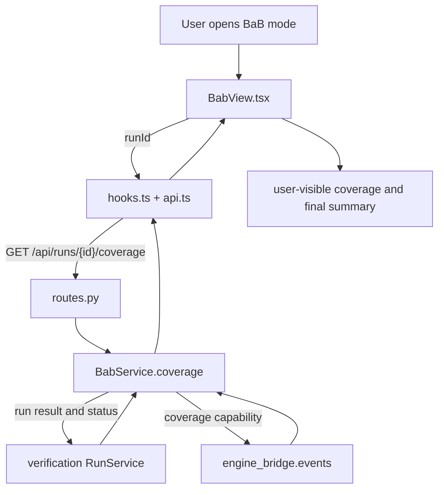

# BaB Explorer

Current responsibility: report what BaB observation data exists for a run and display ACT's final BaB summary. The current `BabView.tsx` is coverage and summary only. Node tables, search trees, node selection, and node controls are not implemented because the pinned ACT baseline emits no committed node events. This module must not infer a tree, control nodes, or treat coverage as a verdict. See the [parent scope](../README.md), [repository rules](../../AGENTS.md), and the [development task guide](../../README.md#choose-a-development-task).

## Change Guide

| Goal | Edit here | Conditional / reused path |
| --- | --- | --- |
| Relabel or rearrange current summary fields | [BabView.tsx](BabView.tsx) | Reuse the coverage query; no new observer or verification change. |
| Expose another ACT final-summary field | [bridge events](../../engine_bridge/events/README.md#change-guide), then the view | Inspect worker/RunOut mapping; generic summary dictionaries may already carry the field. |
| Change coverage availability or its wire shape | [service.py](service.py), [schemas.py](schemas.py), view and affected tests | Change [routes.py](routes.py), [api.ts](api.ts), [hooks.ts](hooks.ts) only for endpoint/query changes. Run `npm run gen:types` for schema edits. |
| Build node history or controls | First satisfy ACT-03 or ACT-05 in the backlog | There is no current tree-query/command path to extend. Coordinate events and verification before adding a view. |

[workspace](../workspace/README.md#change-guide) supplies selection; [verification](../verification/README.md#change-guide) supplies run results; [assistant](../assistant/README.md#change-guide) consumes coverage evidence. These are handoffs, not automatic edit targets.

## Flow Diagram



| Block | Implementation and contract |
| --- | --- |
| Query | `useCoverage` in [hooks.ts](hooks.ts), keyed to the selected run. |
| HTTP | `coverage` in [routes.py](routes.py), `GET /api/runs/{run_id}/coverage`. |
| Service | `BabService.coverage` in [service.py](service.py). Returns node and wave availability, final summary availability, reason, and summary data. |
| Engine coverage | `observation_coverage` in `engine_bridge/events`. It describes the baseline's observation capability, not search results. |
| View | `BabView` renders coverage and the ACT summary as summary-only data. |
| Neighbor handoff | `verification` owns run results and commands. `workspace` owns selection. `assistant` reads coverage as evidence. See the [parent flow diagram](../README.md#flow-diagram). |

## Validation

Run the relevant tests:

```bash
.venv/bin/python -m pytest visual_bench/verification/test_verification.py
.venv/bin/python -m pytest visual_bench/assistant/test_assistant.py
npm test
```

Observable behavior: a run with no BaB summary shows the explicit no-summary message, a BaB run shows ACT's final summary, and the UI states that tree and node actions are disabled. These are validation instructions, not a new test result.

## Reference and Backlog

<details>
<summary>Current files and routes</summary>

## Current Files and Routes

| File | Responsibility |
| --- | --- |
| [schemas.py](schemas.py) | `CoverageOut` wire payload. |
| [service.py](service.py) | `BabService.coverage(run_id)`. Combines `engine_bridge.events.observation_coverage()` with the run's recorded `bab_summary`. |
| [routes.py](routes.py) | `GET /api/runs/{run_id}/coverage`. |
| [api.ts](api.ts) | Calls the coverage endpoint. |
| [hooks.ts](hooks.ts) | `useCoverage`, keyed by `keys.coverage(runId)`. |
| [BabView.tsx](BabView.tsx) | Coverage values, reason, ACT final summary, and the disabled tree placeholder. |
| [../verification/test_verification.py](../verification/test_verification.py) | `bab.summary` lifecycle coverage. |
| [../assistant/test_assistant.py](../assistant/test_assistant.py) | Coverage evidence used by explanations. |


</details>

<details>
<summary>Task acceptance, rationale, and planned capabilities</summary>

## Tasks and Acceptance

| ID | Deliverable | Depends on | Completion evidence |
| --- | --- | --- | --- |
| BAB-01 | Show committed node table and selected path | VER-03, WS-02 | A recorded real run has matching IDs/status/bound origins in table and detail. |
| BAB-02 | Add bounded local graph navigation | BAB-01, PERF-01 | Expand/page a subtree while preserving selected path and positions; large fixtures stay within a measured view budget. |
| BAB-03 | Add supported node actions | BAB-02, VER-04 | An action creates one shared command and shows accepted/applied/rejected independently of graph appearance. |

Current status: BAB-01 through BAB-03 are not started. The current tab covers the summary-only first-version behavior.


Future graph state must be a read-only projection of committed snapshots and events. Layout and expansion state must remain separate from engine node identity. Preserve split, merge, and reuse relation kinds. Never infer success from an empty frontier or visible-node counts.

Planned operations are `buildLocalGraph`, `getNodePage`, and `requestNodeAction`. Planned files include `graph_model.ts`, `layout_adapter.ts`, and `bab.test.tsx`. These are not current capabilities.

ACT-03 is the missing committed node-event capability. ACT-05 is the missing safe-control capability. Owner: C, with D supporting rendering and A reviewing search semantics. On completion, record real samples, exact commands and results, and limitations.

</details>
