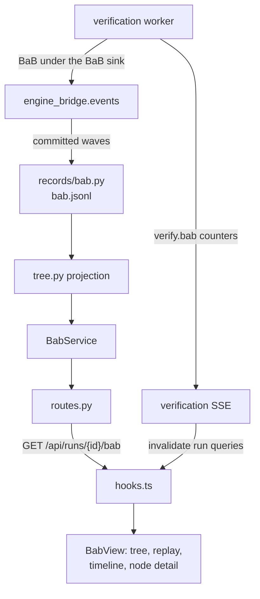

# BaB Explorer

Current responsibility: show the search tree of a BaB run as ACT builds it, wave by wave, and replay it afterwards. ACT checkouts with `act.pipeline.gui.bab_gui` (capability `events.bab_nodes`, SVF-tools/ACT main from 22693fb) report every committed BaB wave; the worker records them (`bab.jsonl`) and this module projects them into a tree with node states, per-wave statistics, ACT's terminal record and per-node detail. Older ACT, including the pinned baseline, keeps the summary-only view: observation coverage and ACT's final BaB summary. This module never infers nodes, never controls the search, and never derives a verdict from the tree. See the [parent scope](../README.md), [repository rules](../../AGENTS.md), and the [development task guide](../../docs/README.md#choose-a-development-task).

## Change Guide

| Goal | Edit here | Conditional / reused path |
| --- | --- | --- |
| Restyle the tree, timeline or node detail | [BabTree.tsx](BabTree.tsx), [BabTimeline.tsx](BabTimeline.tsx), [BabNodeDetail.tsx](BabNodeDetail.tsx), [bab.css](bab.css) | Pure layout/replay rules live in [tree.ts](tree.ts) with [tree.test.ts](tree.test.ts); no service change. [app.tsx](../app.tsx) gives a recorded tree the wide center column (as for propagation). |
| Show another per-node or per-wave value ACT already records | [tree.py](tree.py) projection, [schemas.py](schemas.py), the view | Run `npm run gen:types`. The log line format is the bridge contract (`engine_bridge/contracts.py`). |
| Record another ACT field | [bridge events](../../engine_bridge/events/README.md#change-guide) (`BabTreeSink`), then the projection | The worker and [records/bab.py](../records/bab.py) write whatever the bridge returns; check old logs still load. |
| Change live update rate or log storage | [records/bab.py](../records/bab.py), [verification](../verification/README.md#change-guide) | SSE kind `verify.bab` is generic; the browser refetches through run-scoped query keys. |
| Node actions (pause, split, prune) | BAB-03 in the backlog | Requires ACT controls (ACT-05); there is no command path. |

[workspace](../workspace/README.md#change-guide) supplies selection; [verification](../verification/README.md#change-guide) supplies run results and the live event stream; [assistant](../assistant/README.md#change-guide) consumes coverage evidence. These are handoffs, not automatic edit targets.

## Flow Diagram



| Block | Implementation and contract |
| --- | --- |
| Bridge | `run_observed_bab` and `BabTreeSink` in [engine_bridge/events/bab.py](../../engine_bridge/events/bab.py): ACT's `BaBWave`/`BaBTerminal` copied into `BabWave`/`BabTerminal` (contracts.py); per-neuron node bounds reduced to per-layer ranges and ReLU stability counts. |
| Log | [records/bab.py](../records/bab.py) `BabWriter`: one JSON line per wave, then the terminal, then an `end` line; flushed before each notification; notifications at most 2/s. [store.py](../records/store.py) `bab_log` reads complete lines from a byte offset and checks the seal of a completed run. |
| Projection | [tree.py](tree.py) `BabTree`: nodes with the waves that created, solved or evicted them; per-wave statistics; terminal; breadth-first snapshot with a node budget; equal-split shares; node detail. |
| Service / HTTP | [service.py](service.py) `BabService.tree`, `.node`, `.coverage` (cached incremental reads); [routes.py](routes.py) `GET /api/runs/{run_id}/bab?root=&limit=`, `GET /api/runs/{run_id}/bab/nodes/{node_id}`, `GET /api/runs/{run_id}/coverage`. |
| Browser | [api.ts](api.ts), [hooks.ts](hooks.ts) (keys under the run prefix, so `verify.bab` events refresh them), [BabView.tsx](BabView.tsx) and its components. |

## Validation

```bash
.venv/bin/python -m pytest visual_bench/bab engine_bridge/events
ACT_CODE_ROOT=<ACT main >= 22693fb> .venv/bin/python -m pytest engine_bridge/events/test_bab.py
ACT_GUI_ENGINES=<dir whose active.json selects that checkout> .venv/bin/python -m pytest visual_bench/bab
npm test
```

On the pinned baseline the native tree tests skip and the unsupported path is tested; against ACT main they run real BaB searches (observed verdict and node count equal the unobserved run; every child links to a node solved in its wave; recorded runs serve a tree whose terminal matches the run result). Observable behavior: in the BaB tab a running BaB run grows wave by wave, the replay slider reproduces each committed wave, and selecting a node shows its splits, ACT bound and ReLU stability. These are validation instructions, not a new test result.

## Reference and Backlog

<details>
<summary>Current files and routes</summary>

## Current Files and Routes

| File | Responsibility |
| --- | --- |
| [schemas.py](schemas.py) | `CoverageOut`, `BabTreeOut`, `BabNodeOut`, `BabNodeDetailOut`, `BabWaveOut`, `BabTerminalOut`, `BabSharesOut`, branch and layer payloads. |
| [tree.py](tree.py) | `BabTree` projection of log lines. |
| [service.py](service.py) | `BabService`: coverage, tree snapshot (subtree root, node budget), node detail; reads `bab.jsonl` incrementally and caches the projections of recent runs. |
| [routes.py](routes.py) | `GET /api/runs/{run_id}/coverage`, `GET /api/runs/{run_id}/bab`, `GET /api/runs/{run_id}/bab/nodes/{node_id}`. |
| [api.ts](api.ts), [hooks.ts](hooks.ts) | Endpoint calls; `useCoverage`, `useBabTree`, `useBabNode`. |
| [tree.ts](tree.ts), [tree.test.ts](tree.test.ts) | Pure layout, replay state per wave, branch labels and timeline series. |
| [BabView.tsx](BabView.tsx) | Status strip, replay controls (follows the newest wave while the run is live), closed share, subtree breadcrumbs, legend, ACT terminal reason and final summary. |
| [BabTree.tsx](BabTree.tsx) | SVG node-link tree: one ink per state, the shown wave's changes ringed, new nodes fading in, the selected node's path drawn bold; opens centered on its root when wider than the panel. |
| [BabNodeDetail.tsx](BabNodeDetail.tsx) | Selected node: ACT outcome and bound, split path (clickable), children, per-layer ranges with ReLU active/inactive/unstable bars, and for image inputs the node's input box per pixel. |
| [BabTimeline.tsx](BabTimeline.tsx), [useWidth.ts](useWidth.ts) | Per-wave frontier, solved and proved counts with the lowest node bound; clicking replays that wave. |
| [bab.css](bab.css) | Module styles on the theme variables (dark and light). |
| [test_bab.py](test_bab.py) | Projection, log reading, and HTTP tests (native ones gated on `events.bab_nodes`). |

</details>

<details>
<summary>Task acceptance, rationale, and planned capabilities</summary>

## Tasks and Acceptance

| ID | Deliverable | Depends on | Completion evidence |
| --- | --- | --- | --- |
| BAB-01 | Project ACT's committed waves into a search tree: node states (pending, branched, proved, falsified, retired, evicted, unresolved) with the waves that created, solved or evicted each node, per-wave statistics and ACT's terminal record; `GET /api/runs/{id}/bab` (subtree root, node budget) and `GET /api/runs/{id}/bab/nodes/{node_id}` (split path, ACT bound, per-layer ReLU stability) | EVT-02, VER-17, REC-06 | Synthetic projection tests; a native test where a recorded real BaB run's node ids, parents, outcomes and terminal match ACT's records and its verdict matches the unobserved run. |
| BAB-02 | Live tree view with bounded navigation: node-link tree colored by state, split labels, nodes of the shown wave highlighted, wave replay, subtree focus with a node budget | BAB-01, PERF-01 | A running BaB on the 18080 deployment grows wave by wave; replaying a completed run reproduces each wave's state; desktop and 390 px screenshots. PERF-01 thresholds are not measured yet. |
| BAB-03 | Add supported node actions | BAB-02, VER-04, ACT-05 | An action creates one shared command and shows accepted/applied/rejected independently of graph appearance. |
| BAB-04 | Search progress and node detail: wave timeline (frontier, solved, proved, lowest node bound), closed share of the split tree, the selected node's splits, bound and ReLU stability per layer | BAB-01 | vitest for layout, replay and series; on a real run the tree, the detail and the timeline agree. |

Current status (2026-11-12): BAB-01, BAB-02 and BAB-04 have a first version, verified against SVF-tools/ACT main 22693fb; BAB-03 is not started (ACT exposes no BaB controls). Known limits: per-neuron node bounds are not recorded (only per-layer ranges and ReLU stability); the GUI runs BaB with ACT's pipeline configuration (at most 100 solved nodes, depth 8), so trees stay small; node selection is local to the BaB tab, not part of the workspace selection the assistant reads (AI-03).

Design rules. The tree is a read-only projection of committed records: a node exists once ACT names it, and a replay to wave w shows exactly what ACT had committed by then. Node identity is ACT's node_id, never a batch lane. The verdict comes from the run result and the terminal record; an empty frontier, a share or a node count is never shown as one. The closed share splits every node's share equally among its children, so it measures the split tree, not input volume. Layout and focus state belong to the view and never change node identity.

</details>
