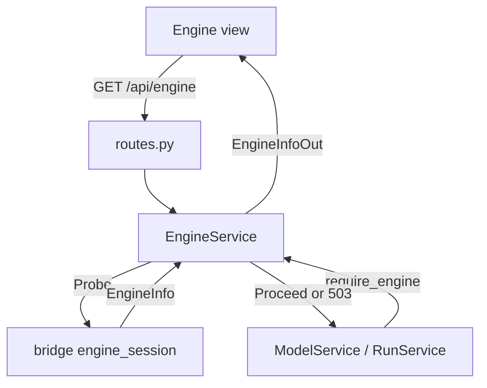
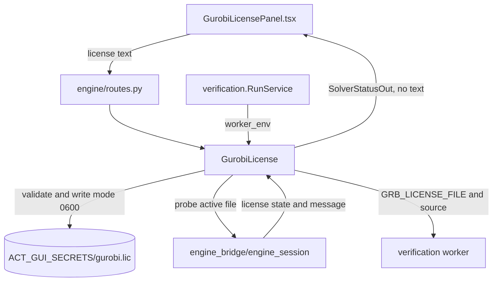

# Engine Status and Solver Licenses

**Current responsibility and status.** This module reports whether the pinned ACT checkout is usable and manages the optional user supplied Gurobi license. The first version is implemented for VER-05. B owns the service path and C owns the Engine tab.

This module does not run verification, call a solver for its own purposes, or decide a license's scientific effect. ACT probing and Gurobi probing are bridge responsibilities. Model loading and run lifecycle call this module through `require_engine` and worker environment setup. See the [parent flow diagram](../README.md#flow-diagram) and [project development entry point](../../README.md#choose-a-development-task).

## Change Guide

| Goal | Required edits | Conditional edits / reused path |
| --- | --- | --- |
| Add a diagnostic or capability using existing fields | [bridge engine_session](../../engine_bridge/engine_session/README.md#change-guide), probe tests | Existing diagnostic/capability lists already map to the wire. Schema/service/view changes only for a new shape or presentation. |
| Change readiness gating | [service.py](service.py), caller error tests | Model/run services reuse require_engine unless its contract changes. |
| Add or change license source policy | [solver_license.py](solver_license.py), privacy/source tests | Schema/routes/hooks/view only if the public API or selectable source changes. |
| Change license handoff to workers | worker_env in [solver_license.py](solver_license.py), run manifest tests | [verification](../verification/README.md#change-guide) only if environment/manifest contract changes. |
| Change badge or license form layout | Owning Engine/Gurobi view | No bridge or worker changes for the same status data. |

Generate wire.ts after schema changes. No current method declares a Gurobi requirement; status is not proof that a run used the solver.

## Flow Diagram

Arrows are labeled as calls, results, or events. Neighboring modules are named explicitly and linked in the block tables. HTTP transport may be grouped; views use hooks or props, never direct fetch calls.

### Probe and gate ACT



| Block | Code entry | Contract or artifact | Neighbor handoff |
| --- | --- | --- | --- |
| Probe | `EngineService.info` | Cached `EngineInfo` includes commit, expected commit, tracked changes, runtime, capabilities, and diagnostics | Bridge owns compatibility facts |
| Gate | `require_engine` | Usable ACT proceeds; first error diagnostic becomes 503 | [Model_spec](../model_spec/README.md) and [verification](../verification/README.md) stop before ACT access |
| Browser | `engine_out`, hooks | `EngineInfoOut` preserves diagnostics and capability availability | Engine views present status, not verdicts |

### Upload and hand off Gurobi



| Block | Code entry | Contract or artifact | Neighbor handoff |
| --- | --- | --- | --- |
| Validate | `validate_license_text` | Accepts only printable `KEY=VALUE` text with identifying Gurobi keys | Route maps rejection to 422 |
| Store | `GurobiLicense.upload` | Uploaded file is mode 0600; content is never returned or logged | Secret path is service owned |
| Probe | `GurobiLicense.status` | Reports source, fingerprint, timestamp, state, message, and methods using it | Bridge owns Gurobi's verdict |
| Worker handoff | `worker_env` | Uploaded source overrides `GRB_LICENSE_FILE`; run manifest stores only source | [Verification](../verification/README.md) owns run provenance |

## Validation

Run the module's real ACT and bridge probe tests:

```bash
.venv/bin/python -m pytest visual_bench/engine
```

Acceptance is observable when `/api/engine` reports the pinned commit and diagnostics, an unusable ACT checkout blocks model or run access with 503, valid license text returns status without its content, the stored file is mode 0600, invalid text returns 422 without creating a file, and a run manifest records `uploaded` or `environment` without the license secret.

The status reports `used_by_methods: []`: no current method declares a Gurobi requirement. Fuzzing is inference-based; do not infer solver usage from this list. Do not claim Gurobi affects a verdict unless a bridge execution path and test prove it.

## Reference and Backlog

<details>
<summary>Current files, routes and contracts</summary>

## Current Files and Contracts

| Layer | Entry | Contract or artifact | Owner for handoff |
| --- | --- | --- | --- |
| Wire | [schemas.py](schemas.py) | Engine info, diagnostics, solver status, license upload payload | Generated browser types come from Pydantic |
| Service | [service.py](service.py) | Cached `probe`, `engine_out`, `require_engine` | Model_spec and verification call the gate |
| License service | [solver_license.py](solver_license.py) | Validate, store mode 0600, remove, status, and worker environment | Verification records source in the run manifest |
| HTTP | [routes.py](routes.py) | `/api/engine`, `/api/solvers/gurobi`, license PUT and DELETE | Browser uses the same service data |
| Browser data | [api.ts](api.ts), [hooks.ts](hooks.ts) | Engine and solver queries, upload and remove invalidation | Shared query client owns cache |
| Views | [EngineBadge.tsx](EngineBadge.tsx), [EngineView.tsx](EngineView.tsx), [GurobiBadge.tsx](GurobiBadge.tsx), [GurobiLicensePanel.tsx](GurobiLicensePanel.tsx) | Status badges and license controls | Workspace owns tab placement |
| Tests | [test_engine.py](test_engine.py) | Privacy, file mode, Gurobi probe result, rejection, and run manifest source | Bridge tests cover native probe behavior |


</details>

<details>
<summary>Task acceptance and planned capabilities</summary>

## Tasks

<a id="3-tasks"></a>

| ID | Deliverable | Depends on | Completion evidence |
| --- | --- | --- | --- |
| VER-05 | Accept a user-supplied Gurobi license and hand it to run workers | ES-04 | Only text shaped like a Gurobi license is stored (0600, `ACT_GUI_SECRETS`, default `<records>/../secrets`); its content is never returned; an uploaded license overrides `GRB_LICENSE_FILE`; each run manifest records the license source and requested device (`test_engine.py`). The task ID keeps its original VER prefix. |


Future solver selection or method specific license use needs a bridge capability and an updated task. The current module reports Gurobi's own probe state and passes the active path to workers, but does not validate solver correctness or select a solver.

</details>
