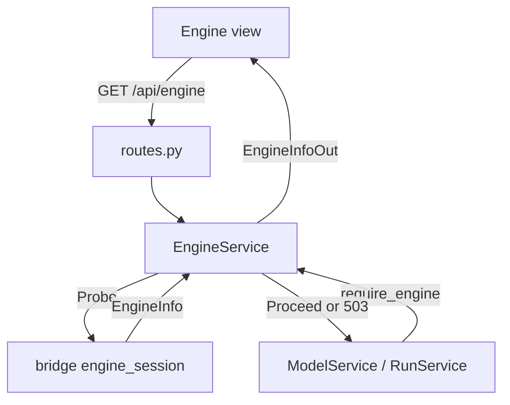
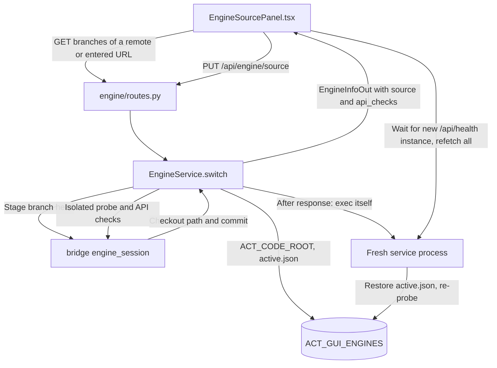
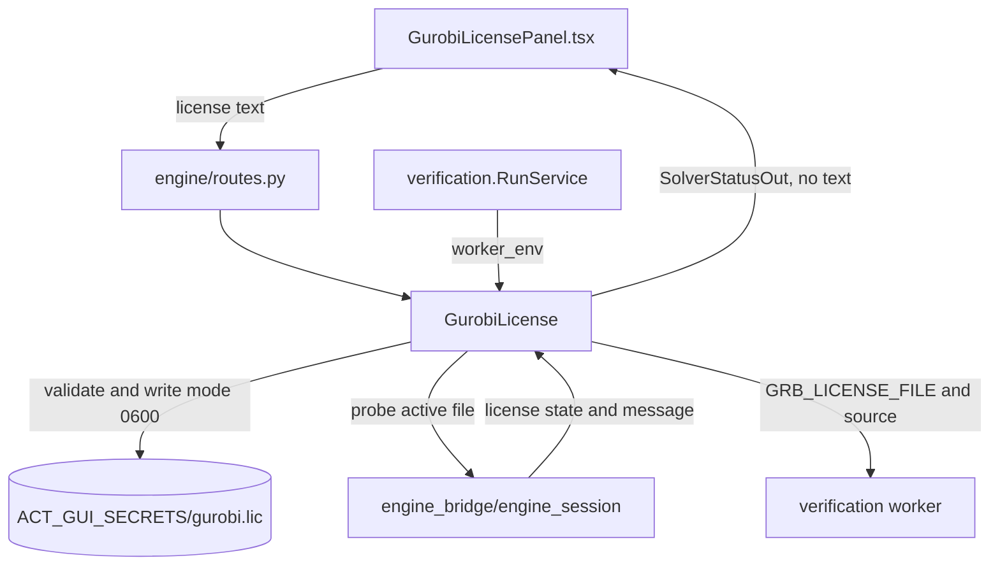

# Engine Status and Solver Licenses

**Current responsibility and status.** This module reports whether the active ACT checkout is usable, selects which ACT branch the workbench imports (the pinned baseline or a branch head of an operator-configured remote), and manages the optional user supplied Gurobi license. The first versions are implemented for VER-05 and VER-08. B owns the service path and C owns the Engine tab.

This module does not run verification, call a solver for its own purposes, or decide a license's scientific effect. ACT probing and Gurobi probing are bridge responsibilities. Model loading and run lifecycle call this module through `require_engine` and worker environment setup. See the [parent flow diagram](../README.md#flow-diagram) and [project development entry point](../../README.md#choose-a-development-task).

## Change Guide

| Goal | Required edits | Conditional edits / reused path |
| --- | --- | --- |
| Add a diagnostic or capability using existing fields | [bridge engine_session](../../engine_bridge/engine_session/README.md#change-guide), probe tests | Existing diagnostic/capability lists already map to the wire. Schema/service/view changes only for a new shape or presentation. |
| Offer another ACT repository for switching | Users enter its https URL under "Other repository…"; operators can preconfigure some with `ACT_GUI_ACT_REMOTES` (`name=url,...`; default SVF-tools and guanqin-123 on GitHub) | No code change. `ACT_GUI_ALLOW_CUSTOM_REMOTES=0` limits users to the configured ones. |
| Change which repository URLs are accepted | `custom_remote` in [service.py](service.py), `test_unsafe_repository_urls_are_rejected` | Keep it https-only without credentials, IP hosts or `..` segments: the URL goes straight to git on the server. |
| Gate a feature on what the active ACT provides | Service: `require_capability(name)` in the owning service. Browser: `useCapabilities()` from [hooks.ts](hooks.ts) to disable the control with the returned reason | Capability names and their ACT requirements live in bridge [parity.py](../../engine_bridge/engine_session/parity.py). |
| Change branch switching or its persistence | `switch` / `check` / `_restore` in [service.py](service.py), [test_engine.py](test_engine.py) | Git staging and import switching live in [bridge engine_session](../../engine_bridge/engine_session/README.md#change-guide). |
| Change readiness gating | [service.py](service.py), caller error tests | Model/run services reuse require_engine unless its contract changes. |
| Add or change license source policy | [solver_license.py](solver_license.py), privacy/source tests | Schema/routes/hooks/view only if the public API or selectable source changes. |
| Change license handoff to workers | worker_env in [solver_license.py](solver_license.py), run manifest tests | [verification](../verification/README.md#change-guide) only if environment/manifest contract changes. |
| Change badge or license form layout | Owning Engine/Gurobi view | No bridge or worker changes for the same status data. |

Generate wire.ts after schema changes. No current method declares a Gurobi requirement; status is not proof that a run used the solver.

## Flow Diagram

Arrows are labeled as calls, results, or events. Neighboring modules are named explicitly and linked in the block tables. HTTP transport may be grouped; views use hooks or props, never direct fetch calls.

### Probe and gate ACT



| Block | Code entry | Contract or artifact | Neighbor handoff |
| --- | --- | --- | --- |
| Probe | `EngineService.info` | Cached `EngineInfo` includes commit, expected commit, tracked changes, runtime, capabilities, and diagnostics | Bridge owns compatibility facts |
| Gate | `require_engine` | Usable ACT proceeds; first error diagnostic becomes 503 | [Model_spec](../model_spec/README.md) and [verification](../verification/README.md) stop before ACT access |
| Browser | `engine_out`, hooks | `EngineInfoOut` preserves diagnostics and capability availability | Engine views present status, not verdicts |

### Switch the ACT branch



| Block | Code entry | Contract or artifact | Neighbor handoff |
| --- | --- | --- | --- |
| Remotes | `config.act_remotes`, `EngineService.sources` / `branches` / `_resolve`, `custom_remote` | Configured remotes plus user-entered https URLs; an entered repository whose branch imports as ACT is saved in `ACT_GUI_ENGINES/remotes.json` and listed for every user, most recently used first; beyond `MAX_CUSTOM_REMOTES` (10) the least recently used one is forgotten and its staged checkouts deleted (the active checkout is kept), except repositories of a configured remote's owner (github.com/guanqin-123, github.com/SVF-tools), which are never evicted and not counted; branch names come from `git ls-remote` | Running a repository's code is arbitrary code execution on the server: on a public deployment put access control in front, or set `ACT_GUI_ALLOW_CUSTOM_REMOTES=0` |
| Check | `EngineService.check`, `POST /api/engine/source/check` | Stages the head commit under `ACT_GUI_ENGINES` (default `<records>/../engines`) and probes it in a fresh interpreter, returning its API checks without switching | The browser shows the result before the user switches |
| Switch | `EngineService.switch`, `PUT /api/engine/source` | Refused with 409 while runs are active or a restart is pending; an unimportable checkout is refused with 422 `engine_unusable`; otherwise writes `active.json` and returns the probe; the route then re-executes the service process (`restart_service`) | ACT cannot be re-imported in a running process. The switch is global for every browser; new runs and model loads get 503 `restart_pending` until the restart |
| Restore | `EngineService._restore` | On service start, `active.json` sets `ACT_CODE_ROOT` to the staged checkout if it still exists, else the baseline | The service owns `ACT_CODE_ROOT`; do not set it by hand |
| Gate | `require_capability`; `ModelService.methods`, `describe`, `load`; `RunService.start`; worker `record_layers` | A capability whose API checks fail is `unsupported`: its methods disappear from model summaries, its runs and loads get 422 `capability_unavailable`, and interval runs skip layer states | Views disable the matching mode tab, load tab, method/domain and Run button and show the reason (`useCapabilities`) |
| Provenance | RunService manifest | `act.commit` is the active commit; `act.source` records baseline or remote/branch | A non-baseline commit carries the `version_mismatch` warning |

### Upload and hand off Gurobi



| Block | Code entry | Contract or artifact | Neighbor handoff |
| --- | --- | --- | --- |
| Validate | `validate_license_text` | Accepts only printable `KEY=VALUE` text with identifying Gurobi keys | Route maps rejection to 422 |
| Store | `GurobiLicense.upload` | Uploaded file is mode 0600; content is never returned or logged | Secret path is service owned |
| Probe | `GurobiLicense.status` | Reports source, fingerprint, timestamp, state, message, and methods using it | Bridge owns Gurobi's verdict |
| Worker handoff | `worker_env` | Uploaded source overrides `GRB_LICENSE_FILE`; run manifest stores only source | [Verification](../verification/README.md) owns run provenance |

## Validation

Run the module's real ACT and bridge probe tests:

```bash
.venv/bin/python -m pytest visual_bench/engine
```

Acceptance is observable when `/api/engine` reports the active commit, source, diagnostics and API checks, switching to a configured remote's branch changes them after the restart while an unimportable branch is refused, a capability with a failed check disables its features, an unusable ACT checkout blocks model or run access with 503, valid license text returns status without its content, the stored file is mode 0600, invalid text returns 422 without creating a file, and a run manifest records `uploaded` or `environment` without the license secret.

The status reports `used_by_methods: []`: no current method declares a Gurobi requirement. Fuzzing is inference-based; do not infer solver usage from this list. Do not claim Gurobi affects a verdict unless a bridge execution path and test prove it.

## Reference and Backlog

<details>
<summary>Current files, routes and contracts</summary>

## Current Files and Contracts

| Layer | Entry | Contract or artifact | Owner for handoff |
| --- | --- | --- | --- |
| Wire | [schemas.py](schemas.py) | Engine info with source and API checks, remotes/branches, switch request, diagnostics, solver status, license upload payload | Generated browser types come from Pydantic |
| Service | [service.py](service.py) | Cached `probe`, `engine_out`, `require_engine` | Model_spec and verification call the gate |
| License service | [solver_license.py](solver_license.py) | Validate, store mode 0600, remove, status, and worker environment | Verification records source in the run manifest |
| HTTP | [routes.py](routes.py) | `/api/engine`, `GET`/`PUT /api/engine/source`, `POST /api/engine/source/check`, `GET /api/engine/branches?remote=|url=`, `/api/solvers/gurobi`, license PUT and DELETE | Browser uses the same service data |
| Browser data | [api.ts](api.ts), [hooks.ts](hooks.ts) | Engine and solver queries, upload and remove invalidation | Shared query client owns cache |
| Views | [EngineBadge.tsx](EngineBadge.tsx), [EngineView.tsx](EngineView.tsx), [EngineSourcePanel.tsx](EngineSourcePanel.tsx), [ApiChecks.tsx](ApiChecks.tsx), [GurobiBadge.tsx](GurobiBadge.tsx), [GurobiLicensePanel.tsx](GurobiLicensePanel.tsx) | Status badges and license controls | Workspace owns tab placement |
| Tests | [test_engine.py](test_engine.py) | Privacy, file mode, Gurobi probe result, rejection, run manifest source, branch check/switch/refusal/restore against a synthetic git remote, entered-repository URL rejection, remembering and the operator switch, and capability gating of methods and runs | Bridge tests cover native probe behavior |


</details>

<details>
<summary>Task acceptance and planned capabilities</summary>

## Tasks

<a id="3-tasks"></a>

| ID | Deliverable | Depends on | Completion evidence |
| --- | --- | --- | --- |
| VER-05 | Accept a user-supplied Gurobi license and hand it to run workers | ES-04 | Only text shaped like a Gurobi license is stored (0600, `ACT_GUI_SECRETS`, default `<records>/../secrets`); its content is never returned; an uploaded license overrides `GRB_LICENSE_FILE`; each run manifest records the license source and requested device (`test_engine.py`). The task ID keeps its original VER prefix. |


| VER-08 | Switch the ACT branch from the browser | ES-05, ES-06 | The Engine tab lists configured remotes and their branches; Check API reports a candidate's API checks without switching; switching is refused while runs are active, refuses an unimportable branch, persists the choice and restarts the service onto it; run manifests record `act.source`; returning to the baseline restores the pinned commit (`test_engine.py`, synthetic remote). Python dependencies are those of the image; a branch needing other packages fails to import and is refused. |
| VER-10 | Load ACT from a user-entered repository | VER-08 | Any user can enter an https git URL of an ACT fork, list its branches, check and switch to one; unsafe URLs (other schemes, credentials, IP hosts, `..`, option-like strings) get 422 `invalid_remote_url`; a repository is remembered for everyone only after a branch imported as ACT, at most 10 unprotected ones by recency with guanqin-123 repositories never evicted; `ACT_GUI_ALLOW_CUSTOM_REMOTES=0` returns 403 (`test_engine.py`). Whether its features are usable is decided by the API checks (VER-09), not by trusting the repository. |
| VER-09 | Gate features on the active ACT's API checks | ES-06 | After a switch the browser refetches all server data; methods, domains, model sources and modes whose capability fails its API checks are disabled with the failed check as the reason, and the service rejects them with `capability_unavailable` (`test_engine.py`). |

Future solver selection or method specific license use needs a bridge capability and an updated task. The current module reports Gurobi's own probe state and passes the active path to workers, but does not validate solver correctness or select a solver.

</details>
