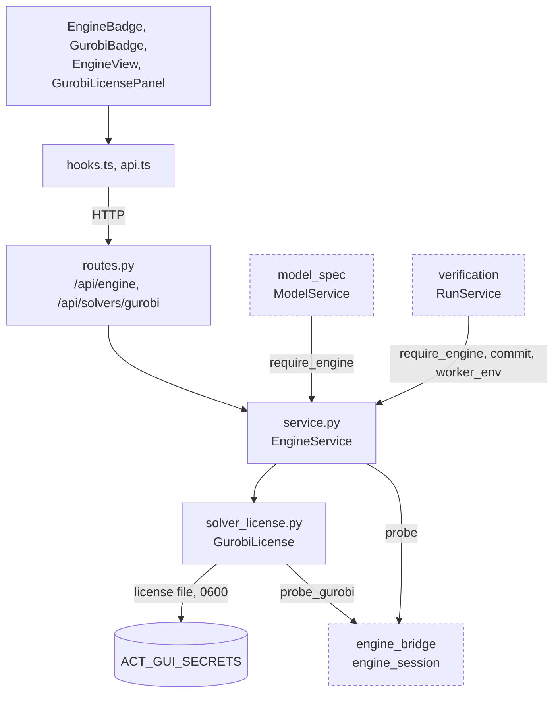

# Engine Status and Solver Licenses

**Status:** first version (split out of verification on 2026-11-04): ACT engine probe and the Gurobi license (VER-05). **Owner:** B; C owns the Engine tab interaction.
Follow the [repository rules](../../AGENTS.md) and [parent scope](../README.md).

## 1. Objective and Scope

Show which ACT checkout the workbench runs against and whether it is usable, and manage the optional user-supplied Gurobi license that run workers inherit.

| Subproblem | Responsibility |
| --- | --- |
| Engine status | Report ACT root, commit vs. the pinned commit, tracked changes, Python/torch/CUDA, capabilities, and diagnostics from `engine_bridge.engine_session.probe`. |
| Engine gate | `EngineService.require_engine()` is the single check other services call before asking the bridge to touch ACT; an unusable engine becomes a 503 with ACT's diagnostic. |
| Solver license | Upload, remove, and check a Gurobi license; hand it to each run worker through its environment. The license text never leaves the service. |

Non-goals: no verification, no solver calls of its own, no license validation beyond the file shape (Gurobi's own check is the verdict).

## 2. Files and Usage

| File | Layer | Responsibility |
| --- | --- | --- |
| `schemas.py` | Wire | `EngineInfoOut`, `CapabilityOut`, `DiagnosticOut`, `SolverStatusOut`, `SolverLicenseUpload`. |
| `service.py` | Service | `EngineService`: cached probe (`info`), `engine_out()`, `require_engine()`, owns `gurobi`. |
| `solver_license.py` | Service | `GurobiLicense`: validate/store (0600 under `ACT_GUI_SECRETS`), remove, status via `probe_gurobi`, `worker_env()`. |
| `routes.py` | HTTP | `GET /api/engine`, `GET /api/solvers/gurobi`, `PUT/DELETE /api/solvers/gurobi/license`. |
| `api.ts`, `hooks.ts` | Browser data | Engine info and Gurobi status queries; upload/remove mutations invalidate the Gurobi status query. |
| `EngineBadge.tsx`, `EngineView.tsx`, `GurobiBadge.tsx`, `GurobiLicensePanel.tsx` | Views | Top-bar badges and the Engine tab. |
| `test_engine.py` | Tests | License upload privacy and Gurobi verdict, rejection of non-license text. |

Run this module's tests: `.venv/bin/python -m pytest visual_bench/engine`.

Dependencies: engine_bridge.engine_session (probe, probe_gurobi), `visual_bench.errors`. Used by model_spec and verification services (engine gate, commit, worker license env).

## Flow Diagram

Arrows point from caller to callee and are labeled with what flows. Dashed nodes belong to other modules and use the same names as the [parent diagram](../README.md#flow-diagram); every edge to a dashed node also appears there.

## 3. Tasks

| ID | Deliverable | Depends on | Completion evidence |
| --- | --- | --- | --- |
| VER-05 | Accept a user-supplied Gurobi license and hand it to run workers | ES-04 | Only text shaped like a Gurobi license is stored (0600, `ACT_GUI_SECRETS`, default `<records>/../secrets`); its content is never returned; an uploaded license overrides `GRB_LICENSE_FILE`; each run manifest records the license source and requested device (`test_engine.py`). The task ID keeps its original VER prefix. |

## 4. Acceptance

- A missing or incompatible ACT checkout is reported with ACT's diagnostic and blocks runs with 503, never with a verdict.
- The license content never appears in any response, record, or log; removal deletes the stored file.
