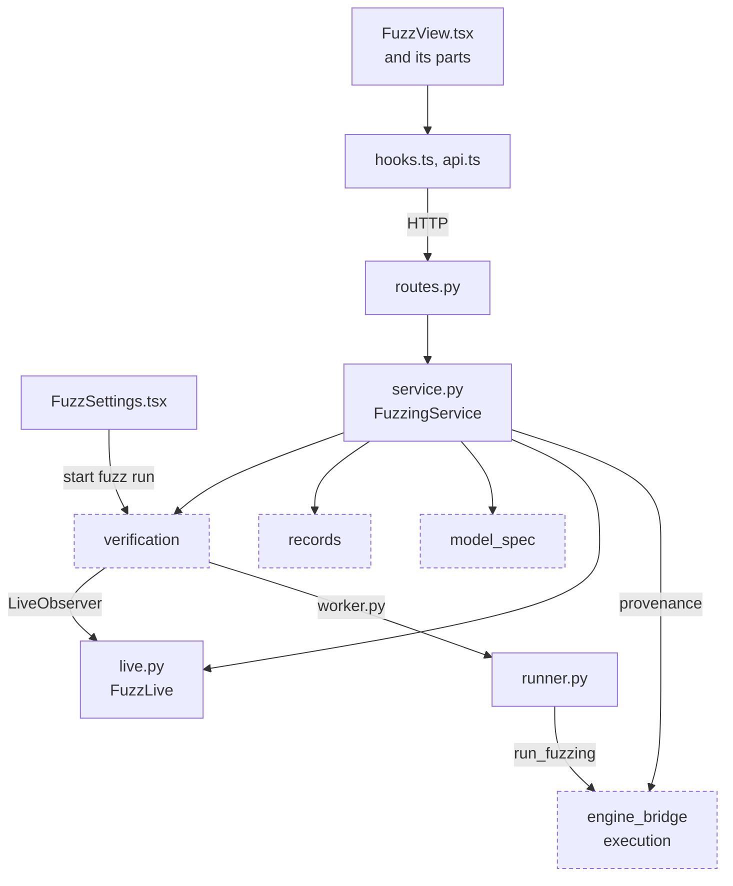

# Fuzzing

**Status:** first version (split out of verification on 2026-11-04): ACTFuzzer runs, live and recorded fuzzing views, saved counterexamples and their export (VER-06, VER-07 fuzzing part). **Owner:** B for the service; C for the Fuzzing mode views; A reviews violation semantics.
Follow the [repository rules](../../AGENTS.md) and [parent scope](../README.md).

## 1. Objective and Scope

Let a researcher run ACT's inference-based fuzzer (ACTFuzzer) on a model, watch coverage, mutated inputs, and counterexamples live, and keep the counterexamples ACT reported.

| Subproblem | Responsibility |
| --- | --- |
| Options | `FuzzOptions`: budget, RNG seed, early stop, and ACTFuzzer's tunable hyperparameters; defaults equal the pinned ACT `pipeline.yaml`. |
| Execution | A fuzz run is an ordinary run of the [verification](../verification/README.md) lifecycle (method `fuzz`); this module supplies the worker step (`runner.py`) and the live observer (`live.py`). |
| Record view | Project `fuzzing.json` and committed `fuzz.progress` events into `FuzzingOut` (timeline, strategies, seeds, frames, counterexamples). |
| Saved counterexamples | User annotations on the record; export as a VNN-COMP result with the VNN-LIB 2.0 assignment, or as PNG for image inputs. |

Non-goals: fuzzing never certifies; a run is `falsified` only when ACT's PropertyChecker accepted a counterexample, otherwise `unknown`. This module does not decide violations, change ACT's fuzzer, or own the run lifecycle (start/stop/SSE live in verification).

## 2. Files and Usage

| File | Layer | Responsibility |
| --- | --- | --- |
| `schemas.py` | Wire | `FuzzOptions`, `FuzzMutationWeights`, `FuzzingOut` and its parts, saved-counterexample payloads. |
| `runner.py` | Worker | Inside the run worker: splits options with `engine_bridge.execution.split_options`, calls `run_fuzzing`, streams `progress`/`frame` lines, shapes the worker output. |
| `live.py` | Service | `FuzzLive`: latest frame and ACT counterexamples per running run (memory only); turns progress lines into `fuzz.progress` events for the supervisor. |
| `service.py` | Service | `FuzzingService`: `defaults()`, `fuzzing(run_id)`, `save_counterexample`, `saved_assignment` (VNN-LIB 2.0). Provenance strings come from `engine_bridge.execution.FUZZ_PROVENANCE`. |
| `routes.py` | HTTP | `GET /api/fuzz/defaults`, `GET /api/runs/{id}/fuzzing`, `POST /api/runs/{id}/saved-counterexamples`, `GET /api/runs/{id}/saved-counterexamples/{index}/vnnlib`. |
| `api.ts`, `hooks.ts` | Browser data | Fuzz defaults and fuzzing record queries; save mutation invalidates the record. While a run is live the record query is invalidated on each committed run event. |
| `FuzzView.tsx` | View | Fuzzing mode composition: banner, summary, and the parts below. |
| `FuzzTimeline.tsx`, `FuzzMutations.tsx`, `FuzzCounterexamples.tsx`, `FuzzSaved.tsx`, `FuzzInputs.tsx`, `FuzzStrategies.tsx`, `DeltaBars.tsx`, `SaveButton.tsx` | Views | Coverage/violation timeline, live mutated-input strip, found and saved counterexamples (PNG/VNN-LIB export), seed inputs, strategy table, perturbation bars, save action. |
| `presentation.ts` | View helpers | Pure formatting and image-shape helpers shared by the fuzzing views. |
| `FuzzSettings.tsx` | View | Settings form for every ACTFuzzer option (used by the runs panel in Fuzzing mode). |
| `test_fuzzing.py` | Tests | Live progress and recorded artifacts, saved counterexample idempotency and export, stop with ACT's report, defaults drift against ACT, hyperparameters reaching ACT, batch nets. |

Run this module's tests: `.venv/bin/python -m pytest visual_bench/fuzzing`.

Dependencies: verification (`RunService` for run state and requests), model_spec (input shape for export), records, engine_bridge.execution (fuzz adapter, provenance, option split). The ACT-side adapter is [engine_bridge/execution](../../engine_bridge/execution/README.md) (EXE-04).

## Flow Diagram

Arrows point from caller to callee and are labeled with what flows. Dashed nodes belong to other modules and use the same names as the [parent diagram](../README.md#flow-diagram); every edge to a dashed node also appears there.

## 3. Tasks

The task IDs keep their original VER prefix.

| ID | Deliverable | Depends on | Completion evidence |
| --- | --- | --- | --- |
| VER-06 | Run and demonstrate ACTFuzzer from the GUI | EXE-04, VER-02, REC-01 | `fuzz` is a run method for every catalog model, with `FuzzOptions` (max iterations, RNG seed, stop at first counterexample, and ACTFuzzer's tunable hyperparameters: coverage strategy, activation threshold, mutation weights, perturb mode/scale, seed selection, PGD restarts; defaults equal the pinned ACT `pipeline.yaml`, served by `GET /api/fuzz/defaults` and drift-checked against ACT in `test_fuzzing.py`); options on another method are rejected. The worker streams progress as JSON lines over an inherited pipe; the supervisor commits each as a `fuzz.progress` event, so the Fuzzing tab follows the run live over SSE and a reconnect replays it. Mutated-input frames (lane 0 of ACT's mutated batch, sampled with the progress reports) arrive on the same pipe but are held in memory as the latest frame only, never committed as events; the Fuzzing tab shows that frame beside the coverage chart while running, and `fuzzing.json` keeps up to 16 frames as a playable filmstrip whose position is marked on the chart. The sealed `fuzzing.json` artifact holds ACT's summary, timeline, per-strategy counts, and the first 20 counterexamples (each with ACT's model output on its seed), plus the first 20 seed rows with their outputs; `GET /api/runs/{id}/fuzzing` serves it (`pending` with the live timeline while running). The view shows coverage and counterexamples over iterations, the seed inputs and their outputs, a gallery of mutated counterexamples (seed / mutated / perturbation; image thumbnails for 1- or 3-channel square inputs), expected vs argmax class for labelled properties, a seed-vs-mutated input and output comparison, and strategy shares. Records written before seed capture omit those parts. `test_fuzzing.py` covers the lifecycle and record. |
| VER-07 | Stop runs; save and export fuzz counterexamples; show the ACT verdict | VER-06 | `POST /api/runs/{id}/stop` is idempotent and commits `run.stop_requested`: a fuzz worker gets SIGTERM, ACTFuzzer ends after its current iteration through its own timeout check, and the run completes with ACT's report of the iterations run (`summary.stopped`); verify/BaB workers are killed and the run fails with `stopped` (no verdict). A worker that ignores the stop for `STOP_GRACE_S` is killed. Violating frames carry ACT's own counterexample (`FuzzFrameOut.counterexample`; lane 0 need not be it), so the Fuzzing tab lists counterexamples while running. `POST /api/runs/{id}/saved-counterexamples {index}` saves ACT's counterexample #index on the record (idempotent: 201 then 200; 404 if ACT reported none); `GET .../saved-counterexamples/{index}/vnnlib` returns it as a VNN-COMP result file: `sat` followed by the VNN-LIB 2.0 command-line assignment (standard Sec. 5.3.1) of `X` (input-spec shape) and `Y` (`[1, n]`), element type `float64` because ACT computes and checks in float64; the browser exports image inputs as a native-resolution PNG. `VerdictBanner.tsx` shows the selected run's ACT verdict (CERTIFIED / COUNTEREXAMPLE FOUND / UNKNOWN / TIMEOUT, or no verdict) above the Verification and BaB modes. Evidence: `test_fuzzing.py` (save/export, fuzz stop), `../verification/test_verification.py` (verify stop), and `engine_bridge/execution/test_execution.py` (frame counterexample, `should_stop`). |

## 4. Acceptance

- A fuzz run never reports `certified`; its verdict is ACT's (`falsified` with ACT's counterexample, else `unknown`).
- Live frames are display state and are never recorded as events; the sealed `fuzzing.json` is the record.
- Saving the same counterexample twice returns the saved entry; an index ACT did not report is a 404.
