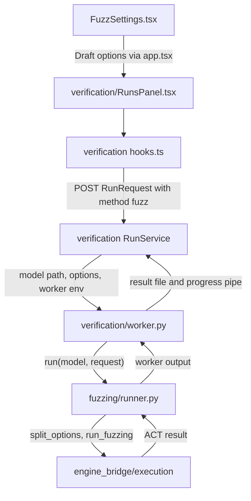
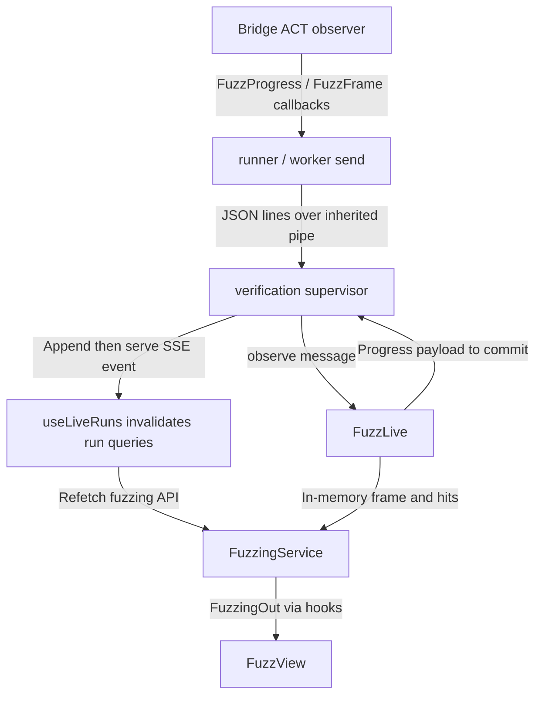
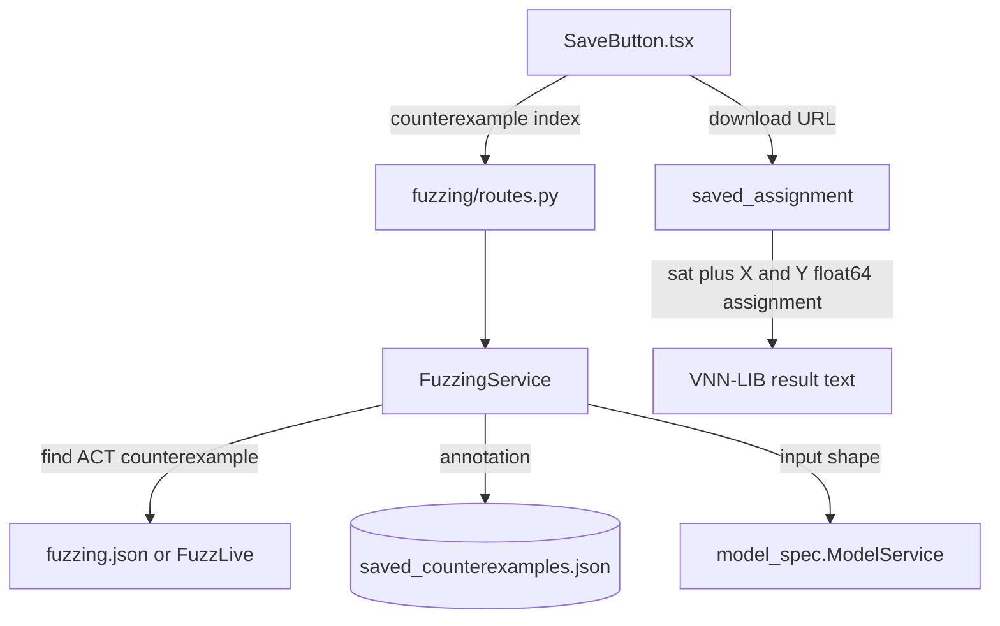

# Fuzzing

**Current responsibility and status.** This module presents ACTFuzzer as the `fuzz` method of the shared run lifecycle. It owns fuzz options, live progress projection, recorded fuzz artifacts, saved counterexamples, and VNN-LIB export. The first version is implemented. B owns the service path, C owns the Fuzzing mode, and A reviews violation semantics.

This module does not start or stop runs itself, decide whether a property is violated, or import ACT. ACT decides the counterexample and verdict. The shared run lifecycle is [verification](../verification/README.md), and ACT adaptation is [engine_bridge/execution](../../engine_bridge/execution/README.md). See the [parent flow diagram](../README.md#flow-diagram) and [project development entry point](../../docs/README.md#choose-a-development-task).

## Change Guide

| Goal | Required edits | Conditional edits / reused path |
| --- | --- | --- |
| Expose another ACT FuzzingConfig parameter | [schemas.py](schemas.py), [FuzzSettings.tsx](FuzzSettings.tsx), bridge [fuzz.py](../../engine_bridge/execution/fuzz.py) TUNABLE, parameter/default tests; regenerate wire.ts | [runner.py](runner.py) and split_options already forward ordinary hyperparameters. Change them only for a separate run argument or changed ACT calling convention. verification forwards nested FuzzOptions unchanged. |
| Change a control label or image layout | Owning FuzzSettings/Fuzz* view or [presentation.ts](presentation.ts) | No schema, worker, storage or bridge edit when the data is unchanged. |
| Add a new live metric from ACT | Bridge observation and neutral contract, [schemas.py](schemas.py), [service.py](service.py), view and relevant tests | Inspect [runner.py](runner.py) and [live.py](live.py): dataclass serialization and progress forwarding are generic. Change them only for new message/state semantics. SSE already invalidates run queries. |
| Add a field to recorded fuzz output | Bridge result if absent, [service.py](service.py)/[schemas.py](schemas.py) mapping, consuming view and tests | runner.py uses dataclasses.asdict; verification writes fuzzing.json generically. Existing storage/export usually need no change. |
| Change saved counterexample meaning or assignment export | [service.py](service.py), related tests | [routes.py](routes.py), API/hooks/views only when URL, payload or interaction changes. PNG rendering is browser-owned. |
| Change shared start/stop or lifecycle | [verification](../verification/README.md#change-guide) | runner.py only for fuzz-specific execution/stop semantics. |
| Change live fuzz commands or option discovery | [schemas.py](schemas.py), [service.py](service.py), [routes.py](routes.py), [runner.py](runner.py), [live.py](live.py), control tests | [verification](../verification/README.md) owns the control pipe; the bridge owns ACT validation and capability gating. Regenerate wire types. |

After schema changes run `npm run gen:types`. A path appearing below does not make every file on it a required edit.

`GET /api/fuzz/options` returns active-engine option metadata and `live_control`; the legacy
`GET /api/fuzz/defaults` remains available. `POST /api/runs/{run_id}/fuzz/control` queues
pause/resume/stop/update commands by `request_id`. A retry returns the first response with
`status: duplicate` and sends no second command, including after the run finishes. The receipts
are persisted as `fuzz_control_requests.json`. Unknown runs return 404; inactive/non-fuzz runs
and unavailable controls return 409; ACT-rejected update values return 422 `invalid_options`.
Stop remains available on the legacy baseline.

The runner sends applied changes as `control` messages and requested pause flags as
`control_state`; `FuzzLive.observe` maps these to committed `fuzz.control`, `fuzz.paused`, and
`fuzz.resumed` events. ACT applies pause and updates at its batch boundaries. `FuzzingOut.control`
replays the initial live configuration frozen in the run manifest plus applied change events;
rejected changes remain visible without changing current values. `summary.stop_reason` retains
ACT's end reason. Historical/legacy records without control metadata return `control: null`.
Option defaults and values use the explicit scalar-or-numeric-weight-map wire union.

### Browser control slice (VER-15)

Depends on the option-discovery and command contracts above. [api.ts](api.ts) and
[hooks.ts](hooks.ts) are the only browser data entry points. `useFuzzControl` creates a
fresh request ID per user action and invalidates the selected run's fuzzing query;
committed SSE events refresh the applied state.

[FuzzSettings.tsx](FuzzSettings.tsx) and [FuzzOptionInput.tsx](FuzzOptionInput.tsx) use
schema kinds, bounds, choices, and defaults while preserving the launch `FuzzOptions`
shape. The shared Budget (s) remains the launch timeout; `stop_on_first` maps to the
schema's `stop_on_first_violation`. Missing metadata falls back to the existing launch
fields, including RNG seed. Perturb choices retain isotropic / anisotropic / fixed labels.

[FuzzLiveControls.tsx](FuzzLiveControls.tsx) presents pause/resume, stop, and a compact
Live settings disclosure containing only options marked live. It edits `control.live`,
submits only changed fields under ACT's option names, and distinguishes queued commands
from applied/rejected receipts. The last three receipts stay visible; older receipts are
collapsed. Unsupported engines retain the shared stop path with pause disabled.
[FuzzView.tsx](FuzzView.tsx) displays the observed iteration limit and final stop reason.

The primary settings action is Apply. Reading order is run controls, current live values,
then change receipts. No duplicate metrics or decorative cards are added.
Layout: live settings - fit fields to the available panel width -> ram-grid
(`https://github.com/changeroa/StyleGallery/blob/main/patterns/grid-repetition/ram-grid.md`);
scroll owner: the existing workbench center; avoid nested scroll panels and fixed-width
fields. [fuzzing.css](fuzzing.css) reuses the existing field width, spacing scale, native
controls, semantic theme colors, and wrapping action rows.

[options.ts](options.ts) owns name mapping, fallback descriptors, input validation, and
changed-field selection. [options.test.ts](options.test.ts) contains synthetic pure-helper
tests; these are not native ACT or browser-rendering evidence.
Browser checks run on 2026-11-06 after generated-contract adoption: `npm run typecheck`
passed; `npm test` passed 35 tests across 7 files (12 new fuzz helper tests); `npm run build`
passed; frontend draft guard passed for all five changed component/style files.
Desktop/390 px rendering and WCAG 2.2 AA browser verification remain the lead's deployment
QA; this completion record does not claim those checks.

## Flow Diagram

Arrows are labeled as calls, results, or events. Neighboring modules are named explicitly and linked in the block tables. HTTP transport may be grouped; views use hooks or props, never direct fetch calls.

### Configure and start



| Block | Code entry | Contract or artifact | Neighbor handoff |
| --- | --- | --- | --- |
| Configure | [FuzzSettings.tsx](FuzzSettings.tsx), [../verification/hooks.ts](../verification/hooks.ts) | `FuzzOptions` nested in `RunRequest` | [Verification](../verification/README.md) owns start and idempotency |
| Execute | [runner.py](runner.py) | `run_fuzzing` result and JSON line messages | [Engine bridge](../../engine_bridge/execution/README.md) owns ACT semantics |
| Supervise | [../verification/service.py](../verification/service.py) | Worker output becomes sealed result and fuzz artifact | [Records](../records/README.md) owns persistence |

### Live progress, frames, and query return



| Block | Code entry | Contract or artifact | Neighbor handoff |
| --- | --- | --- | --- |
| Progress | [live.py](live.py), [../verification/service.py](../verification/service.py) | `fuzz.progress` is committed and replayable | [Verification](../verification/README.md) owns event sequence |
| Frame | [live.py](live.py) | Latest frame is memory only while running | Fuzzing owns display state |
| Browser return | [service.py](service.py), [hooks.ts](hooks.ts) | `FuzzingOut` is pending with timeline and latest frame | [Visual Bench browser composition](../README.md#flow-diagram) refreshes the view |

### Save and export



| Block | Code entry | Contract or artifact | Neighbor handoff |
| --- | --- | --- | --- |
| Save | [service.py: save_counterexample](service.py) | First save returns 201, repeat returns 200, unknown ACT index is 404 | [Records](../records/README.md#flow-diagram) stores user annotation |
| Export | [service.py: saved_assignment](service.py) via `verification.service.vnncomp_sat` | `sat`, shaped `X`, and `[1,n]` `Y`, all `float64` (same format as verification-run exports) | [model_spec](../model_spec/README.md#flow-diagram) supplies shape |
| Image export | [FuzzSaved.tsx](FuzzSaved.tsx) and view helpers | Browser can download native resolution PNG for image inputs | Browser presentation owns PNG formatting |

## Validation

Run the module's real ACT tests:

```bash
.venv/bin/python -m pytest visual_bench/fuzzing
.venv/bin/python -m pytest visual_bench/fuzzing/test_control.py
ACT_CODE_ROOT=/data1/guanqin/ACT-wt/act-gui-match .venv/bin/python -m pytest engine_bridge/execution/test_fuzz_worker.py
```

Acceptance is observable when the run emits queued, started, progress, and completed events; `/api/runs/{id}/fuzzing` changes from pending to available; `fuzzing.json` is sealed; frames are available without becoming events; repeated save requests return 201 then 200; and the exported text contains `sat`, shaped `X`, and `[1,n]` `Y`.

Use `visual_bench/verification/test_verification.py` for shared stop and run lifecycle behavior. Use `engine_bridge/execution/test_execution.py` for bridge frame and stop semantics. Do not claim these checks were run unless their command and result are recorded in the task completion record.

Acceptance recorded 2026-11-06: all 19 fake-provider cases in `test_control.py` passed as part of
`.venv/bin/python -m pytest -q` (156 passed, 24 skipped, the three known failures). All 17 native
bridge/control-worker cases passed under the ACT branch; the broader native suite has existing
baseline/catalog incompatibilities. Exact commands/counts are in
[execution validation](../../engine_bridge/execution/README.md#validation). Wire generation and
`npm run check:types` passed with scalar and numeric-weight-map values represented explicitly.

## Acceptance

- ACT controls the counterexample and verdict. Fuzzing reports `falsified` or `unknown`, never `certified`.
- Progress events are committed record data. Frames are display state while live and a capped artifact after completion.
- Saved counterexamples are annotations on the run record, not a second scientific result.

## Reference and Backlog

<details>
<summary>Current files, routes and contracts</summary>

## Current Files and Contracts

| Layer | Entry | Contract or artifact | Owner for handoff |
| --- | --- | --- | --- |
| Wire | [schemas.py](schemas.py) | `FuzzOptions`, `FuzzingOut`, progress, frame, seed, counterexample, and saved-counterexample payloads; input-sized vectors above `DISPLAY_VALUES` (3x224x224) values are omitted (records keep them) | `verification` embeds options in `RunRequest`; `generated/wire.ts` is generated |
| Worker | [runner.py](runner.py) | Reads live commands, calls `run_fuzzing`, writes progress/frame/control/control_state JSON lines, and returns outcome/fuzzing | `engine_bridge/execution` owns ACT option and result adaptation |
| Live service | [live.py](live.py) | Keeps frames/hits in memory; returns progress/control/pause/resume events for supervisor commit | `verification.RunService` owns both pipes and the event log |
| Application service | [service.py](service.py) | Reads `fuzzing.json` and committed progress, saves annotations, emits VNN-LIB 2.0 text | `records` owns artifacts and annotations; `model_spec` owns input descriptions |
| HTTP | [routes.py](routes.py) | `/api/fuzz/defaults`, `/api/fuzz/options`, `/api/runs/{id}/fuzz/control`, `/api/runs/{id}/fuzzing`, saved-counterexample routes | `verification` owns `/api/runs` and SSE |
| Browser data | [api.ts](api.ts), [hooks.ts](hooks.ts) | TanStack Query keys, mutations, and invalidation | `shared` owns HTTP and query primitives |
| Views | [FuzzView.tsx](FuzzView.tsx), [FuzzTimeline.tsx](FuzzTimeline.tsx), [FuzzMutations.tsx](FuzzMutations.tsx), [FuzzCounterexamples.tsx](FuzzCounterexamples.tsx), [FuzzSaved.tsx](FuzzSaved.tsx), [FuzzInputs.tsx](FuzzInputs.tsx), [FuzzStrategies.tsx](FuzzStrategies.tsx), [DeltaBars.tsx](DeltaBars.tsx), [SaveButton.tsx](SaveButton.tsx), [FuzzSettings.tsx](FuzzSettings.tsx), [presentation.ts](presentation.ts) | Presentation of live and sealed data | `workspace` and `verification` provide selection and run controls |
| Tests | [test_fuzzing.py](test_fuzzing.py) | Real ACT lifecycle, options, live events, stop, saved export, batch inputs | Keep fake fixtures separate from real ACT checks |
| Control tests | [test_control.py](test_control.py) | Explicitly fake-provider HTTP validation, real pipe writes, idempotency, capability errors and event replay | Native semantics and worker tests live in [execution](../../engine_bridge/execution/README.md) to avoid HTTP fixture engine restoration |


</details>

<details>
<summary>Task acceptance and planned capabilities</summary>

## Tasks

<a id="3-tasks"></a>

Task IDs retain the original `VER` prefix. Dependencies are acceptance prerequisites, not import instructions.

| ID | Deliverable | Depends on | Completion evidence |
| --- | --- | --- | --- |
| VER-06 | Run and demonstrate ACTFuzzer from the GUI | EXE-04, VER-02, REC-01 | `fuzz` is a run method for every catalog model, with `FuzzOptions` (max iterations, RNG seed, stop at first counterexample, and ACTFuzzer's tunable hyperparameters: coverage strategy, activation threshold, mutation weights, perturb mode/scale, seed selection, PGD restarts; defaults equal the pinned ACT `pipeline.yaml`, served by `GET /api/fuzz/defaults` and drift-checked against ACT in `test_fuzzing.py`); options on another method are rejected. The worker streams progress as JSON lines over an inherited pipe; the supervisor commits each as a `fuzz.progress` event, so the Fuzzing tab follows the run live over SSE and a reconnect replays it. Mutated-input frames (lane 0 of ACT's mutated batch, sampled with the progress reports) arrive on the same pipe but are held in memory as the latest frame only, never committed as events; the Fuzzing tab shows that frame beside the coverage chart while running, and `fuzzing.json` keeps up to 16 frames as a playable filmstrip whose position is marked on the chart. The sealed `fuzzing.json` artifact holds ACT's summary, timeline, per-strategy counts, and the first 20 counterexamples (each with ACT's model output on its seed), plus the first 20 seed rows with their outputs; `GET /api/runs/{id}/fuzzing` serves it (`pending` with the live timeline while running). The view shows coverage and counterexamples over iterations, the seed inputs and their outputs, a gallery of mutated counterexamples (seed / mutated / perturbation; image thumbnails for 1- or 3-channel square inputs), expected vs argmax class for labelled properties, a seed-vs-mutated input and output comparison, and strategy shares. Records written before seed capture omit those parts. `test_fuzzing.py` covers the lifecycle and record. |
| VER-07 | Stop runs; save and export fuzz counterexamples; show the ACT verdict | VER-06 | `POST /api/runs/{id}/stop` is idempotent and commits `run.stop_requested`: a fuzz worker gets SIGTERM, ACTFuzzer ends after its current iteration through its own timeout check, and the run completes with ACT's report of the iterations run (`summary.stopped`); verify/BaB workers are killed and the run fails with `stopped` (no verdict). A worker that ignores the stop for `STOP_GRACE_S` is killed. Violating frames carry ACT's own counterexample (`FuzzFrameOut.counterexample`; lane 0 need not be it), so the Fuzzing tab lists counterexamples while running. `POST /api/runs/{id}/saved-counterexamples {index}` saves ACT's counterexample #index on the record (idempotent: 201 then 200; 404 if ACT reported none); `GET .../saved-counterexamples/{index}/vnnlib` returns it as a VNN-COMP result file: `sat` followed by the VNN-LIB 2.0 command-line assignment (standard Sec. 5.3.1) of `X` (input-spec shape) and `Y` (`[1, n]`), element type `float64` because ACT computes and checks in float64; the browser exports image inputs as a native-resolution PNG. `VerdictBanner.tsx` shows the selected run's ACT verdict (CERTIFIED / COUNTEREXAMPLE FOUND / UNKNOWN / TIMEOUT, or no verdict) above the Verification and BaB modes. Evidence: `test_fuzzing.py` (save/export, fuzz stop), `../verification/test_verification.py` (verify stop), and `engine_bridge/execution/test_execution.py` (frame counterexample, `should_stop`). |
| VER-15 | Expose option discovery and idempotent live fuzz commands | EXE-07, VER-16, REC-05 | `test_control.py` exercises the HTTP contract with a labeled fake provider, validates command delivery and duplicates, and reconstructs applied config/pause state from committed events. Native semantics and the actual worker channel are covered by EXE-07. |

The public fuzz observer/control path is capability-gated; older ACT keeps the private progress
hook and stop fallback. Additional frame history remains separate work; the latest live frame
is still memory-only.

</details>
