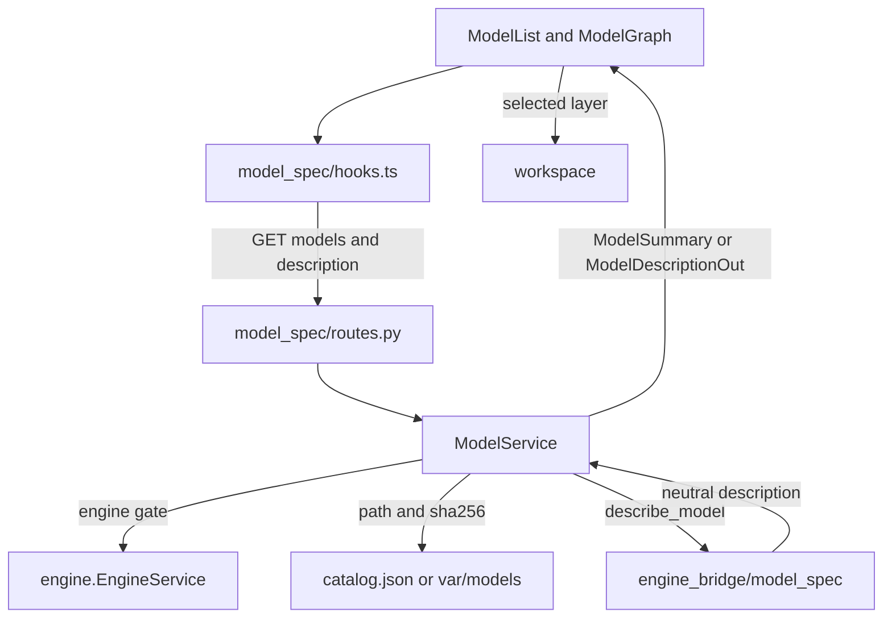
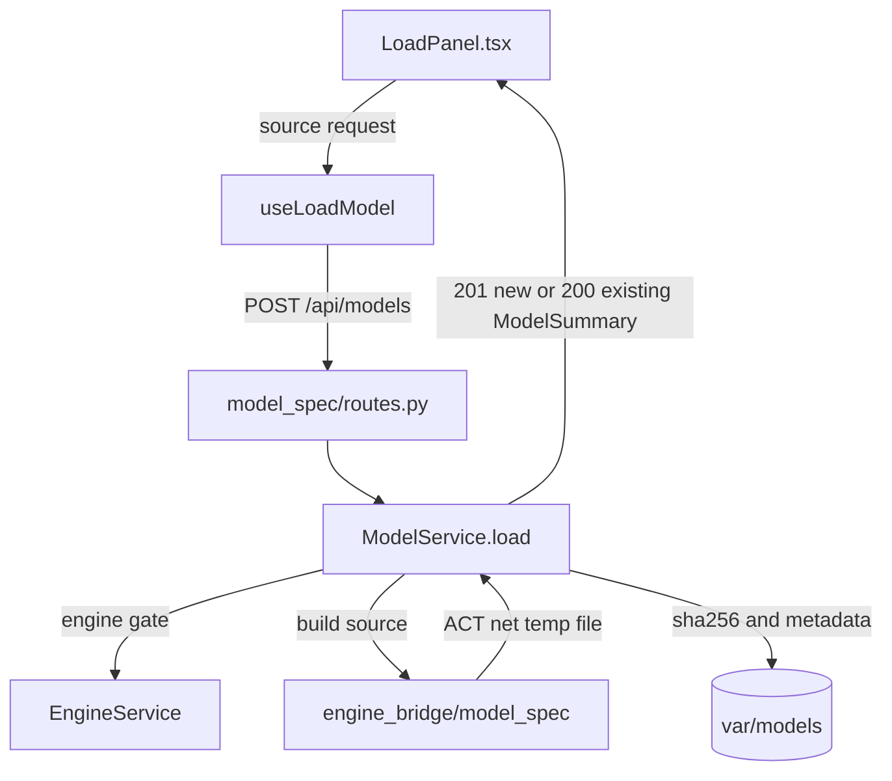
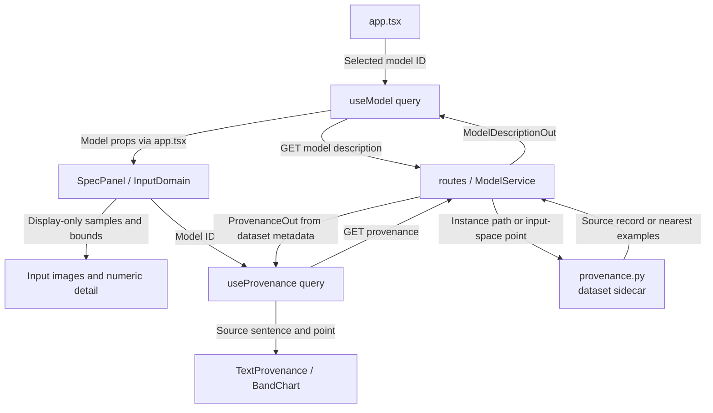

# Model and Specification View

**Current responsibility and status.** This module lists pinned and built models, loads supported VNN-LIB and classifier sources, serves ACT-backed model descriptions and dataset samples, and renders the network and input or output specification. MSV-01 and MSV-04 are implemented. MSV-02 and MSV-03 remain backlog. C owns the views, B integrates the service, and A reviews variable and constraint semantics.

The module owns presentation and content addressed model snapshots. It does not reinterpret ACT semantics, calculate bounds, or replace unsupported specifications with boxes. ACT-side loading and description are [engine_bridge/model_spec](../../engine_bridge/model_spec/README.md). Run creation is [verification](../verification/README.md), engine readiness is [engine](../engine/README.md), and selection is [workspace](../workspace/README.md). See the [parent flow diagram](../README.md#flow-diagram) and [project development entry point](../../docs/README.md#choose-a-development-task).

## Change Guide

| Goal | Required edits | Conditional edits / reused path |
| --- | --- | --- |
| Show a new description field | [schemas.py](schemas.py), [service.py](service.py) mapping, consuming view/tests; generate wire.ts | [bridge model_spec](../../engine_bridge/model_spec/README.md#change-guide) only if the neutral description lacks the field. Routes/hooks/API only for endpoint/query changes. |
| Support a new source | [bridge source builder](../../engine_bridge/model_spec/sources.py), [schemas.py](schemas.py), [service.py](service.py), [LoadPanel.tsx](LoadPanel.tsx), source tests | Existing POST /api/models transport can remain if its operation is unchanged. |
| Change graph or input-image presentation | [ModelGraph.tsx](ModelGraph.tsx), [SpecPanel.tsx](SpecPanel.tsx), [InputDomain.tsx](InputDomain.tsx) as relevant | Shared pixels helpers only when reusable rendering changes; no ACT or model-identity change for presentation. |
| Show where an input comes from | [service.py](service.py) `provenance` / `nearest`, [TextProvenance.tsx](TextProvenance.tsx), [SpecPanel.tsx](SpecPanel.tsx), shared [BandChart.tsx](../shared/ui/BandChart.tsx) and [Neighbours.tsx](../shared/ui/Neighbours.tsx) | [provenance.py](provenance.py) reads and rebuilds workbench dataset metadata; show text only for the exact recorded instance hash. No ACT provenance API is required. |
| Change content identity or persistence | [service.py](service.py), persistence/hash tests | [verification](../verification/README.md#change-guide) only when its model ID/path contract changes. |
| Add editable specification drafts | MSV-03 backlog: define validation and new immutable model references first | No general draft API exists today. Preserve old runs' pinned snapshots. |

## Flow Diagram

Arrows are labeled as calls, results, or events. Neighboring modules are named explicitly and linked in the block tables. HTTP transport may be grouped; views use hooks or props, never direct fetch calls.

### List and describe a model



| Block | Code entry | Contract or artifact | Neighbor handoff |
| --- | --- | --- | --- |
| List | `ModelService.models` | Catalog and derived model summaries with methods and sha256 | [Verification](../verification/README.md) uses method list |
| Describe | `ModelService.describe` | `ModelDescriptionOut` with stable layer IDs, shapes, input bounds, and output constraints | [Analysis](../analysis/README.md) and [workspace](../workspace/README.md) use IDs |
| Select | [ModelGraph.tsx](ModelGraph.tsx) | Layer selection is presentation state, not ACT computation | [Workspace](../workspace/README.md) owns global selection |

### Load and persist a source



| Block | Code entry | Contract or artifact | Neighbor handoff |
| --- | --- | --- | --- |
| Source request | `LoadVnnlibRequest`, `LoadTorchRequest` | Relative VNN-LIB paths (`onnx` lists one path per network of a multi-network property, comma-separated), classifier source, index or indices, eps | Bridge validates source availability |
| Build | `ModelService.load` | Content addressed `<kind>-<sha12>` model and `.meta.json` | Derived model can be used by [verification](../verification/README.md) |
| Repeat load | `model_id` from sha256 | Same content returns 200 and existing model | No duplicate build is required |

### Render an input specification



| Block | Code entry | Contract or artifact | Neighbor handoff |
| --- | --- | --- | --- |
| Description | `InputSpecOut`, `OutputSpecOut` | ACT shape, bounds, center, dataset, constraint text, and true class; bounds and center are omitted above `DISPLAY_VALUES` (3x224x224) values per row, and the panel says so | No browser reinterpretation of constraints |
| Image view | [InputDomain.tsx](InputDomain.tsx) | Clean, bounds, heat map, and sampled display perturbations | Samples are visual only, not verification evidence |
| Provenance | [TextProvenance.tsx](TextProvenance.tsx), [textDiff.ts](textDiff.ts), shared [BandChart.tsx](../shared/ui/BandChart.tsx) | Recorded source sentence, class names, replayed variants with word differences, match status, and the box with the source point | Text only from metadata matching this exact instance hash |
| Navigation | [ModelGraph.tsx](ModelGraph.tsx) | Stable layer ID | [Workspace](../workspace/README.md) and [analysis](../analysis/README.md) consume selection |

## Validation

Run the module's real ACT tests:

```bash
.venv/bin/python -m pytest visual_bench/model_spec
```

Acceptance is observable when catalog models list their pinned sha256 and methods, a valid VNN-LIB or classifier source returns 201 then 200 for the same content, the model survives service restart, descriptions preserve ACT layer IDs and shapes, samples return the requested dataset row, a model the active engine cannot load is reported as `load_failed` and rebuilds from its recorded parameters, and invalid paths or sources return structured errors.

Run `npm run gen:types` after changing `schemas.py`, then `npm run check:types`. Do not hand edit `visual_bench/generated/wire.ts`. Do not claim tests were run unless the command and result are recorded.

The source-text sidecar is dataset metadata, stored under the benchmark directory;
its existing hashes and format are retained. Offline reconstruction and both helper
self-checks share the same module:

```bash
.venv/bin/python -m visual_bench.model_spec.provenance --help
.venv/bin/python -m visual_bench.model_spec.provenance --self-check
```

The builder loads optional encoder/dataset packages only when rebuilding. Normal
queries do not run the encoder, import ACT, or change verification results.

## Reference and Backlog

<details>
<summary>Current files, routes and contracts</summary>

## Current Files and Contracts

| Layer | Entry | Contract or artifact | Owner for handoff |
| --- | --- | --- | --- |
| Wire | [schemas.py](schemas.py) | Model summaries, source requests, samples, layers, input and output specs | `generated/wire.ts` is generated from Pydantic models |
| Dataset metadata | [provenance.py](provenance.py) | Sidecar reader, nearest examples, offline SafeNLP builder; existing `act.input_provenance/1` data format is retained | No ACT imports or engine capability |
| Service | [service.py](service.py) | `models`, `sources`, `sample`, `load`, `rebuild`, `describe`, `provenance`, `nearest`; content addressed built models with `built_with` (ACT commit and source) and `engine_check`; input provenance from local dataset metadata (`available` or `none`, independent of the ACT version) | Engine gate is `engine.EngineService`; ACT descriptions are bridge owned; dataset metadata is workbench owned |
| HTTP | [routes.py](routes.py) | `/api/models`, `/api/models/{id}`, `POST /api/models/{id}/rebuild`, `/api/sources`, `/api/sources/sample`, `GET /api/models/{id}/provenance`, `POST /api/models/{id}/provenance/nearest` | Verification consumes model IDs and methods |
| Browser data | [api.ts](api.ts), [hooks.ts](hooks.ts) | Queries for models, descriptions, sources, samples, provenance and nearest known examples (`useProvenance`, `useRowProvenance`, `useNearest`, also used by fuzzing and verification); load and rebuild invalidate the model list | Shared query keys own cache identity |
| Views | [LoadPanel.tsx](LoadPanel.tsx), [ModelList.tsx](ModelList.tsx), [ModelGraph.tsx](ModelGraph.tsx), [SpecPanel.tsx](SpecPanel.tsx), [InputDomain.tsx](InputDomain.tsx), [TextProvenance.tsx](TextProvenance.tsx), [RebuildNotice.tsx](RebuildNotice.tsx) | Load (with find by source sentence), graph, spec (vector boxes as a band chart), image-domain, provenance and sample presentation; rebuild offer for a model the active engine cannot load | Workspace owns selection and navigation |
| Tests | [test_model_spec.py](test_model_spec.py), [test_provenance_data.py](test_provenance_data.py), [test_provenance.py](test_provenance.py), [textDiff.test.ts](textDiff.test.ts) | Real ACT loads, idempotency, persistence, descriptions, samples, engine-check and rebuild, structured errors; provenance available / none, neighbours and their errors; word differences | Bridge loader tests cover ACT source adaptation |


</details>

<details>
<summary>Task acceptance and planned capabilities</summary>

## Tasks

<a id="3-tasks"></a>

The task IDs and dependencies remain stable. MSV-04 is the implemented loading slice and appears in the parent task index.

| ID | Deliverable | Depends on | Completion evidence |
| --- | --- | --- | --- |
| MSV-01 | Deliver real description list/detail UI | VER-01, WS-02 | A real sample shows correct layer shapes, tensor edges, and specification variables with loading/error states. |
| MSV-02 | Evaluate and wrap the network renderer | MSV-01 | Show stable IDs, external selection, node callbacks, resize, worker/assets, and browser findings; document a fallback if the candidate fails. |
| MSV-03 | Validate specification drafts | MSV-01, MSB-03 | Invalid variable mappings are explained; a valid change creates a new reference and cannot mutate an existing run. |
| MSV-04 | Load models from VNN-LIB and torch sources | MSB-04, MSV-01 | `LoadPanel.tsx` in the sidebar: VNN-LIB tab (benchmark, instance) and Torch tab (classifier, test-image index with preview and label, eps slider, batch size with a per-image picker: a batch of several test images builds one net with a row per image (fuzzing and Verification; BaB needs one image), and the Specification panel shows it one row at a time). `POST /api/models` builds through the bridge and returns the content-addressed model (201 new, 200 existing); loaded models appear under "Loaded" with their parameters, and selecting one prefills the form so a new image/eps rebuilds a new snapshot. Flat VNN-LIB image vectors of known datasets are drawn as H x W x C (cora_2024 convention). |
| MSV-05 | Flag and rebuild models built on another ACT engine | MSV-04, VER-08 | `ModelService.load` records `built_with` (commit, baseline or remote/branch) in `.meta.json`. `ModelSummary.engine_check` is `same_commit` when the active engine built it, otherwise the outcome of the first describe on the active commit (`loads` / `load_failed`) or `unchecked`; model files are never scanned eagerly (built models can be GBs). `ModelList.tsx` marks `load_failed` ("needs rebuild") and untried models from another commit; `RebuildNotice.tsx` replaces the load error with a button that calls `POST /api/models/{id}/rebuild`, which rebuilds the recorded source settings through `load` and selects the new model; the old model and its runs are kept. Evidence: `test_model_spec.py::test_model_from_another_engine_is_flagged_when_it_fails_to_load_and_rebuilds`. |
| MSV-07 | Load multi-network VNN-LIB properties | MSB-06, MSV-04 | `/api/sources` lists an instance whose `instances.csv` row names several networks (VNN-COMP `[(role, path), ...]`, e.g. monotonic_acasxu_2026, isomorphic_acasxu_2026) with `onnx` holding the paths comma-separated in network order, only while the active engine has `source.vnnlib.multi_network`; `LoadVnnlibRequest` validates every path and `load` requires that capability. The VNN-LIB tab names such a network `f + g` (`hooks.ts` `netStem`). Evidence: `test_model_spec.py::test_invalid_model_loads_are_structured_errors` (path outside the benchmark in the second network). |
| MSV-08 | Show where a VNN-LIB input comes from | MSV-04, MSV-01 | `provenance.py` owns sidecar reading, hash matching, nearest-example lookup and offline SafeNLP reconstruction. `GET /api/models/{id}/provenance` returns available/none and one metadata row per input; `POST .../nearest` ranks recorded examples, and `/api/sources` carries source text. Views preserve sentence search, perturbation differences, the vector-box chart and counterexample neighbours. Tests: `test_provenance_data.py` runs with no ACT checkout; `test_provenance.py` exercises the available and missing-data HTTP paths on the baseline engine. |
| MSV-06 | Load a batch of VNN-LIB properties on one network | MSB-05, MSV-04 | `LoadVnnlibRequest.vnnlibs` (distinct, starts with `vnnlib`, at most 64); the VNN-LIB tab has a batch size (capped at the network's property count) and a per-slot property picker restricted to the first slot's ONNX file, with the batch collapsed into chips. `hooks.ts` `batchRows`/`useBatchRows` label batch rows for every view (test image `#i` or property name): ModelList chip, Verification row verdicts, fuzzing Inputs table. Rebuild keeps the batch. `visual_bench/fuzzing/test_fuzzing.py::test_vnnlib_properties_on_one_network_are_one_net_fuzzed_row_by_row`. |


MSV-02's renderer evaluation and MSV-03's editable draft validation are not current capabilities. Proposed `ModelSpecView.tsx`, `view_model.ts`, and `network_renderer.ts` are design references only. Keep unsupported specifications visible with their actual representation and reason.

</details>
