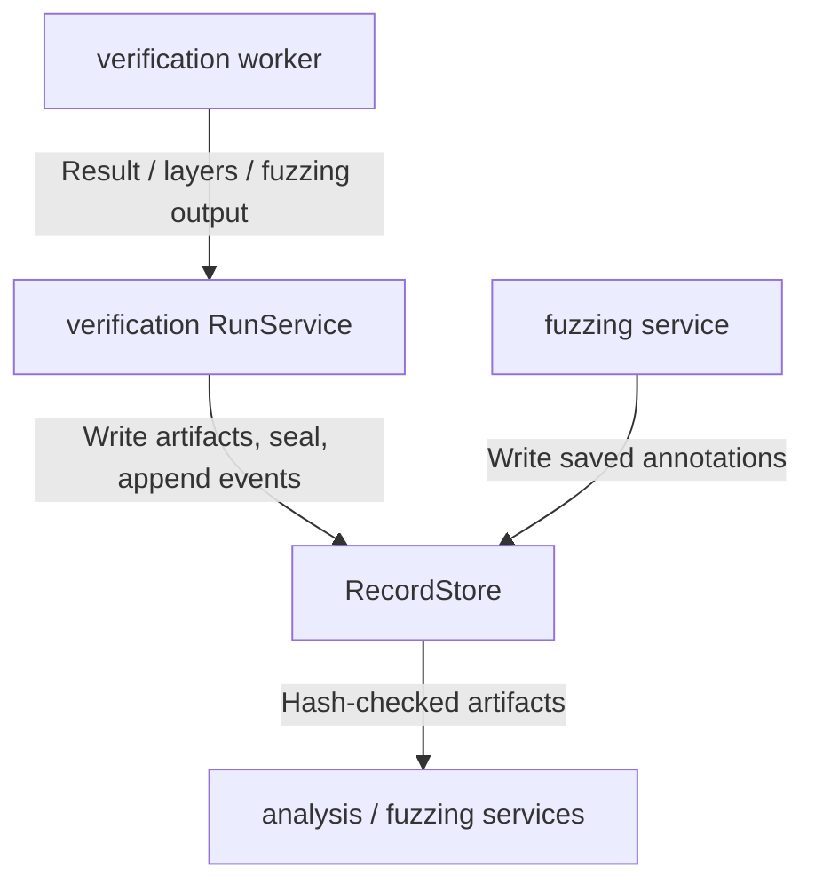
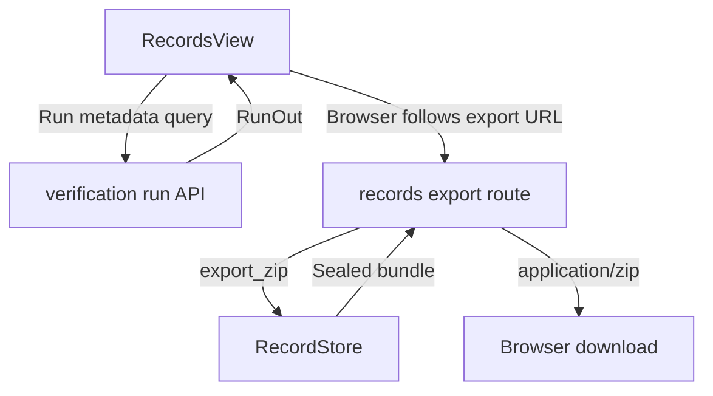

# Records and Replay

Current responsibility: persist run manifests, ordered lifecycle events, sealed artifacts, mutable user annotations, and zip exports. The first version supports integrity checks, torn-tail recovery, SSE event waiting, and export of sealed records. Run metadata queries are served by verification and reused by the Records tab. Export is this module's own route and must not be conflated with the query endpoint. See the [parent scope](../README.md), [repository rules](../../AGENTS.md), and the [development task guide](../../README.md#choose-a-development-task).

## Change Guide

| Goal | Edit here | Conditional / reused path |
| --- | --- | --- |
| Change provenance/hash display | [RecordsView.tsx](RecordsView.tsx) | Reuse verification's run query. Do not add a second metadata endpoint. |
| Change sealing, integrity or recovery | [store.py](store.py) and relevant verification/fuzzing tests | Writer services only if the store contract changes. |
| Change zip contents | RecordStore.export_zip in [store.py](store.py), export coverage tests | [routes.py](routes.py) for HTTP headers/errors only; [api.ts](api.ts) or view only if URL/download interaction changes. |
| Add a scientific artifact | Producing worker/bridge plus [verification](../verification/README.md#change-guide) artifact write path | Existing generic RecordStore may need no change. [analysis](../analysis/README.md#change-guide) is a reader, not the layers.json writer. |
| Change saved counterexample annotations | [fuzzing](../fuzzing/README.md#change-guide) service/schema/view | RecordStore annotation methods are reused unless persistence guarantees change. Annotations are not part of the artifact seal. |

Run metadata belongs to verification's schema/query; an added metadata field requires its owning schema change and `npm run gen:types`. Import and scientific snapshot replay remain planned, not available export features.

## Flow Diagram

The query, artifact producer and export routes have different owners. Arrows are labeled with the transferred data or operation.





| Block | Code and contract | Neighbor handoff |
| --- | --- | --- |
| Run metadata | [hooks.ts](hooks.ts) reuses the run query and [RecordsView.tsx](RecordsView.tsx) renders RunOut | [verification](../verification/README.md#flow-diagram) |
| Artifact producer | [verification/service.py](../verification/service.py) writes worker results, layers and fuzzing artifacts and seals them | [Run lifecycle](../verification/README.md#flow-diagram) |
| Annotation writer | [fuzzing/service.py](../fuzzing/service.py) saves user annotations through RecordStore | [Saving counterexamples](../fuzzing/README.md#flow-diagram) |
| Artifact readers | [analysis/service.py](../analysis/service.py) reads layers; fuzzing reads fuzzing data and annotations | [analysis](../analysis/README.md#flow-diagram), [fuzzing](../fuzzing/README.md#flow-diagram) |
| Export | [api.ts](api.ts) supplies exportUrl; [routes.py](routes.py) checks existence/seal and calls [store.py](store.py) export_zip | Downloaded zip; no second metadata API |

## Validation

Run the existing record and fuzzing coverage:

```bash
.venv/bin/python -m pytest visual_bench/verification/test_verification.py
.venv/bin/python -m pytest visual_bench/fuzzing/test_fuzzing.py
npm test
```

Observable behavior: the Records tab shows verification's selected run metadata, the export button requests the records route, incomplete runs report that export requires a sealed record, and the downloaded zip contains only relative run paths plus sealed artifacts, events, hashes, and available annotations. These are validation instructions, not a new test result.

## Reference and Backlog

<details>
<summary>Current files and routes</summary>

## Current Files and Routes

| File | Responsibility |
| --- | --- |
| [store.py](store.py) | `RecordStore`: per-run directories, atomic writes, ordered `events.jsonl`, sealed artifact hashes, mutable annotations, event waiting, and zip export. |
| [routes.py](routes.py) | `GET /api/runs/{run_id}/export`, owned by records. Returns a zip only for a sealed run. |
| [api.ts](api.ts) | Export URL helper. Run metadata query is imported from verification's client path. |
| [hooks.ts](hooks.ts) | Run record query shared with verification and the export action. |
| [RecordsView.tsx](RecordsView.tsx) | Provenance, hashes, status, native reference, and export button. |
| [../verification/test_verification.py](../verification/test_verification.py) | Record integrity, recovery, and lifecycle coverage. |
| [../fuzzing/test_fuzzing.py](../fuzzing/test_fuzzing.py) | Fuzzing artifacts and saved annotation export coverage. |

Record layout under `var/records/<run_id>/`:

```text
manifest.json                 immutable request and provenance
events.jsonl                  ordered lifecycle events
result.json                   final ACT result
layers.json                   recorded interval layer states
fuzzing.json                  fuzzing result when applicable
artifacts.json                sha256 seal for available artifacts
saved_counterexamples.json    mutable user annotation, included in export
```


</details>

<details>
<summary>Task acceptance, rationale, and planned capabilities</summary>

## Tasks and Acceptance

| ID | Deliverable | Depends on | Completion evidence |
| --- | --- | --- | --- |
| REC-01 | Persist immutable run metadata and final result | BASE-03 | Save/read a manifest and artifact for the native ACT run recorded in BASE-03 with identical hashes; no private absolute paths are required in a bundle. |
| REC-02 | Persist commit batches and snapshot boundaries | REC-01, EVT-02 | A simulated interrupted write recovers the last committed prefix; incomplete references are never visible. |
| REC-03 | Implement replay, coverage, and resync reads | REC-02 | Snapshot S plus following events reproduces recorded state; missing/expired history is explicitly represented. |
| REC-04 | Export fixed research data and figure configuration | REC-03, ANA-02 | Export/import preserves numerical data, selected coordinates, guarantees, revision, and plot configuration; invalid bundle paths are rejected. |

Current status: REC-01 is implemented. REC-02 and REC-03 are partial through lifecycle events, recovery, and replay. REC-04 has sealed export only, not import. User annotations are written atomically, are not hashed into `artifacts.json`, and are included in exports.


Keep the first store local and small. Publish artifacts atomically, then write the seal. Event replay reconstructs recorded display state, never solver memory, and never executes imported commands. Missing history is not zero. Orphan artifacts may be cleaned only after committed references are checked.

Planned operations are `createRunRecord`, `appendCommit`, `readSnapshot`, `readEvents`, `readArtifact`, and `exportBundle`. Current equivalents live on `RecordStore`. Planned files such as `repository.py`, `commit_log.py`, and `bundle.py` are intentionally folded into `store.py` until later tasks require extraction.

Owner: B, with D and C integrating figure and data export. On completion, record exact commands and results, provenance, and limitations.

</details>
