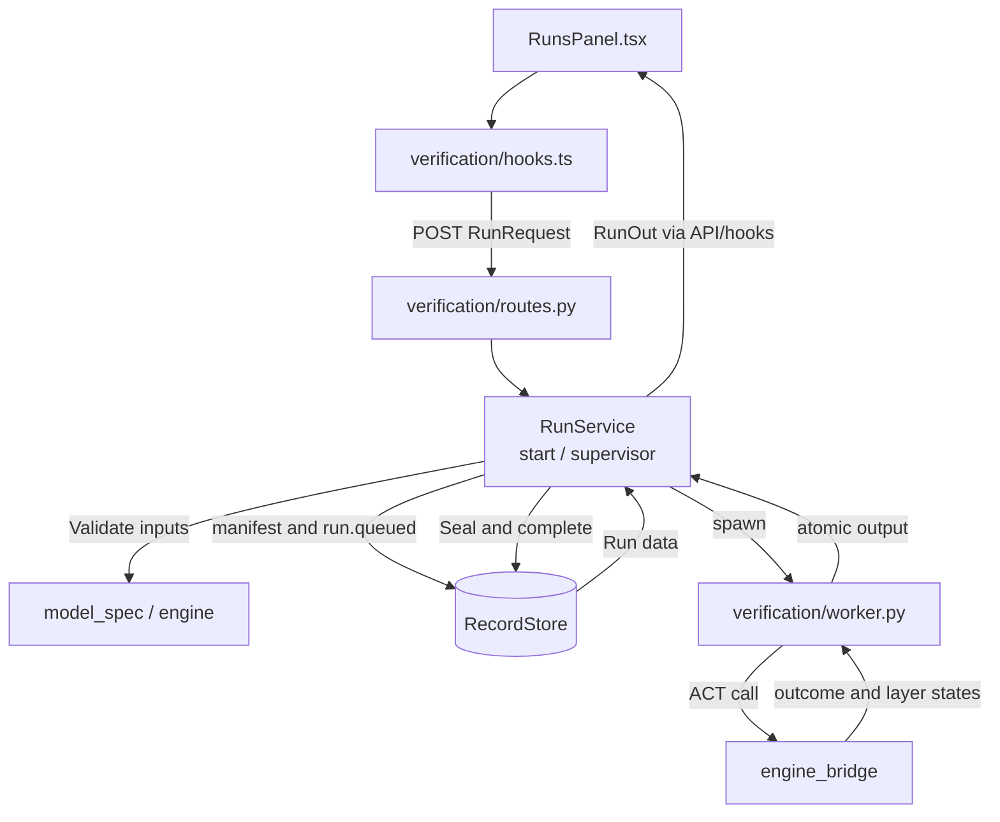
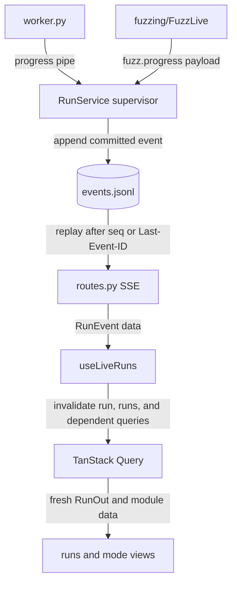
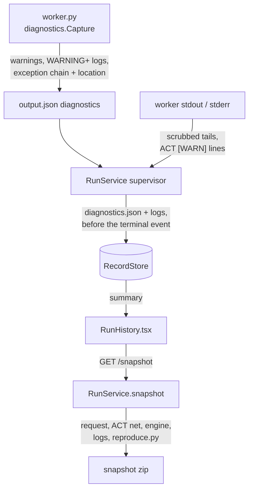
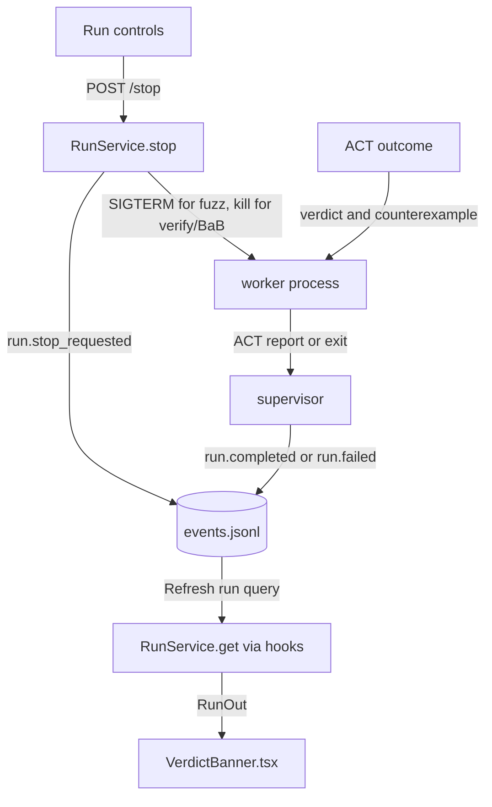

# Verification Application

**Current responsibility and status.** This module owns the application run lifecycle for interval, BaB, and fuzz methods. It validates requests, checks idempotency, creates records, supervises one worker process per run, commits lifecycle events, exposes SSE replay, and reports ACT's result. The first version is implemented for VER-01, VER-02, VER-07, with VER-03 and VER-04 partial. B owns the service path, C owns run interaction, and A reviews verdict semantics.

The module does not implement verification algorithms, import ACT directly, own model loading, or own fuzz presentation and solver licensing. ACT calls go through [engine_bridge](../../engine_bridge/README.md). Fuzz-specific behavior is [fuzzing](../fuzzing/README.md), and engine gating and licenses are [engine](../engine/README.md). See the [parent flow diagram](../README.md#flow-diagram) and [project development entry point](../../README.md#choose-a-development-task).

## Change Guide

| Goal | Required edits | Conditional edits / reused path |
| --- | --- | --- |
| Change run validation or idempotency | [schemas.py](schemas.py) / [service.py](service.py), focused lifecycle tests | Worker only if an execution argument changes; existing nested fuzz options are forwarded, not individually mapped here. |
| Add an ACT run method | Bridge method/invocation support, [schemas.py](schemas.py), [worker.py](worker.py), tests and consuming mode/control | Service scheduling and records can be reused if the request/outcome shape still fits. Coordinate [workspace](../workspace/README.md#change-guide) for mode registration. |
| Change stop or worker supervision | [service.py](service.py), lifecycle tests | [worker.py](worker.py) only if signal/output handling changes; fuzz-specific adaptation belongs to fuzzing/bridge. |
| Change fuzz control transport or deadlines | `RunService.send_fuzz_control`, `_supervise` in [service.py](service.py), [worker.py](worker.py) | Fuzzing owns request validation/idempotency and projects the returned control events. Native pipe tests are in `engine_bridge/execution/test_fuzz_worker.py`. |
| Add an event or run projection field | Owning commit/projection code and schema when shape changes, focused tests | Event payloads and SSE forwarding are generic; change routes/hooks only if replay, subscription or invalidation semantics change. |
| Change history/control presentation | [RunsPanel.tsx](RunsPanel.tsx), [RunHistory.tsx](RunHistory.tsx), [VerdictBanner.tsx](VerdictBanner.tsx) as relevant | No ACT or record change when existing RunOut suffices. |
| Change captured diagnostics or the reproduction snapshot | [diagnostics.py](diagnostics.py) (capture, path scrubbing, snapshot zip), [test_diagnostics.py](test_diagnostics.py) | [worker.py](worker.py) for what the worker captures; `RunService._write_diagnostics`/`snapshot` in [service.py](service.py) for supervisor-side data; `RunDiagnosticsOut` + `npm run gen:types` only if the history summary changes. |

Generate wire.ts after schema edits. Browser and assistant share services; the assistant does not call the HTTP routes internally.

## Flow Diagram

Arrows are labeled as calls, results, or events. Neighboring modules are named explicitly and linked in the block tables. HTTP transport may be grouped; views use hooks or props, never direct fetch calls.

### Start and supervise



| Block | Code entry | Contract or artifact | Neighbor handoff |
| --- | --- | --- | --- |
| Request | `RunRequest`, [routes.py](routes.py) | Method, model, budget, optional domain or fuzz options | [Model_spec](../model_spec/README.md) validates method support |
| Start | [service.py: RunService.start](service.py) | Returns 202 without waiting for computation, or 200 for identical idempotent request | [engine](../engine/README.md#flow-diagram) gate blocks unusable ACT with 503 |
| Execute | [worker.py](worker.py) | `output.json` contains ACT outcome, layers, and optional fuzz artifact | Bridge owns numerical result |
| Seal | [service.py: _commit_result](service.py) | `result.json`, optional `layers.json` and `fuzzing.json`, then completion event | [Records](../records/README.md#flow-diagram) seals and hashes artifacts |

### Live events and query invalidation



| Block | Code entry | Contract or artifact | Neighbor handoff |
| --- | --- | --- | --- |
| Commit | `RecordStore.append_event` through supervisor | Ordered sequence, status, payload | [Records](../records/README.md) owns torn-tail recovery and replay |
| SSE | `routes.events` | Replays after `after` or `Last-Event-ID`, ends after terminal event | Browser follows one stream per active run |
| Refresh | `useLiveRuns` | Each committed event invalidates run and dependent data | [Fuzzing](../fuzzing/README.md) and [analysis](../analysis/README.md) read the refreshed run |

### Diagnostics and reproduction snapshot



| Block | Code entry | Contract or artifact | Neighbor handoff |
| --- | --- | --- | --- |
| Capture | `diagnostics.Capture` in [worker.py](worker.py) | Python warnings, WARNING+ log records, notes, exception chain with frames attributed to `act` / `engine_bridge` / `visual_bench` / `library`; location = innermost ACT frame | Bridge errors keep ACT's exception as `__cause__`, so the chain reaches ACT frames |
| Record | `RunService._write_diagnostics` | `diagnostics.json` (failure, worker report, process exit, engine snapshot frozen at start, environment, worker request), `act_stdout.log`, `worker_stderr.log` (last 1 MiB, scrubbed) | [Records](../records/README.md) stores them unsealed, because failed runs are never sealed |
| Download | `GET /api/runs/{id}/snapshot`, `RunService.snapshot` | Zip: README, request.json, `model/<id>.json` (the net with its INPUT_SPEC/ASSERT instance), `model/entry.json`, run record files, logs, diagnostics, reproduce.py; 409 while the run is active | Model file read through model_spec's sha-checked path |

Absolute server paths are replaced by `<ACT>`, `<ACT-GUI>`, `<python>`, `<run>`, `<models>`, `<records>` or `~` before they are stored. Diagnostics report what the GUI observed; they never change ACT's verdict.

### Stop and verdict



| Block | Code entry | Contract or artifact | Neighbor handoff |
| --- | --- | --- | --- |
| Stop | `RunService.stop`, `_signal_stop` | Idempotent; fuzz gets a grace period, verify and BaB are killed | [Fuzzing](../fuzzing/README.md) owns ACT stopped summary |
| Verdict | `_commit_result`, `RunResultOut` | Workbench reports ACT verdict and keeps no result after forced verify stop | Banner is shared by Verification and BaB modes |

Fuzz workers inherit a second pipe: the supervisor writes JSON control commands and the worker's
reader thread invokes bridge `FuzzRunControl`. The progress pipe returns applied updates and pause
flags through `FuzzLive.observe` for ordered event commit. The service freezes initial live option
values in the manifest, closes control descriptors when the worker finishes, and retains SIGTERM
plus the existing grace kill as stop fallback. SIGTERM wakes paused ACT runs. The supervisor
deadline excludes reported pause time and follows applied `timeout_seconds` updates, so it does
not kill a valid paused or extended run at the original wall-clock deadline.

## Validation

Run the module's real ACT tests:

```bash
.venv/bin/python -m pytest visual_bench/verification
ACT_CODE_ROOT=/data1/guanqin/ACT-wt/act-gui-match .venv/bin/python -m pytest engine_bridge/execution/test_fuzz_worker.py
```

Acceptance is observable when start returns without waiting for ACT completion, SSE delivers ordered events through a terminal event, identical `client_request_id` requests return the same run, conflicting parameters return 409, ACT results and native parity are exposed, and forced verify or BaB stop ends failed without a verdict.

`test_diagnostics.py` fails a real ACT load on a synthetic broken net and checks the located ACT frame, the snapshot contents, path scrubbing, and that the snapshot's `reproduce.py` reproduces the same error and location.

Use `visual_bench/fuzzing/test_fuzzing.py` for fuzz stop and saved counterexamples. Use `npm test` for browser selection and query behavior. Do not claim checks were run unless the command and result are recorded.

Live-control acceptance on 2026-11-06: native worker tests passed for pause/update/resume and
stopping while paused through either the inherited pipe or SIGTERM. The complete default suite
reported 156 passed, 24 skipped and the three known failures. The native bridge suite reported
61 passed and 20 existing baseline/catalog failures; all new fuzz cases passed. Exact commands and
failure categories are recorded in [execution validation](../../engine_bridge/execution/README.md#validation).

Propagation validation on 2026-11-05:

- `.venv/bin/python -m pytest`: 126 passed, 6 observer-capability skips, 3 known failures:
  `test_probe_version_mismatch_is_a_warning` (tracked-change and optional-API diagnostics),
  `test_run_verdict_matches_recorded_native_act[mnist_relu_6_100_eps015-bab]`
  (`FALSIFIED` versus recorded `UNKNOWN`), and
  `test_classifier_builder_reproduces_the_pinned_catalog_net` (SHA256 mismatch).
  The previously documented torch model-load idempotency issue did not fail in this run.
- `npm run check:types`, `npm run typecheck`: passed. `npm test`: 23 tests in 6 files passed
  at this backend verification snapshot; concurrent browser work has its own final checks.
- `ACT_CODE_ROOT=/data1/guanqin/ACT-wt/act-gui-match ACT_GUI_ENGINES=/tmp/act-gui-propagation-test-engines .venv/bin/python -m pytest engine_bridge/inspection/test_propagation.py visual_bench/verification/test_propagation.py visual_bench/analysis/test_propagation.py`:
  15 passed. The temporary engine directory contained an `active.json` with
  `{"path":"/data1/guanqin/ACT-wt/act-gui-match","source":{"kind":"branch","branch":"act-gui-match"}}`.
  EngineService restores this selection; setting only `ACT_CODE_ROOT` is insufficient for service tests.
- After the final ASSERT shape correction, the same command restricted to
  `engine_bridge/inspection/test_propagation.py visual_bench/verification/test_propagation.py`
  passed 9 tests. There is no pending ACT instrumentation blocker for these tested native networks.

## Reference and Backlog

<details>
<summary>Current files, routes and contracts</summary>

## Current Files and Contracts

| Layer | Entry | Contract or artifact | Owner for handoff |
| --- | --- | --- | --- |
| Wire | [schemas.py](schemas.py) | `RunRequest`, `RunOut`, `RunResultOut`, `RunEvent` | `visual_bench/schemas.py` re-exports wire models for generation |
| Service | [service.py](service.py) | `RunService.start`, `stop`, `send_fuzz_control`, `get`, `list`, `request`, `save_counterexample`, `saved_counterexample_file`; `vnncomp_sat` formats VNN-COMP witnesses for this module and fuzzing; records are authoritative | `workbench.py` injects records, model, engine, and live collaborators |
| Worker | [worker.py](worker.py) | Executes one request in a child process, writes output (with `diagnostics`) atomically, sends fuzz, propagation or BaB counters on an inherited pipe; records full propagation through `records/propagation.py` and BaB waves through `records/bab.py` | Bridge owns ACT invocation; fuzzing shapes its method result |
| Propagation tests | [test_propagation.py](test_propagation.py) | Real observer-capable ACT worker, pipe, `verify.propagation` SSE, own-domain layer states, index/detail queries and sealed blobs in interval/HybridZ/dual runs | Skipped on checkouts without `observe.propagation`; synthetic storage coverage is in analysis |
| Diagnostics | [diagnostics.py](diagnostics.py) | `Capture`, `scrubber`, `summary`, `printed_problems`, `snapshot_zip`; `RunDiagnosticsOut` on `RunOut.diagnostics`; `GET /api/runs/{id}/snapshot` | records stores the diagnostics files; RunHistory offers the download |
| HTTP | [routes.py](routes.py) | `/api/verification/defaults`, `/api/runs`, `/api/runs/{id}`, `/stop`, `/events`, `POST /saved-counterexample[?row=]`, `GET /saved-counterexample/vnnlib[?row=]` | Browser uses HTTP; assistant uses the same RunService directly |
| Browser data | [api.ts](api.ts), [hooks.ts](hooks.ts) | Start, stop and save-counterexample mutations, run queries, one SSE subscription per active run | `shared` owns HTTP and query keys |
| Views | [RunsPanel.tsx](RunsPanel.tsx), [RunHistory.tsx](RunHistory.tsx), [VerdictBanner.tsx](VerdictBanner.tsx), [labels.ts](labels.ts) | Controls, history (warning count, error location, Snapshot download for failed or warning runs), method labels, ACT verdict display with per-row batch verdicts and counterexample save/export | workspace owns selection; fuzzing owns fuzz panels |
| Tests | [test_verification.py](test_verification.py), [test_diagnostics.py](test_diagnostics.py) | Real worker lifecycle, parity, stop, idempotency, domain validation, batched verdicts, counterexample save/export, record recovery; diagnostics capture and snapshot replay | Records and bridge tests cover their own boundaries |


</details>

<details>
<summary>Task acceptance and planned capabilities</summary>

## Tasks

<a id="3-tasks"></a>

Dependencies are acceptance prerequisites, not code-import instructions. Moved tasks retain their IDs.

| ID | Deliverable | Depends on | Completion evidence |
| --- | --- | --- | --- |
| VER-01 | Implement description gateway and wire generation | MSB-03, BASE-02 | Applies the BASE-02 generation pipeline to real descriptions: real bridge data validates through Pydantic and generated browser types have no drift. |
| VER-02 | Implement isolated run lifecycle | VER-01, EXE-01, REC-01 | Start returns a run reference without waiting for completion; a deterministic sample matches native ACT; worker failure is visible. Method `interval` takes `domain` (`interval` default, `dual`, `hybridz`), recorded on the run; native references apply to the interval domain only. |
| VER-03 | Implement committed snapshots, SSE stream, and reconnect | VER-02, EVT-02, REC-02 | The service SSE route emits payloads that validate against the generated event schema; snapshot at S plus events after S reconstructs the same state; duplicates and gaps do not corrupt it. |
| VER-05 | Accept a user-supplied Gurobi license and hand it to run workers | ES-04 | Moved to [engine](../engine/README.md#3-tasks). Run manifests still record the license source and requested device (`service.py`). |
| VER-06 | Run and demonstrate ACTFuzzer from the GUI | EXE-04, VER-02, REC-01 | Moved to [fuzzing](../fuzzing/README.md#3-tasks); this module runs fuzz like any other method (worker, progress pipe, `fuzz.progress` events, SSE). |
| VER-07 | Stop runs and show the ACT verdict (saving/export of fuzz counterexamples: [fuzzing](../fuzzing/README.md#3-tasks)) | VER-06 | `POST /api/runs/{id}/stop` is idempotent and commits `run.stop_requested`: a fuzz worker gets SIGTERM and ACTFuzzer ends after its current iteration with ACT's report (`summary.stopped`); verify/BaB workers are killed and the run fails with `stopped` (no verdict); a worker that ignores the stop for `STOP_GRACE_S` is killed. `VerdictBanner.tsx` shows ACT's verdict with the native reference for Verification and BaB runs. Evidence: `test_verification.py::test_stop_ends_a_verification_worker_without_a_verdict`, `../fuzzing/test_fuzzing.py::test_stop_ends_fuzz_run_with_act_report_of_iterations_run`. |
| VER-11 | Save and export verify_once/BaB counterexamples like fuzz ones | VER-07, EXE-01 | The bridge adds `counterexample_output` (ACT's ACTToTorch model at ACT's counterexample, in its batch row; a failure is reported as `counterexample_output_error` and only disables the export). `POST /api/runs/{id}/saved-counterexample` saves it on the run record (`saved_counterexamples.json` annotation, idempotent, 201 then 200); `GET .../saved-counterexample/vnnlib` returns the VNN-COMP witness in the same format as fuzz exports (`vnncomp_sat`, X shaped as one input row). Batched runs carry every falsified row's counterexample and output on `rows[]`; `?row=` saves/exports that row's counterexample (default: the summary `counterexample_row`), and `RunOut.saved_counterexample_rows` lists the saved rows. The banner lets the user pick a falsified row (row chip or the counterexample selector) and offers Save, then Export counterexample (VNN-LIB 2.0) and, for image inputs, Export image (.png). Evidence: `test_verification.py::test_batched_run_saves_and_exports_the_counterexample_of_each_falsified_row`, `test_verification.py::test_falsified_run_reports_act_counterexample`, `engine_bridge/execution/test_execution.py::test_bab_counterexample_carries_the_output_of_acts_rebuilt_model`. |
| VER-12 | Capture run diagnostics and offer a reproduction snapshot | VER-02, REC-01 | Every run that reaches a worker records `diagnostics.json` and scrubbed worker logs before its terminal event: Python warnings, WARNING+ log records, ACT's printed `[WARN]`/`[ERROR]` lines, the exception chain with the innermost ACT frame as error location, process exit, the engine snapshot (commit, branch source, tracked changes, Python/torch/CUDA, capabilities, failing API checks) and the worker request. `RunOut.diagnostics` summarizes them; Run History shows warnings and location and downloads `GET /api/runs/{id}/snapshot`. Evidence: `test_diagnostics.py::test_failed_act_call_leaves_a_snapshot_that_reproduces_it` (real ACT load failure located at `<ACT>/act/back_end/layer_util.py`, replayed by the bundled reproduce.py), `::test_capture_records_warnings_logs_and_the_failing_frame`, `::test_snapshot_waits_for_the_run_to_end`. |
| VER-04 | Implement the shared command gateway | VER-03, EXE-03 | Same-ID retry cannot apply twice; changed parameters, stale revision, unsupported actions, and expired authority are rejected. |
| VER-13 | Stream propagation records live and store them | VER-02, INSP-04 | Implemented in `worker.py`, `service.py`, and `records/propagation.py`: all `interval` methods (interval/HybridZ/dual domains) run under the sink when `observe.propagation` passes. Full float32 tensor envelopes are content-addressed and the complete `propagation.json` index plus blobs are sealed. Pipe lines `{"propagation": <index entry>}` become `verify.propagation` SSE events; notifications coalesce to at most 10/s plus a final flush, while stored history stays complete. Final layer states come from the run's own forward records, including labeled dual pre-activation bounds. Older ACT records `availability: unavailable` and retains INSP-01 fallback. `test_propagation.py` exercises the real worker/pipe/SSE/API flow for all domains when the active ACT supports observation; otherwise those tests skip. |
| VER-14 | Set verify_once domain options in the run form | VER-02, EXE-06 | `RunRequest.dual` (`DualOptions`: alpha `fixed` / `optimize` / `optimize_refresh`, iterations, learning rate, decay, per-class alpha, stagnation patience/tolerance, max time, forward linear cap) and `RunRequest.hybridz` (`HybridzOptions.tolerance`) are valid only with their domain; the service fills in the defaults, records them on the run (`RunOut.dual` / `.hybridz`) and requires `verify.dual.options` for non-default dual options. `GET /api/verification/defaults` serves the defaults (equal to ACT's `DualConfig`). `VerifySettings.tsx` shows Alpha and Iterations after the domain select and the rest in a collapsible section with reset, like the fuzz settings. Evidence: `test_verification.py::test_verification_defaults_match_act_dual_config`, `::test_dual_alpha_optimization_reaches_act` (skips unless the engine passes `verify.dual.options`), invalid-option cases in `::test_invalid_run_requests_are_structured_errors`. |
| VER-16 | Carry live fuzz controls through the shared worker lifecycle | VER-02, EXE-07 | A second inherited pipe carries commands; progress messages commit control and pause events; supervisor deadlines follow pause state and applied timeout changes. Native `test_fuzz_worker.py` verifies pause/update/resume and pipe/SIGTERM stop while paused; service tests verify command delivery and legacy fallback. |
| VER-17 | Record the BaB search tree while BaB runs | VER-02, EVT-02, REC-06 | When `events.bab_nodes` passes at start (recorded as `execution.bab_tree` in the manifest), the worker runs BaB under the bridge's BaB sink and appends every committed wave to `bab.jsonl`; pipe lines `{"bab": <counters>}` become `verify.bab` SSE events at most twice a second plus a final one. Older ACT keeps the summary-only path. Evidence: native `bab/test_bab.py`. |

The original design targets `run_state.py` and `commands.py` are not current files. Scientific
snapshots and verification/BaB pause/step/split still require their own engine capabilities;
the implemented fuzz control channel does not imply those capabilities.

</details>
