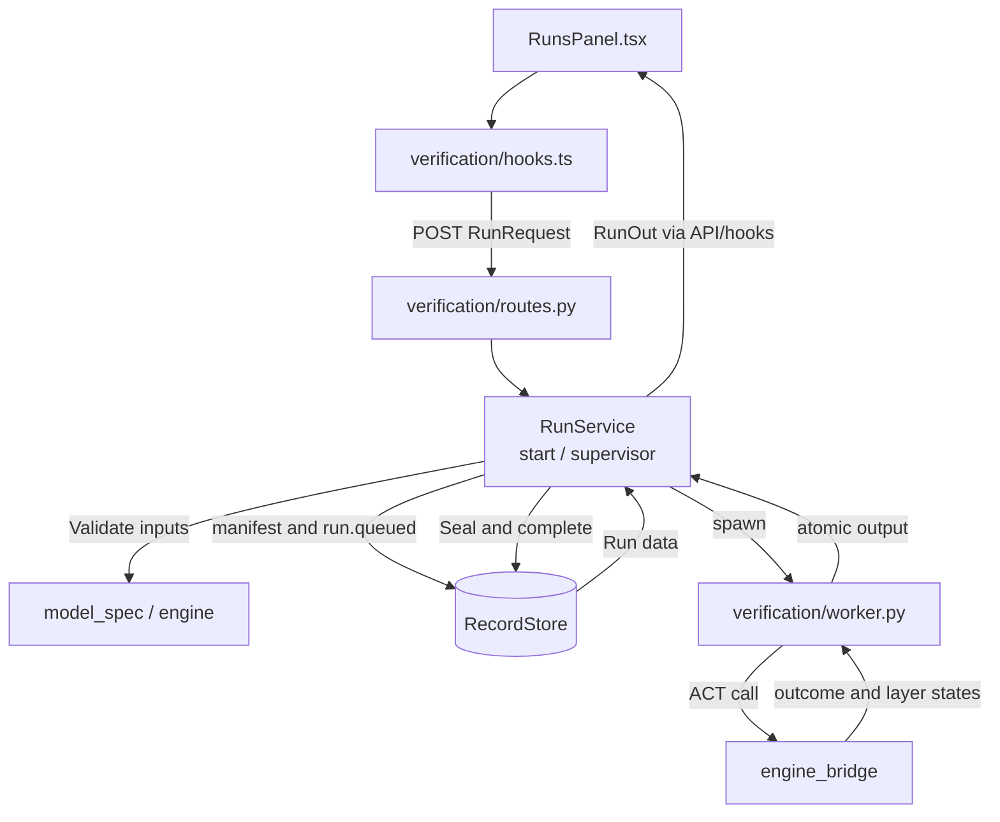
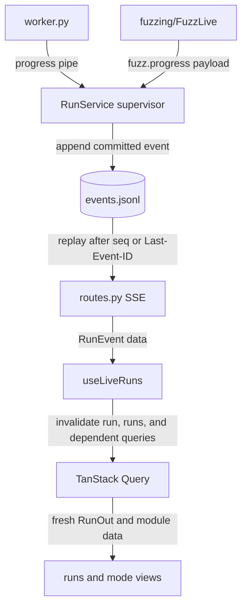
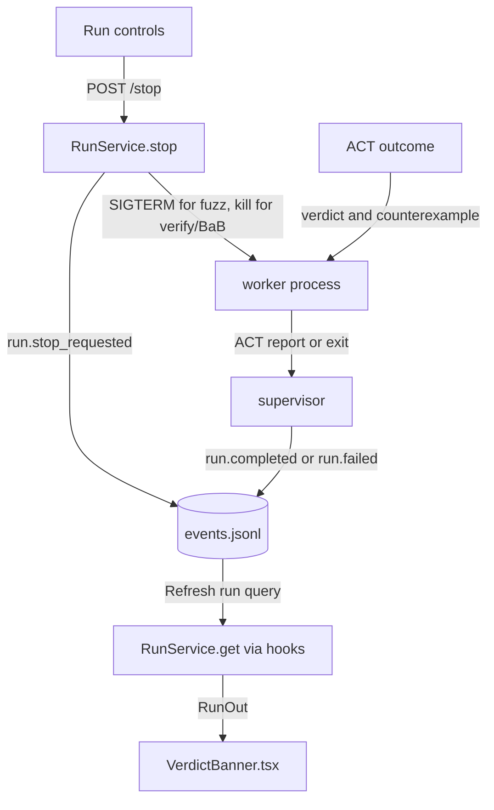

# Verification Application

**Current responsibility and status.** This module owns the application run lifecycle for interval, BaB, and fuzz methods. It validates requests, checks idempotency, creates records, supervises one worker process per run, commits lifecycle events, exposes SSE replay, and reports ACT's result. The first version is implemented for VER-01, VER-02, VER-07, with VER-03 and VER-04 partial. B owns the service path, C owns run interaction, and A reviews verdict semantics.

The module does not implement verification algorithms, import ACT directly, own model loading, or own fuzz presentation and solver licensing. ACT calls go through [engine_bridge](../../engine_bridge/README.md). Fuzz-specific behavior is [fuzzing](../fuzzing/README.md), and engine gating and licenses are [engine](../engine/README.md). See the [parent flow diagram](../README.md#flow-diagram) and [project development entry point](../../README.md#choose-a-development-task).

## Change Guide

| Goal | Required edits | Conditional edits / reused path |
| --- | --- | --- |
| Change run validation or idempotency | [schemas.py](schemas.py) / [service.py](service.py), focused lifecycle tests | Worker only if an execution argument changes; existing nested fuzz options are forwarded, not individually mapped here. |
| Add an ACT run method | Bridge method/invocation support, [schemas.py](schemas.py), [worker.py](worker.py), tests and consuming mode/control | Service scheduling and records can be reused if the request/outcome shape still fits. Coordinate [workspace](../workspace/README.md#change-guide) for mode registration. |
| Change stop or worker supervision | [service.py](service.py), lifecycle tests | [worker.py](worker.py) only if signal/output handling changes; fuzz-specific adaptation belongs to fuzzing/bridge. |
| Add an event or run projection field | Owning commit/projection code and schema when shape changes, focused tests | Event payloads and SSE forwarding are generic; change routes/hooks only if replay, subscription or invalidation semantics change. |
| Change history/control presentation | [RunsPanel.tsx](RunsPanel.tsx), [RunHistory.tsx](RunHistory.tsx), [VerdictBanner.tsx](VerdictBanner.tsx) as relevant | No ACT or record change when existing RunOut suffices. |

Generate wire.ts after schema edits. Browser and assistant share services; the assistant does not call the HTTP routes internally.

## Flow Diagram

Arrows are labeled as calls, results, or events. Neighboring modules are named explicitly and linked in the block tables. HTTP transport may be grouped; views use hooks or props, never direct fetch calls.

### Start and supervise



| Block | Code entry | Contract or artifact | Neighbor handoff |
| --- | --- | --- | --- |
| Request | `RunRequest`, [routes.py](routes.py) | Method, model, budget, optional domain or fuzz options | [Model_spec](../model_spec/README.md) validates method support |
| Start | [service.py: RunService.start](service.py) | Returns 202 without waiting for computation, or 200 for identical idempotent request | [engine](../engine/README.md#flow-diagram) gate blocks unusable ACT with 503 |
| Execute | [worker.py](worker.py) | `output.json` contains ACT outcome, layers, and optional fuzz artifact | Bridge owns numerical result |
| Seal | [service.py: _commit_result](service.py) | `result.json`, optional `layers.json` and `fuzzing.json`, then completion event | [Records](../records/README.md#flow-diagram) seals and hashes artifacts |

### Live events and query invalidation



| Block | Code entry | Contract or artifact | Neighbor handoff |
| --- | --- | --- | --- |
| Commit | `RecordStore.append_event` through supervisor | Ordered sequence, status, payload | [Records](../records/README.md) owns torn-tail recovery and replay |
| SSE | `routes.events` | Replays after `after` or `Last-Event-ID`, ends after terminal event | Browser follows one stream per active run |
| Refresh | `useLiveRuns` | Each committed event invalidates run and dependent data | [Fuzzing](../fuzzing/README.md) and [analysis](../analysis/README.md) read the refreshed run |

### Stop and verdict



| Block | Code entry | Contract or artifact | Neighbor handoff |
| --- | --- | --- | --- |
| Stop | `RunService.stop`, `_signal_stop` | Idempotent; fuzz gets a grace period, verify and BaB are killed | [Fuzzing](../fuzzing/README.md) owns ACT stopped summary |
| Verdict | `_commit_result`, `RunResultOut` | Workbench reports ACT verdict and keeps no result after forced verify stop | Banner is shared by Verification and BaB modes |

## Validation

Run the module's real ACT tests:

```bash
.venv/bin/python -m pytest visual_bench/verification
```

Acceptance is observable when start returns without waiting for ACT completion, SSE delivers ordered events through a terminal event, identical `client_request_id` requests return the same run, conflicting parameters return 409, ACT results and native parity are exposed, and forced verify or BaB stop ends failed without a verdict.

Use `visual_bench/fuzzing/test_fuzzing.py` for fuzz stop and saved counterexamples. Use `npm test` for browser selection and query behavior. Do not claim checks were run unless the command and result are recorded.

## Reference and Backlog

<details>
<summary>Current files, routes and contracts</summary>

## Current Files and Contracts

| Layer | Entry | Contract or artifact | Owner for handoff |
| --- | --- | --- | --- |
| Wire | [schemas.py](schemas.py) | `RunRequest`, `RunOut`, `RunResultOut`, `RunEvent` | `visual_bench/schemas.py` re-exports wire models for generation |
| Service | [service.py](service.py) | `RunService.start`, `stop`, `get`, `list`, `request`, `save_counterexample`, `saved_counterexample_file`; `vnncomp_sat` formats VNN-COMP witnesses for this module and fuzzing; records are authoritative | `workbench.py` injects records, model, engine, and live collaborators |
| Worker | [worker.py](worker.py) | Executes one request in a child process, writes output atomically, sends fuzz lines on an inherited pipe | Bridge owns ACT invocation; fuzzing shapes its method result |
| HTTP | [routes.py](routes.py) | `/api/runs`, `/api/runs/{id}`, `/stop`, `/events`, `POST /saved-counterexample`, `GET /saved-counterexample/vnnlib` | Browser uses HTTP; assistant uses the same RunService directly |
| Browser data | [api.ts](api.ts), [hooks.ts](hooks.ts) | Start, stop and save-counterexample mutations, run queries, one SSE subscription per active run | `shared` owns HTTP and query keys |
| Views | [RunsPanel.tsx](RunsPanel.tsx), [RunHistory.tsx](RunHistory.tsx), [VerdictBanner.tsx](VerdictBanner.tsx), [labels.ts](labels.ts) | Controls, history, method labels, ACT verdict display with per-row batch verdicts and counterexample save/export | workspace owns selection; fuzzing owns fuzz panels |
| Tests | [test_verification.py](test_verification.py) | Real worker lifecycle, parity, stop, idempotency, domain validation, batched verdicts, counterexample save/export, record recovery | Records and bridge tests cover their own boundaries |


</details>

<details>
<summary>Task acceptance and planned capabilities</summary>

## Tasks

<a id="3-tasks"></a>

Dependencies are acceptance prerequisites, not code-import instructions. Moved tasks retain their IDs.

| ID | Deliverable | Depends on | Completion evidence |
| --- | --- | --- | --- |
| VER-01 | Implement description gateway and wire generation | MSB-03, BASE-02 | Applies the BASE-02 generation pipeline to real descriptions: real bridge data validates through Pydantic and generated browser types have no drift. |
| VER-02 | Implement isolated run lifecycle | VER-01, EXE-01, REC-01 | Start returns a run reference without waiting for completion; a deterministic sample matches native ACT; worker failure is visible. Method `interval` takes `domain` (`interval` default, `dual`, `hybridz`), recorded on the run; native references apply to the interval domain only. |
| VER-03 | Implement committed snapshots, SSE stream, and reconnect | VER-02, EVT-02, REC-02 | The service SSE route emits payloads that validate against the generated event schema; snapshot at S plus events after S reconstructs the same state; duplicates and gaps do not corrupt it. |
| VER-05 | Accept a user-supplied Gurobi license and hand it to run workers | ES-04 | Moved to [engine](../engine/README.md#3-tasks). Run manifests still record the license source and requested device (`service.py`). |
| VER-06 | Run and demonstrate ACTFuzzer from the GUI | EXE-04, VER-02, REC-01 | Moved to [fuzzing](../fuzzing/README.md#3-tasks); this module runs fuzz like any other method (worker, progress pipe, `fuzz.progress` events, SSE). |
| VER-07 | Stop runs and show the ACT verdict (saving/export of fuzz counterexamples: [fuzzing](../fuzzing/README.md#3-tasks)) | VER-06 | `POST /api/runs/{id}/stop` is idempotent and commits `run.stop_requested`: a fuzz worker gets SIGTERM and ACTFuzzer ends after its current iteration with ACT's report (`summary.stopped`); verify/BaB workers are killed and the run fails with `stopped` (no verdict); a worker that ignores the stop for `STOP_GRACE_S` is killed. `VerdictBanner.tsx` shows ACT's verdict with the native reference for Verification and BaB runs. Evidence: `test_verification.py::test_stop_ends_a_verification_worker_without_a_verdict`, `../fuzzing/test_fuzzing.py::test_stop_ends_fuzz_run_with_act_report_of_iterations_run`. |
| VER-11 | Save and export verify_once/BaB counterexamples like fuzz ones | VER-07, EXE-01 | The bridge adds `counterexample_output` (ACT's ACTToTorch model at ACT's counterexample, in its batch row; a failure is reported as `counterexample_output_error` and only disables the export). `POST /api/runs/{id}/saved-counterexample` saves it on the run record (`saved_counterexamples.json` annotation, idempotent, 201 then 200); `GET .../saved-counterexample/vnnlib` returns the VNN-COMP witness in the same format as fuzz exports (`vnncomp_sat`, X shaped as one input row). The verdict banner offers Save, then Export counterexample (VNN-LIB 2.0) and, for image inputs, Export image (.png). Evidence: `test_verification.py::test_falsified_run_reports_act_counterexample`, `engine_bridge/execution/test_execution.py::test_bab_counterexample_carries_the_output_of_acts_rebuilt_model`. |
| VER-04 | Implement the shared command gateway | VER-03, EXE-03 | Same-ID retry cannot apply twice; changed parameters, stale revision, unsupported actions, and expired authority are rejected. |


The original design targets `run_state.py` and `commands.py` are not current files. Add them only with VER-03 or VER-04 work. Scientific snapshots, command receipts, pause, step, split, and live ACT handles require the corresponding engine capabilities and committed event contract.

</details>
