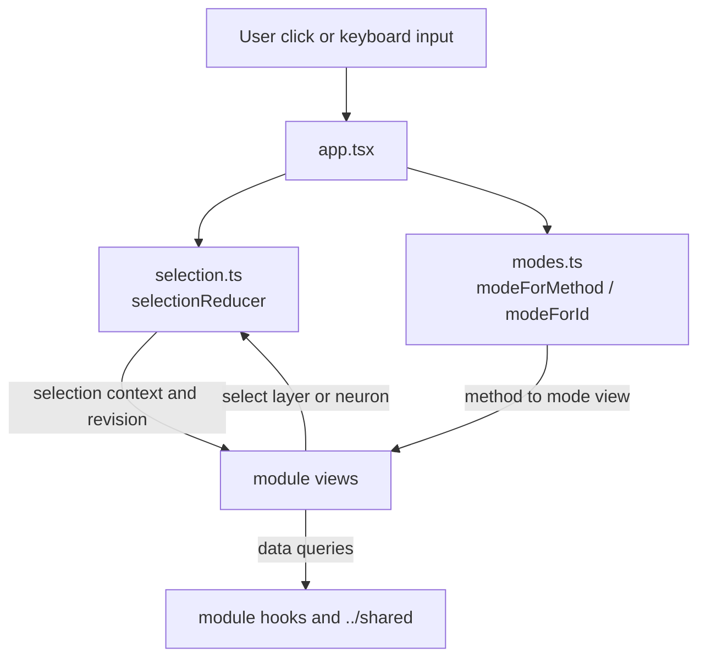
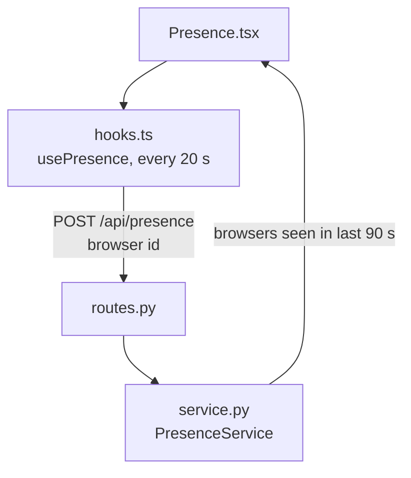
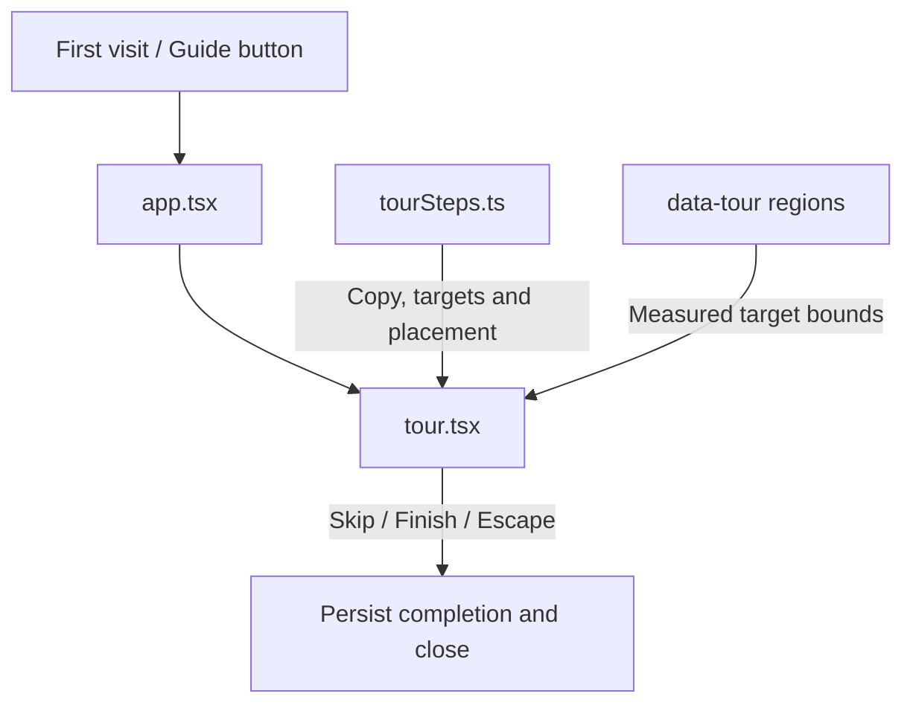

# Workspace

Current responsibility: own the browser's shared model, run, layer, and neuron selection, mode registry, layout context, theme, and onboarding tour. The first slice is implemented in `selection.ts`, `modes.ts`, `layout.tsx`, `theme.tsx`, and the tour files. WS-03, pinning and layout restoration, is not started. It also owns the online-visitor bar under Run history (WS-04), its only server slice: `schemas.py` → `service.py` → `routes.py` and `api.ts` → `hooks.ts` → `Presence.tsx`. It does not own run data, solver state, or ACT commands. See the [parent scope](../README.md), the [repository rules](../../AGENTS.md), and the [development task guide](../../README.md#choose-a-development-task).

## Change Guide

| Goal | Edit here | Conditional / reused path |
| --- | --- | --- |
| Change selection/reset behavior | [selection.ts](selection.ts) and [selection.test.ts](selection.test.ts) | Update [app.tsx](../app.tsx) or consumers only when action/prop contracts change. No server change. |
| Add or remap a center mode | [modes.ts](modes.ts), its owning view, [modes.test.ts](modes.test.ts) | Existing app composition uses the registry. A new engine method also needs verification/bridge support; a display-only mode does not. |
| Change tour wording or order | [tourSteps.ts](tourSteps.ts) | Copy-only changes need no prose-pinning tests. Change [tour.tsx](tour.tsx) for interaction; [app.tsx](../app.tsx) only for region targets or composition. |
| Change tour placement | placeCard in [tourSteps.ts](tourSteps.ts) and its placement tests | Keep viewport-boundary cases in [tourSteps.test.ts](tourSteps.test.ts); render desktop/mobile. |
| Change the online-visitor bar | [Presence.tsx](Presence.tsx), [hooks.ts](hooks.ts) (interval), [service.py](service.py) (window) | Wire changes go through [schemas.py](schemas.py) and `npm run gen:types`; keep [test_workspace.py](test_workspace.py) green. |
| Change context bar or theme | [layout.tsx](layout.tsx), [theme.tsx](theme.tsx), relevant [styles.css](../styles.css) | Other feature modules only if their public selection/navigation contract changes. |

Pinning and restoration are WS-03 future work, not an existing docking API.

## Flow Diagram



The online-visitor bar is a heartbeat loop, independent of selection:



The context bar and theme are independent presentation helpers in layout.tsx and theme.tsx. The tour has its own path:



| Block | Implementation and contract |
| --- | --- |
| User input | `app.tsx` callbacks. Produces selection actions or mode changes. |
| Selection | `selectionReducer` in [selection.ts](selection.ts). Returns a new context and revision; model changes clear run, layer, and neuron. |
| Modes | `modes`, `modeForMethod`, and `modeForId` in [modes.ts](modes.ts). Maps `fuzz`, `interval`, and `bab` to visible center views. |
| Layout and theme | `ContextBar` in [layout.tsx](layout.tsx) and theme state in [theme.tsx](theme.tsx). Renders shared context; it does not fetch. |
| Tour | `Tour` in [tour.tsx](tour.tsx) plus `TOUR_STEPS` in [tourSteps.ts](tourSteps.ts). Reads `data-tour` regions and ends on Finish, Skip, or Escape. |
| Presence | `PresenceService.beat` in [service.py](service.py): in-memory map of browser id to last heartbeat, pruned to a 90 s window; no IPs, no persistence. One id per browser (localStorage), so tabs are deduplicated. Correct only while the service runs as one process. |
| Neighbor handoff | Module views receive selection and callbacks from `app.tsx`; their data path continues through the [parent flow diagram](../README.md#flow-diagram). |

## Validation

Run the browser test suite:

```bash
npm test
.venv/bin/python -m pytest visual_bench/workspace
```

Relevant observable behavior is that selection changes update the context bar and dependent views, mode methods select the corresponding center view, and the tour starts once, can be replayed from Guide, and exits with Finish, Skip, or Escape. These are validation instructions, not a new test result.

## Reference and Backlog

<details>
<summary>Current files and routes</summary>

## Current Files and Routes

Route: `POST /api/presence` (body `PresenceHeartbeat`, response `PresenceOut`), mounted by `server.py`. `app.tsx` is the composition root that consumes this module.

| File | Responsibility |
| --- | --- |
| [selection.ts](selection.ts) | Pure reducer for `modelId`, `runId`, `layerId`, `neuron`, and monotonic `revision`. Changing model or run clears incompatible context. |
| [selection.test.ts](selection.test.ts) | Selection transitions and stale-context behavior. |
| [modes.ts](modes.ts) | The `Fuzzing`, `Verification`, and `BaB` mode registry. Each entry maps a run method to a view. Add modes here, not in `app.tsx`. |
| [modes.test.ts](modes.test.ts) | Mode IDs and method mapping. |
| [layout.tsx](layout.tsx) | Context bar showing the current model, run, layer, and index. |
| [theme.tsx](theme.tsx) | Light and dark theme toggle with persistence. |
| [tour.tsx](tour.tsx) | Skippable first-visit tour, keyboard navigation, target measurement, and portal rendering. |
| [tourSteps.ts](tourSteps.ts) | Tour copy, order, target regions, and missing-region hints. |
| [tourSteps.test.ts](tourSteps.test.ts) | Tour step and placement behavior. |
| [schemas.py](schemas.py) | `PresenceHeartbeat` and `PresenceOut` wire models. |
| [service.py](service.py) | `PresenceService`: in-memory online-visitor count. |
| [routes.py](routes.py) | `POST /api/presence`. |
| [test_workspace.py](test_workspace.py) | Deduplication, expiry, and route validation. |
| [api.ts](api.ts), [hooks.ts](hooks.ts) | Heartbeat call and the 20 s `usePresence` query. |
| [Presence.tsx](Presence.tsx) | Online-visitor bar under Run history. |

Browser-wide HTTP, wire-number, query-key, and shared UI code lives in [`../shared/`](../README.md#shared-browser-layer). Views obtain server data through their module hooks.


</details>

<details>
<summary>Task acceptance, rationale, and planned capabilities</summary>

## Tasks and Acceptance

All tasks remain tracked in [the development plan](../../docs/plan.md). Dependencies are acceptance prerequisites, not import instructions.

| ID | Deliverable | Depends on | Completion evidence |
| --- | --- | --- | --- |
| WS-01 | Define selection state and reducer | BASE-02 | Given different layer/node IDs, actions preserve their object kinds and snapshot scope. |
| WS-02 | Link two panels through context | WS-01 | Select A then B; delaying A’s response cannot revert either active panel. |
| WS-03 | Add pinning and layout restoration | WS-02 | A pinned panel survives active-context changes; invalid restored references have an explicit fallback. |
| WS-04 | Show the online-visitor count under Run history | BASE-02 | Two browsers count as two, two tabs of one browser as one, and a silent browser drops out after 90 s (`test_workspace.py`). |

Current status: WS-01 and WS-02 are implemented as the selection reducer and application wiring. WS-04 is implemented. WS-03 is planned.


Use pure state transitions and derived context rather than a feature-wide event bus. A layout library may be added later, but domain objects must not contain renderer instances or layout-library nodes. Pinning, restoration, and unavailable-object states belong to WS-03 and are not current capabilities.

Planned public operations are `reduceWorkspace`, `getPanelContext`, and `navigateTo`. Their names describe intended boundaries, not shipped APIs. The current equivalent is `selectionReducer` plus callbacks in `app.tsx`.

Owner: C. A reviews scientific identity and semantics. On task completion, record the implementation, fixture provenance, exact commands and results, ACT or provider dependencies, and unverified behavior here.

</details>
