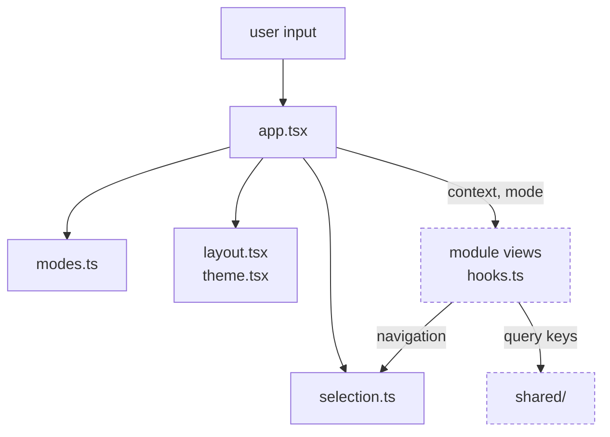

# Workspace

**Status:** first version: `selection.ts`, `modes.ts`, `layout.tsx` (WS-01/02, vitest); server data moved from the in-house `useQuery` to TanStack Query on 2026-11-04 (keys in `shared/queryClient.ts`); WS-03 not started. **Owner:** C.
Follow the [repository rules](../../AGENTS.md) and [parent scope](../README.md).

## Current Files and Usage

| File | Responsibility |
| --- | --- |
| `selection.ts` (+ `selection.test.ts`) | Selection reducer: model/run/layer/value context and stale-selection rules. |
| `modes.ts` (+ `modes.test.ts`) | Mode registry `{ id, label, method, View }` for Fuzzing, Verification, BaB; `app.tsx` renders modes and maps run methods to modes from it. Add a mode here, not in `app.tsx`. |
| `layout.tsx` | Context bar and layout pieces used by `app.tsx`. |
| `theme.tsx` | Light/dark theme toggle and persistence. |
| `tour.tsx`, `tourSteps.ts` (+ `tourSteps.test.ts`) | Skippable onboarding tour. Starts automatically on the first visit (`localStorage` key `act-gui.tour.v1`), spotlights layout regions marked `data-tour="..."` in `app.tsx`, and replays from the topbar Guide button. Esc or Skip ends it; steps whose region is not on screen (no model selected) show a centered card with a hint. Add or reorder steps in `tourSteps.ts`. |

Browser-wide infrastructure lives in [`../shared/`](../README.md#shared-browser-layer): HTTP client, wire-number helpers, the TanStack `QueryClient` with the query key factory, and shared UI (`Empty`, `StopButton`, image rendering). Tests: `npm test`.

## Flow Diagram

Arrows point from caller to callee and are labeled with what flows. Dashed nodes belong to other modules and use the same names as the [parent diagram](../README.md#flow-diagram); every edge to a dashed node also appears there.

## 1. Subproblems and Objective

Maintain one authoritative user-selection context so views remain coordinated.

| Subproblem | Responsibility |
| --- | --- |
| Layout | Panel registration, visibility, size, and restoration. Start with a fixed layout; introduce docking when needed. |
| Selection | Distinguish network layers from BaB nodes. Coordinate run/node/layer/revision and pinned contexts. |
| Asynchronous changes | Expose loading/stale states during selection changes; late results must not replace newer selections. |

## 2. Scope and Non-goals

Own the behavior above and its failure/availability states. Deliver it incrementally using the sequence below; the full scope is not a first-slice requirement.

Does not own solver state, weights, large-tensor caches, or ACT search commands.

## 3. Inputs, Outputs, and State

- **Inputs:** Selectable model/run indexes, user actions, and navigation requests from other panels.
- **Outputs:** SelectionContext, layout state, and context-bearing navigation notifications.
- State, absence, and scientific semantics follow the [architecture](../../docs/design.md). Type names here describe intended contracts, not existing APIs.

## 4. Design Patterns and Rationale

**Pure state reducer and derived selectors.** Express selection changes as testable transitions. Views consume derived state rather than bypassing the state owner through an unrestricted event bus.

**Layout adapter.** A library such as Dockview handles layout only; domain objects do not contain renderer instances or layout-library nodes.

Use small interfaces, pure functions, or ordinary classes. A pattern name alone does not justify adding a framework.

## 5. Dependencies and Implementation Placement

Inject selectable objects and query entry points. Do not import another feature’s internal store. The first slice can use a minimal context interface.

Start with state.ts and the necessary components. Do not prebuild a general plugin registry.

Add code and focused tests in this module as implementation proceeds. Keep language/runtime boundaries explicit. No installation or test commands exist yet.

## 6. Implementation Plan

All tasks are **Planned**. IDs identify reviewable implementation slices; dependencies are completion prerequisites, not code-import instructions. Fixture-based work may proceed earlier against an agreed contract, but it does not satisfy real-integration acceptance.

| ID | Deliverable | Depends on | Completion evidence |
| --- | --- | --- | --- |
| WS-01 | Define selection state and reducer | BASE-02 | Given different layer/node IDs, actions preserve their object kinds and snapshot scope. |
| WS-02 | Link two panels through context | WS-01 | Select A then B; delaying A’s response cannot revert either active panel. |
| WS-03 | Add pinning and layout restoration | WS-02 | A pinned panel survives active-context changes; invalid restored references have an explicit fallback. |

Owner: **C**. A reviews scientific semantics; use the team-role mapping in the [development plan](../../docs/plan.md). There are no implied calendar estimates.

Missing ACT interfaces require linked ACT issues/changes owned by A. Record the required capability and engine PR before marking the corresponding GUI integration task complete.

## 7. Acceptance and Tests

- After a rapid A→B selection, a late A response cannot revert selection or panel content.
- Pinned panels retain their own revision while ordinary panels follow the active context.
- Restoring a layout containing unavailable objects produces an explicit fallback, not a blank screen.

On completion, provide real samples, commands actually run, results, and unverified items, then update this document's status. See the [development plan](../../docs/plan.md).

## 8. Future Extraction Criteria

Split internal files/directories when independent evolution, reuse, or size warrants it. This README owns this module's subproblem and design details; the parent retains summary and navigation.

## 9. Functional Implementation Specification

**Design proposal:** the interfaces and file names below are implementation targets, not existing code or ACT APIs. Add them only with the task that uses them. The task table above owns delivery status.

### Feature Behavior

| Feature | Trigger | Observable result |
| --- | --- | --- |
| Select an object | Click a layer/node or follow an evidence reference. | Publish one typed SelectionContext; retain a previous view only with a stale label. |
| Pin a panel | Pin a layer inspection, then change the active run. | The pinned panel keeps its original context; unpinned panels follow the new selection. |
| Restore a layout | Reload saved panel arrangement. | Restore layout version and valid selections; show an unavailable-object state when a reference no longer resolves. |

### Processing Flow

1. Receive a typed navigation action with object kind and snapshot identity.
2. Validate it against the available object index; update the pure reducer.
3. Derive context keys for each panel, including pinned contexts.
4. Panels request data under their own key; response handlers never overwrite another key.

### Proposed Public Operations

| Operation | Contract and responsibility |
| --- | --- |
| `reduceWorkspace(state, action) → state` | Pure function. Actions include selectRun, selectLayer, selectNode, pinPanel, unpinPanel, and restoreLayout. |
| `getPanelContext(state, panelId) → SelectionContext` | Returns active or pinned context; layer and search-node IDs have distinct types. |
| `navigateTo(reference) → NavigationResult` | Resolve evidence references; a missing historical object produces a visible unavailable state. |

### Planned Files (design targets)

Implemented equivalents: `state.ts` → `selection.ts`; `Workspace.tsx` → `app.tsx` + `layout.tsx` + `modes.ts`.

Paths are relative to this module; none of these implementation files exists yet. Keep the public API small and add implementation/testing files with the feature, without further directory scaffolding.

| File | Responsibility |
| --- | --- |
| `state.ts` | Actions, reducer, typed selection, and selectors. |
| `Workspace.tsx` | Panel composition and context binding. |
| `layout_adapter.ts` | Add only when a docking library is introduced. |
| `state.test.ts` | Selection races, pinning, and restore behavior. |

### State, Failure, and Recovery Rules

No selection action sends an engine mutation. If a referenced run is gone, navigation reports the missing object rather than selecting a similarly named object.

### Task Completion Record

For each completed task, attach its implementation PR, fixture/input provenance, exact commands and results, any ACT/provider dependency, and remaining capability limitations. Update status here only after the stated evidence exists. Tests mentioned in this document remain planned until then.
